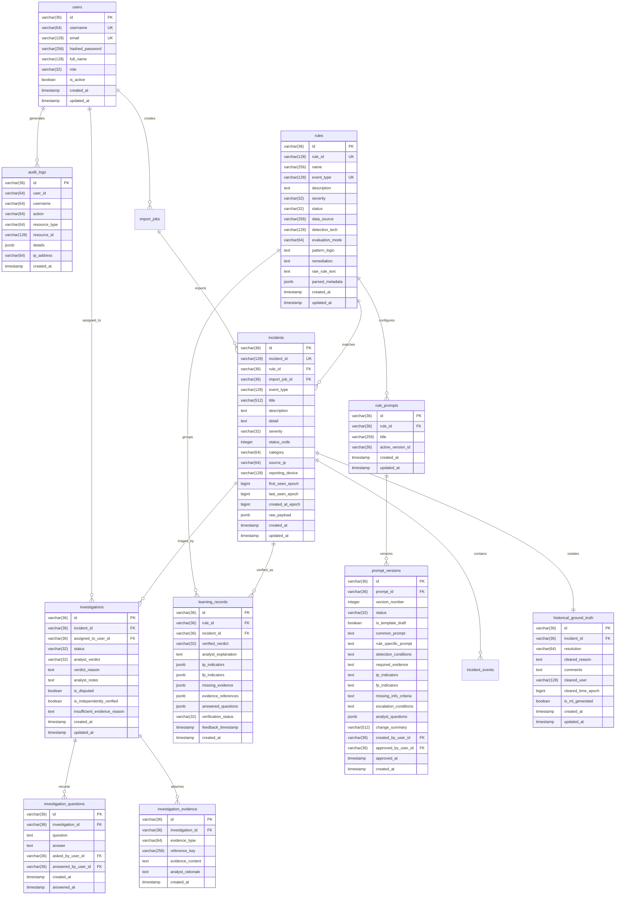

# AI Verdict — Database Schema Specification

## 1. Schema Entity Relationship Diagram

---

## 2. Table Specifications

### A. Phase 2 Tables

#### `investigations`
Manages the active SOC analyst triage workflow, question tracking, and verified verdicts.
- **`incident_id`**: Foreign key to `incidents.id` (`UNIQUE`, `ON DELETE CASCADE`).
- **`status`**: State machine (`PENDING_REVIEW`, `ASSIGNED`, `IN_PROGRESS`, `AWAITING_INFORMATION`, `REVIEWED`, `CLOSED_DRY_RUN`).
- **`analyst_verdict`**: Verified verdict (`TRUE_POSITIVE`, `FALSE_POSITIVE`, `REQUIRES_ATTENTION`).
- **`insufficient_evidence_reason`**: Mandatory reasoning when evidence is incomplete.
- **`is_disputed`**: Flag indicating conflict with historical ground truth.
- **`is_independently_verified`**: Quality flag enabling promotion to verified learning knowledge base.

#### `investigation_questions`
Threaded Q&A checklist items for hypothesis testing.
- **`investigation_id`**: Foreign key to `investigations.id`.
- **`question`**, **`answer`**, **`asked_by_user_id`**, **`answered_by_user_id`**.

#### `investigation_evidence`
Discrete technical artifacts attached to support the verdict.
- **`evidence_type`**: `TELEMETRY`, `LOG`, `PROCESS_TREE`, `FILE_HASH`, `NETWORK`, `REGISTRY`.
- **`reference_key`**: Specific artifact identifier (e.g., hash, IP, command).
- **`analyst_rationale`**: Technical justification.

#### `rule_prompts` & `prompt_versions`
Versioned prompt engineering store linking detection rules to structured LLM directives.
- **`is_template_draft`**: Boolean explicitly distinguishing template drafts synthesized from SIEM rules from AI outputs.
- **`status`**: `DRAFT`, `APPROVED`, `ARCHIVED`.
- **`active_version_id`**: Pointer to the approved production baseline prompt.

#### `learning_records`
Verified ground truth case repository used for future model evaluation and dry-run benchmarks.
- **`verified_verdict`**, **`analyst_explanation`**, **`tp_indicators`**, **`fp_indicators`**, **`missing_evidence`**, **`evidence_references`**.

---

### B. Phase 3 Tables (Dry-Run & Evaluation Framework)

#### `dry_run_configs`
Stores repeatable dry-run replay configurations linking SIEM rules, prompt versions, dataset partitions, and model providers.
- **`rule_id`**: Foreign key to `rules.id` (`NULL` evaluates across all ingested rules).
- **`prompt_version_id`**: Foreign key to `prompt_versions.id` (`NULL` defaults to active rule prompt).
- **`provider_type`**: `DISABLED`, `SIMULATED`, `OPENAI_COMPATIBLE`.
- **`split_strategy`**: `ALL`, `CHRONOLOGICAL_70_30`, `GROUP_AWARE_HOST`.
- **`dataset_filters`**: JSON filtering rules for custom subsets.

#### `dry_run_jobs`
Tracks batch replay execution tasks, item processing counters, and simulation flags.
- **`config_id`**: Foreign key to `dry_run_configs.id`.
- **`status`**: `PENDING`, `RUNNING`, `COMPLETED`, `FAILED`, `CANCELLED`.
- **`total_items`**, **`processed_items`**, **`error_count`**.
- **`is_simulated`**: Boolean flag explicitly indicating simulated testing.
- **`started_at`**, **`completed_at`**.

#### `dry_run_results`
Stores fine-grained individual incident inference outputs and agreement metrics.
- **`job_id`**: Foreign key to `dry_run_jobs.id`.
- **`incident_id`**: Foreign key to `incidents.id`.
- **`predicted_verdict`**: `TRUE_POSITIVE`, `FALSE_POSITIVE`, `REQUIRES_ATTENTION`.
- **`confidence`**: 0.0 – 100.0.
- **`reasoning`**: Structured technical explanation.
- **`supporting_evidence`**, **`missing_evidence`**, **`analyst_questions`**.
- **`latency_ms`**: Measured execution latency.
- **`validation_status`**: `VALID`, `INVALID_SCHEMA`, `UNEXPECTED_VERDICT`.
- **`is_simulated`**: Boolean watermark tagging every simulated prediction.

#### `rule_maturity_evaluations`
Maintains the 5-tier conservative automation readiness lifecycle per SIEM rule.
- **`rule_id`**: Foreign key to `rules.id` (`UNIQUE`).
- **`maturity_status`**: `NOT_TESTED`, `LEARNING`, `UNDER_EVALUATION`, `CANDIDATE_FOR_AUTOMATION`, `APPROVED_FOR_AUTOMATION`.
- **`precision_score`**, **`recall_score`**, **`f1_score`**, **`coverage_score`**, **`sample_size`**.
- **`unresolved_evidence_gaps`**: Identified recurring telemetry deficiencies.
- **`is_admin_approved`**: Boolean human sign-off flag.
- **`approved_by_user_id`**, **`approved_at`**, **`approval_notes`**.

---

### C. Phase 1 Core Tables (Isolated Ground Truth Layer)

#### `historical_ground_truth`
**CRITICAL ISOLATION**: Stored in a completely dedicated table. Submitting an analyst verdict in `investigations` never updates or contaminates this table.
- **`resolution`**: Historical SIEM label ("True Positive", "False Positive").
- **`cleared_reason`**, **`comments`**, **`cleared_user`**, **`cleared_time_epoch`**, **`is_ml_generated`**.
