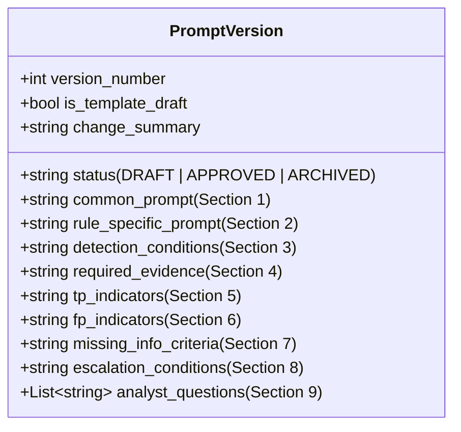
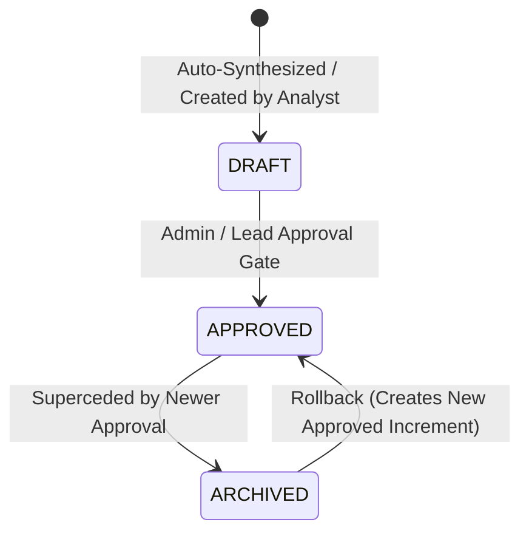
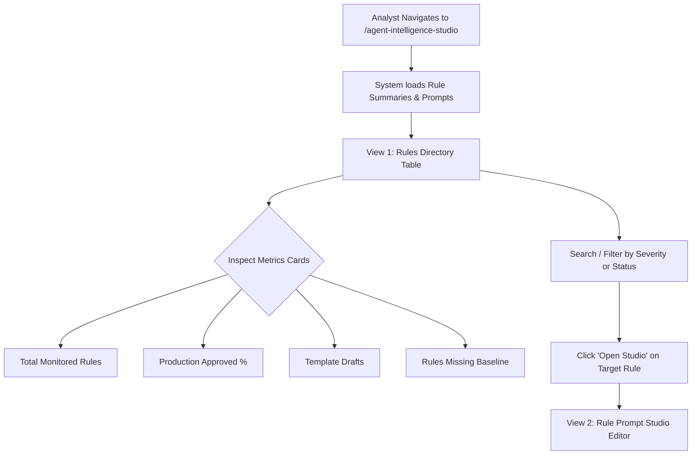
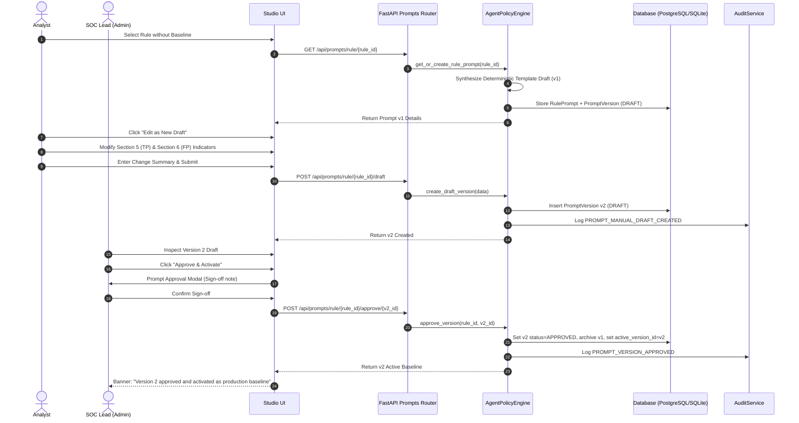
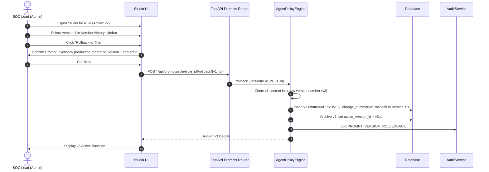
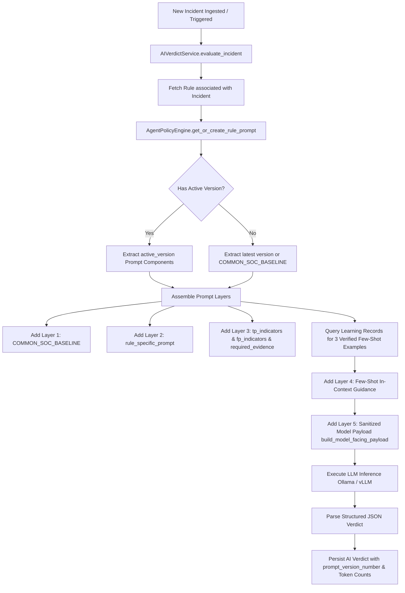

# Agent Intelligence Studio — Architecture, Logic, Use Cases & Workflows

## 1. Executive Summary & Purpose

The **Agent Intelligence Studio** (system identity: **Agent Policy Engine**, formerly referenced in early design phases as *Prompt Studio*) is the central governance, engineering, and policy configuration control plane for the autonomous Level-2 Security Operations Center (SOC) AI Agent.

In traditional AI security tools, prompt engineering is frequently treated as an opaque, hardcoded string or an unversioned configuration variable. This creates severe operational risks: prompt drift, uncontrolled hallucinations, untracked changes, inability to audit automated decisions, and no mechanism to rollback flawed triage guidance.

The Agent Intelligence Studio solves this by providing:
1. **Deterministic Cold-Start Synthesis:** Automatically generates domain-tailored investigation prompts directly from ingested SIEM detection rules without invoking an external or unverified LLM.
2. **Structured 9-Section SOC Directive Framework:** Standardizes investigation prompts into discrete, auditable decision boundaries (True Positive criteria, False Positive indicators, required evidence, abstention triggers, and escalation boundaries).
3. **Formal Approval Gating & Versioning:** Enforces Role-Based Access Control (RBAC) where analysts can draft updates, but only SOC Leads / Administrators can approve versions into production.
4. **Non-Destructive Safe Rollback:** Restores previous policy baselines instantly by cloning and incrementing versions, ensuring an unbroken audit history.
5. **Runtime Multi-Layer Prompt Assembly:** Bridges static SIEM detection logic, active policy directives, few-shot historical precedents (RAG), and sanitized telemetry during live incident triage and dry-run evaluations.

---

## 2. System Architecture & Component Mapping

```
+---------------------------------------------------------------------------------------------------+
|                                  AGENT INTELLIGENCE STUDIO UI                                    |
|                               (frontend/src/app/agent-intelligence-studio)                        |
|                                                                                                   |
|  +----------------------------------------------+  +-------------------------------------------+  |
|  |           View 1: Rules Directory           |  |          View 2: Studio Editor            |  |
|  | - Metrics Cards (Approved, Drafts, Missing)  |  | - Version History Drawer (v1, v2, Active) |  |
|  | - Filterable Table (Severity, Status, Query) |  | - 9-Section Structured Directive Form     |  |
|  | - Download Rules Config (All / Per-Row)      |  | - Download Rule Config (JSON/Markdown)    |  |
|  | - Quick Switch & Studio Deep-Linking         |  | - Admin Approval Modal & Rollback Action  |  |
|  +----------------------------------------------+  +-------------------------------------------+  |
+--------------------------------------------------+------------------------------------------------+
                                                   | HTTP / REST (Bearer Auth)
                                                   v
+---------------------------------------------------------------------------------------------------+
|                                FASTAPI PROMPTS ROUTER (/api/prompts)                              |
|                                    (backend/app/api/prompts.py)                                   |
|                                                                                                   |
|  GET /summary                     -> Aggregated rule prompt health & coverage summary             |
|  GET /export                      -> Export all rules & prompt configurations (JSON/Markdown)     |
|  GET /rule/{rule_id}              -> Fetch rule prompt container + all versions                   |
|  GET /rule/{rule_id}/export       -> Export single rule prompt configuration (JSON/Markdown)      |
|  POST /rule/{rule_id}/generate-draft -> Synthesize deterministic template draft (Analyst/Admin)   |
|  POST /rule/{rule_id}/draft       -> Create manual draft version (Analyst/Admin)                  |
|  POST /rule/{rule_id}/approve/{v} -> Approve draft as production baseline (Admin only)            |
|  POST /rule/{rule_id}/rollback/{v}-> Non-destructive rollback to prior version (Admin only)       |
+--------------------------------------------------+------------------------------------------------+
                                                   |
                                                   v
+---------------------------------------------------------------------------------------------------+
|                        AGENT POLICY ENGINE / PROMPT STUDIO SERVICE                                |
|                        (backend/app/services/prompt_studio_service.py)                            |
|                                                                                                   |
|  - Ingested Rule Parsing & Keyword Matching (CrowdStrike, EDR, Web Policy, Network)               |
|  - Deterministic Template Draft Synthesizer (Zero LLM reliance)                                   |
|  - Self-Healing Baseline Generator (Auto-generates v1 on first fetch)                              |
|  - Version State Machine & Archival Handler                                                       |
|  - Immutable Audit Event Dispatcher (AuditService)                                                |
+------------------------+-------------------------------------------------+------------------------+
                         |                                                 |
                         v                                                 v
+---------------------------------------------------+   +-------------------------------------------+
|               DATABASE STORAGE (SQLAlchemy)       |   |         AI VERDICT INFERENCE ENGINE       |
|                                                   |   |  (backend/app/services/ai_verdict_service)|
|  - Table: rule_prompts (1 per Rule)               |   |                                           |
|    * id, rule_id, title, active_version_id        |   |  - Resolves active_version for rule       |
|  - Table: prompt_versions                         |   |  - Layer 1: COMMON_SOC_BASELINE           |
|    * id, prompt_id, version_number, status        |   |  - Layer 2: Rule-Specific Directives      |
|    * is_template_draft, 9 prompt text sections    |   |  - Layer 3: Few-Shot Historical RAG       |
|    * created_by_user_id, approved_by_user_id      |   |  - Layer 4: Sanitized Model Payload       |
+---------------------------------------------------+   +-------------------------------------------+
```

### Key Source File Reference

| Area | Component / File | Purpose |
|---|---|---|
| **Frontend UI** | [`frontend/src/app/agent-intelligence-studio/page.tsx`](file:///c:/Users/amit/OneDrive/Documents/SOC-AI-Agent/frontend/src/app/agent-intelligence-studio/page.tsx) | Primary UI for browsing rules, synthesizing template drafts, editing policies, approving baselines, and executing rollbacks. |
| **Frontend Alias** | [`frontend/src/app/prompt-studio/page.tsx`](file:///c:/Users/amit/OneDrive/Documents/SOC-AI-Agent/frontend/src/app/prompt-studio/page.tsx) | Direct compatibility alias re-exporting `AgentIntelligenceStudioPage`. |
| **Frontend API Client** | [`frontend/src/lib/api.ts`](file:///c:/Users/amit/OneDrive/Documents/SOC-AI-Agent/frontend/src/lib/api.ts#L1031-L1070) | Client methods: `getRulePromptsSummary`, `getRulePrompt`, `generateTemplateDraft`, `createManualDraft`, `approvePromptVersion`, `rollbackPromptVersion`. |
| **Backend API** | [`backend/app/api/prompts.py`](file:///c:/Users/amit/OneDrive/Documents/SOC-AI-Agent/backend/app/api/prompts.py) | REST endpoints with RBAC enforcement (`require_analyst` vs `require_admin`) and audit logging. |
| **Core Service** | [`backend/app/services/prompt_studio_service.py`](file:///c:/Users/amit/OneDrive/Documents/SOC-AI-Agent/backend/app/services/prompt_studio_service.py) | `AgentPolicyEngine` (aliased as `PromptStudioService`): contains deterministic template synthesis logic and version lifecycle. |
| **Service Alias** | [`backend/app/services/agent_policy_engine.py`](file:///c:/Users/amit/OneDrive/Documents/SOC-AI-Agent/backend/app/services/agent_policy_engine.py) | Re-exports `AgentPolicyEngine`, `PromptStudioService`, and `COMMON_SOC_BASELINE`. |
| **Data Models** | [`backend/app/models/prompt.py`](file:///c:/Users/amit/OneDrive/Documents/SOC-AI-Agent/backend/app/models/prompt.py) | SQLAlchemy relational models: `RulePrompt` and `PromptVersion`. |
| **Inference Consumer** | [`backend/app/services/ai_verdict_service.py`](file:///c:/Users/amit/OneDrive/Documents/SOC-AI-Agent/backend/app/services/ai_verdict_service.py#L125-L180) | `AIVerdictService`: dynamically builds the multi-layer prompt combining the active prompt version with few-shot memory. |
| **Automated Tests** | [`backend/tests/test_prompt_studio.py`](file:///c:/Users/amit/OneDrive/Documents/SOC-AI-Agent/backend/tests/test_prompt_studio.py) | Comprehensive pytest test suite covering template generation, drafting, admin approvals, and safe rollback. |

---

## 3. Core Logic & Implementation Details

### 3.1. Deterministic Template Draft Synthesis (Zero-LLM Cold Start)

When detection rules are ingested from SIEM systems (e.g. FortiSIEM, Splunk, CrowdStrike), there are initially no prompt directives defined. Rather than calling an uncontrolled external LLM to guess what the prompt should look like, the Agent Policy Engine synthesizes an initial draft **100% deterministically**:

1. **Rule Ingestion Extraction:**
   - Evaluates `rule.name`, `rule.event_type`, `rule.pattern_logic`, and `rule.parsed_metadata`.
   - Extracts triggering attributes (e.g., `srcIp`, `destIp`, `commandLine`, `parentProcessName`).
2. **Behavioral Archetype Classification:**
   - **EDR / Suspicious Process Archetype:** Activated if `crowdstrike`, `suspicious`, `process`, or `activity` is matched. Injects indicators for encoded PowerShell (`-enc`), LOLBin abuse, unverified temp directory execution, and standard parent-child process checks.
   - **Web Policy / Network Traffic Archetype:** Activated if `web`, `policy`, `dest`, or `traffic` is matched. Specifically targets loopback reflection (`SAME_SRC_SAME_DEST`), internal RFC-1918 health check noise (`/healthz`, `/ready`), proxy artifacts, and distinguishes them from external exfiltration.
   - **Generic Execution / Malware Archetype:** Fallback covering unsigned binary downloads, untrusted external ASNs, and persistence mechanisms.
3. **Explicit Labeling:**
   - All auto-generated drafts are explicitly tagged:
     * `is_template_draft = True`
     * `status = "DRAFT"`
     * `change_summary = "TEMPLATE-GENERATED DRAFT: Synthesized from SIEM rule specifications with specialized decision criteria"`
   - Guarantees that operators know the prompt was synthesized from deterministic rules, not produced by an AI model.

### 3.2. Structured 9-Section Directive Framework

Every `PromptVersion` record partitions prompt directives into 9 distinct, modular fields to eliminate ambiguity and prevent cognitive overload in LLM reasoning:



1. **Common SOC Baseline Protocol (`common_prompt`):**
   - The universal Level-2 SOC triage standard applied across all rules. Defines standard thresholds, evidence rigor, and explicit ground rules for `FALSE_POSITIVE`, `TRUE_POSITIVE`, and `REQUIRES_ATTENTION`.
2. **Rule-Specific Directive (`rule_specific_prompt`):**
   - Directives tailored to the exact SIEM rule name, vendor syntax, and primary investigation focus.
3. **Detection Conditions & Pattern Logic (`detection_conditions`):**
   - The exact boolean, threshold, or regex condition from the SIEM (e.g. `COUNT(*) > 5 WITHIN 10m`).
4. **Mandatory Evidence Gathering Checklist (`required_evidence`):**
   - The strict list of artifacts required to formulate a verdict (e.g. PPID lineage, user account context, destination IP ASN, file hash reputation).
5. **True Positive Indicators (`tp_indicators`):**
   - Concrete adversary behaviors confirming malicious intent (e.g. `vssadmin delete shadows`, LSASS dumping, C2 beaconing).
6. **False Positive Indicators (`fp_indicators`):**
   - Known benign operational noise that mandates a `FALSE_POSITIVE` vote (e.g. loopback health probes, SCCM/Tanium updates, IT maintenance scripts).
7. **When to Abstain (`missing_info_criteria`):**
   - Explicit guardrails defining when the model must output `REQUIRES_ATTENTION` rather than guessing (e.g. truncated command lines, missing user context).
8. **P1/P2 Escalation Conditions (`escalation_conditions`):**
   - High-severity criteria mandating immediate host isolation or senior analyst paging.
9. **Standard Investigative Q&A Checklist (`analyst_questions`):**
   - Array of questions that guided the tier-2 investigation, displayed interactively in the Studio and stored in incident triage transcripts.

### 3.3. Version Lifecycle & Non-Destructive State Machine



- **Drafting:** Analysts create or edit drafts. The draft is given `version_number = max(existing) + 1` and `status = "DRAFT"`.
- **Approval Gate:** Approval is guarded by `require_admin` (SOC Lead). Approving Version $N$ sets its status to `APPROVED`, records `approved_by_user_id` and timestamp, updates `RulePrompt.active_version_id = N.id`, and transitions any previously active `APPROVED` version to `ARCHIVED`.
- **Safe Rollback:** If an active version performs sub-optimally, the administrator can select any historical version (even archived ones) and trigger Rollback. The engine does **not** mutate existing records or rewind counters; it creates a brand new version $N+1$ cloning the contents of the target rollback version, marks it `APPROVED`, and archives version $N$.

### 3.4. Runtime Prompt Assembly in AI Verdict Inference

When an incident is evaluated (in live ingestion or simulation lab), `AIVerdictService` dynamically resolves the prompt:

1. Looks up the `RulePrompt` associated with the incident's rule. If none exists, auto-generates the initial template draft on-the-fly (self-healing).
2. Retrieves the `active_version` (or latest available version if unapproved).
3. Assembles prompt sections into a coherent markdown payload:
   - `Layer 1`: Common SOC Baseline (`COMMON_SOC_BASELINE`).
   - `Layer 2`: Rule-Specific Guidance (`rule_specific_prompt`).
   - `Layer 3`: Specific TP, FP, Evidence, and Abstention criteria (if not already embedded in rule-specific prompt).
   - `Layer 4`: In-Context Learning (Few-Shot RAG): Retrieves up to 3 verified historical `learning_records` matching the rule, appending real incident ground-truth examples and analyst rationales.
   - `Layer 5`: Sanitized Model-Facing Payload: Incident attributes stripped of ground-truth bias and closure notes (`build_model_facing_payload`).
4. Executes model inference (Ollama / vLLM / OpenAI-compatible).
5. Stores `prompt_version_number`, token counts, and latency in the incident's audit log and verdict record.

---

## 4. Primary Use Cases

### Use Case 1: Automated Rule Onboarding & Baseline Cold-Start
- **Scenario:** A new SIEM rule (e.g. `CrowdStrike Falcon Suspicious Script Activity`) is ingested into the system.
- **Problem:** Triage agents cannot evaluate alerts accurately without rules-of-engagement, but manual prompt authoring for hundreds of rules is slow and error-prone.
- **Studio Solution:** The engine automatically synthesizes Version 1 with standard CrowdStrike EDR directives, LOLBin detection criteria, and evidence checklists. The rule immediately has a functional baseline ready for review.

### Use Case 2: Tuning False Positive Alert Storms (Loopback / Health Probes)
- **Scenario:** The SOC experiences an alert storm for `PH_RULE_WEB_POL_VIOLATION_SAME_SRC_SAME_DEST` caused by an internal Kubernetes ingress controller running local health probes.
- **Problem:** Generic AI agents frequently flag these as potential internal port scans or policy breaches, creating alert fatigue.
- **Studio Solution:** An analyst opens Agent Intelligence Studio for the rule, edits Section 6 (False Positive Indicators) to explicitly state:
  > *"When source IP equals destination IP or traffic targets /healthz, /ready, or 127.0.0.1, classify as FALSE_POSITIVE with 95%+ confidence."*
  They save as a new draft, and the Lead approves it. Subsequent incoming alerts are correctly classified as `FALSE_POSITIVE`.

### Use Case 3: Enterprise SOC Governance & Audit Trail
- **Scenario:** Compliance mandates that automated AI policies must have documented human-in-the-loop oversight and change tracking.
- **Problem:** Directly editing prompts in production configurations violates separation of duties.
- **Studio Solution:** The Studio enforces a strict separation:
  - Junior Analysts can propose and save drafts (`DRAFT`).
  - SOC Leads review the draft's change summary and approve (`APPROVED`).
  - Every action is stamped with the user ID, timestamp, and logged to `audit_logs` (`PROMPT_MANUAL_DRAFT_CREATED`, `PROMPT_VERSION_APPROVED`).

### Use Case 4: Incident Retrospective & Emergency Policy Rollback
- **Scenario:** Version 4 of a prompt was modified to be more aggressive against PowerShell scripts, but inadvertently caused legitimate IT administration scripts to be flagged as `TRUE_POSITIVE`.
- **Problem:** The team needs to immediately revert to Version 3 without corrupting the historical records or restarting services.
- **Studio Solution:** In the Studio Version History sidebar, the lead clicks Version 3 and hits **"Rollback to This"**. The system instantly generates Version 5 (an exact clone of v3) and activates it in production within milliseconds.

### Use Case 5: Prompt Optimization via Simulation Lab & Dry-Runs
- **Scenario:** The SOC team wants to test whether adding specific regex patterns to a prompt improves classification accuracy before putting it into production.
- **Problem:** Testing prompts directly in live triage risks misclassifying active threats.
- **Studio Solution:** Analysts tune the prompt in the Studio, then run the **Agent Simulation Lab / Dry-Run Engine** against a historical golden dataset of 500 incidents to compare verdict accuracy, confusion matrices, and agreement rates before approving the prompt version.

---

## 5. End-to-End Operational Workflows

### Workflow A: Navigating and Inspecting Rules Directory



1. **Access Studio:** User navigates to `/agent-intelligence-studio` (or clicks the **Cpu** icon in the sidebar under `AGENT INTELLIGENCE`).
2. **Review Metrics:** Top cards show active coverage:
   - Total Monitored Rules
   - Production Approved (with percentage coverage)
   - Template Drafts (synthesized, awaiting review)
   - Need Baseline (rules without versioned prompt)
3. **Filter & Search:** Use the search bar to locate rules by name, event type, or data source; filter by severity (Critical, High, Medium, Low) or baseline status (Approved, Draft, None).
4. **Enter Studio:** Click **"Open Studio"** on any rule row. The URL updates to `?rule_id=<uuid>` and switches to the Studio Editor view.

---

### Workflow B: Template Synthesis, Editing & Production Approval



---

### Workflow C: Safe Rollback Execution



---

### Workflow D: Live Incident Triage Prompt Resolution



---

## 6. Security, RBAC & Compliance Controls

| Action | Allowed Roles | Enforced By | Audit Event Logged |
|---|---|---|---|
| Browse Rules & Summaries | Viewer, Analyst, Admin | `get_current_active_user` | None |
| View Prompt Version Details | Viewer, Analyst, Admin | `get_current_active_user` | None |
| Synthesize Template Draft | Analyst, Admin | `require_analyst` | `PROMPT_TEMPLATE_DRAFT_GENERATED` |
| Create Manual Draft | Analyst, Admin | `require_analyst` | `PROMPT_MANUAL_DRAFT_CREATED` |
| Approve Production Version | **Admin (SOC Lead) only** | `require_admin` | `PROMPT_VERSION_APPROVED` |
| Rollback Production Version | **Admin (SOC Lead) only** | `require_admin` | `PROMPT_VERSION_ROLLEDBACK` |

### Key Protections:
1. **Zero Raw Prompt Overwrites:** Updates never overwrite existing rows; every update creates a discrete version.
2. **Ground-Truth Bias Prevention:** The Studio's prompts instruct the model on investigative methodology, but model payloads explicitly strip out ground-truth tags and analyst closure notes using `build_model_facing_payload`.
3. **Deterministic Isolation:** Deterministic template drafts do not send rule descriptions to external APIs or unverified third-party models.

---

## 7. Summary & Future Roadmap

The Agent Intelligence Studio transforms AI prompt management from an ad-hoc trial into a disciplined, auditable software engineering workflow. By enforcing strict separation between drafting and approval, maintaining deterministic baseline generation, and feeding versioned criteria directly into the AI Verdict Engine, the platform ensures reliable, auditable, and repeatable autonomous security operations.

### Future Roadmap Enhancements:
- **Visual Diff Viewer:** Side-by-side graphical diffing between any two prompt versions in the history sidebar.
- **Automated Regression Scoring:** Automatic dry-run evaluation triggering whenever a new draft is created, displaying predicted accuracy delta before lead approval.
- **Multi-Tenant Policy Scoping:** Scoping prompt directives by customer tenant or environment tier (PCI, DMZ, Corporate).

