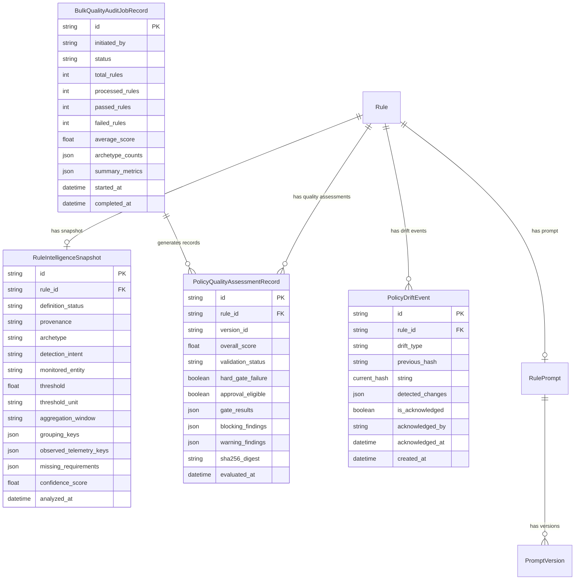

# 13. DATABASE SCHEMA AND MIGRATIONS

## Overview

Agent Intelligence Studio 2.0 introduces four new relational tables and modifies the `RulePrompt` model to persist detection intelligence snapshots, quality assessment history, drift events, and enterprise bulk audit jobs.

Database migrations are managed via Alembic revision `005_agent_intelligence_studio_v2.py`.

---

## Entity-Relationship Diagram



---

## Migration Details: Revision `005_agent_intelligence_studio_v2`

The migration was generated and applied to the database schema:

```python
"""Add Agent Intelligence Studio 2.0 tables

Revision ID: 005_agent_intelligence_studio_v2
Revises: 004_postgres_and_hardening
Create Date: 2026-11-08
"""

def upgrade() -> None:
    # 1. rule_intelligence_snapshots
    op.create_table(
        'rule_intelligence_snapshots',
        sa.Column('id', sa.String(length=64), primary_key=True),
        sa.Column('rule_id', sa.String(length=128), sa.ForeignKey('rules.rule_id', ondelete='CASCADE'), nullable=False),
        sa.Column('definition_status', sa.String(length=32), nullable=False),
        sa.Column('provenance', sa.String(length=32), nullable=False),
        sa.Column('archetype', sa.String(length=64), nullable=True),
        sa.Column('detection_intent', sa.Text(), nullable=True),
        sa.Column('monitored_entity', sa.String(length=128), nullable=True),
        sa.Column('threshold', sa.Float(), nullable=True),
        sa.Column('threshold_unit', sa.String(length=32), nullable=True),
        sa.Column('aggregation_window', sa.String(length=32), nullable=True),
        sa.Column('grouping_keys', sa.JSON(), nullable=True),
        sa.Column('observed_telemetry_keys', sa.JSON(), nullable=True),
        sa.Column('missing_requirements', sa.JSON(), nullable=True),
        sa.Column('confidence_score', sa.Float(), default=0.0),
        sa.Column('analyzed_at', sa.DateTime(), nullable=False),
        sa.Column('created_at', sa.DateTime(), nullable=False),
        sa.Column('updated_at', sa.DateTime(), nullable=False),
    )
    op.create_index('ix_rule_intelligence_rule_id', 'rule_intelligence_snapshots', ['rule_id'])

    # 2. policy_quality_assessments
    op.create_table(
        'policy_quality_assessments',
        sa.Column('id', sa.String(length=64), primary_key=True),
        sa.Column('rule_id', sa.String(length=128), sa.ForeignKey('rules.rule_id', ondelete='CASCADE'), nullable=False),
        sa.Column('version_id', sa.String(length=64), nullable=True),
        sa.Column('overall_score', sa.Float(), nullable=False),
        sa.Column('validation_status', sa.String(length=32), nullable=False),
        sa.Column('hard_gate_failure', sa.Boolean(), default=False),
        sa.Column('approval_eligible', sa.Boolean(), default=False),
        sa.Column('gate_results', sa.JSON(), nullable=True),
        sa.Column('blocking_findings', sa.JSON(), nullable=True),
        sa.Column('warning_findings', sa.JSON(), nullable=True),
        sa.Column('sha256_digest', sa.String(length=64), nullable=False),
        sa.Column('evaluated_at', sa.DateTime(), nullable=False),
    )
    op.create_index('ix_policy_quality_rule_id', 'policy_quality_assessments', ['rule_id'])

    # 3. policy_drift_events
    op.create_table(
        'policy_drift_events',
        sa.Column('id', sa.String(length=64), primary_key=True),
        sa.Column('rule_id', sa.String(length=128), sa.ForeignKey('rules.rule_id', ondelete='CASCADE'), nullable=False),
        sa.Column('drift_type', sa.String(length=64), nullable=False),
        sa.Column('previous_hash', sa.String(length=64), nullable=True),
        sa.Column('current_hash', sa.String(length=64), nullable=True),
        sa.Column('detected_changes', sa.JSON(), nullable=True),
        sa.Column('is_acknowledged', sa.Boolean(), default=False),
        sa.Column('acknowledged_by', sa.String(length=64), nullable=True),
        sa.Column('acknowledged_at', sa.DateTime(), nullable=True),
        sa.Column('created_at', sa.DateTime(), nullable=False),
    )
    op.create_index('ix_policy_drift_rule_id', 'policy_drift_events', ['rule_id'])

    # 4. bulk_quality_audit_jobs
    op.create_table(
        'bulk_quality_audit_jobs',
        sa.Column('id', sa.String(length=64), primary_key=True),
        sa.Column('initiated_by', sa.String(length=64), nullable=False),
        sa.Column('status', sa.String(length=32), nullable=False),
        sa.Column('total_rules', sa.Integer(), default=0),
        sa.Column('processed_rules', sa.Integer(), default=0),
        sa.Column('passed_rules', sa.Integer(), default=0),
        sa.Column('failed_rules', sa.Integer(), default=0),
        sa.Column('average_score', sa.Float(), default=0.0),
        sa.Column('archetype_counts', sa.JSON(), nullable=True),
        sa.Column('summary_metrics', sa.JSON(), nullable=True),
        sa.Column('started_at', sa.DateTime(), nullable=False),
        sa.Column('completed_at', sa.DateTime(), nullable=True),
    )
```

---

## Defensive Query Architecture

To ensure full compatibility with asynchronous SQLite (`aiosqlite`) and PostgreSQL (`asyncpg`), all relationship queries in `AgentPolicyEngine` use explicit `select()` statements rather than synchronous lazy-loading (`MissingGreenlet` prevention). All database transactions use explicit rollback blocks on exception.
