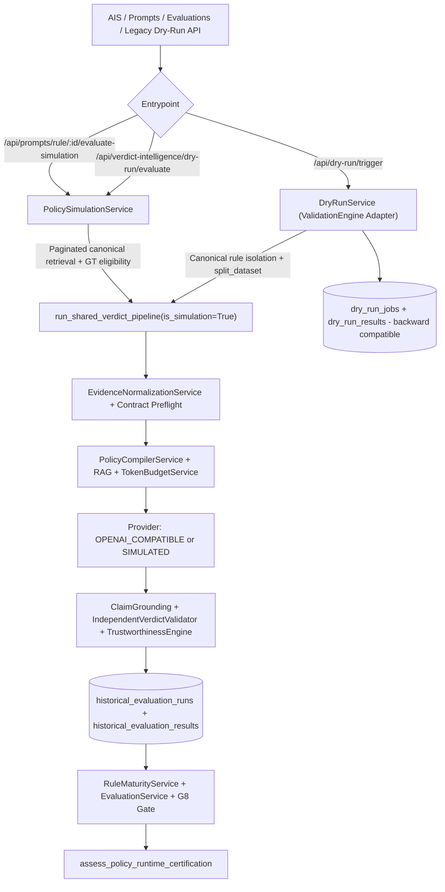

# AIS 2.3 Simulation Architecture Consolidation (`AIS-F11`)

## 1. Objective & Caller Audit

Prior to AIS 2.3, the platform still maintained two parallel historical evaluation execution engines:
1. **Legacy path (`DryRunService` / `ValidationEngine`, `RuleMaturityService`, `/api/dry-run/*`, `/api/evaluations/*`, `run_dry_run_job_task`)** writing directly to `dry_run_configs`, `dry_run_jobs`, `dry_run_results`, and `rule_maturity_evaluations`, bypassing evidence normalization, canonical ground-truth adjudication (`is_ml_generated` / `is_disputed`), claim verification, independent verdict guardrails, and AIS 2.1 runtime certification.
2. **Canonical AIS 2.1/2.2 path (`PolicySimulationService` + `run_shared_verdict_pipeline`)** writing `historical_evaluation_runs` (`HistoricalEvaluationRunRecord`) and `historical_evaluation_results` (`HistoricalEvaluationResultRecord`).

### Caller Inventory (Verified Across Codebase)
| Caller | Legacy Target | AIS 2.3 Consolidation Action |
| --- | --- | --- |
| `backend/app/api/dry_run.py` | `DryRunService` (`ValidationEngine`), `RuleMaturityService` | Preserved API contract; routes through consolidated adapter inside `DryRunService` |
| `backend/app/workers/tasks.py` (`run_dry_run_job_task`) | `DryRunService.execute_dry_run_job` | Routed onto `simulation_replay` queue in `celery_app.py`; delegates via canonical adapter |
| `backend/app/services/validation_engine.py` | Re-exports `ValidationEngine`, `DryRunService` | Aliases consolidated `ValidationEngine` seamlessly |
| `backend/app/api/evaluations.py` | `RuleMaturityService`, `EvaluationService` | Enriched `RuleMaturityResponse` with `evaluation_source`, `autonomous_runtime_eligible`, and `governance_gate_note` |
| `backend/app/services/evaluation_service.py` | `DryRunJob`, `DryRunResult` | `compare_prompt_versions` prioritizes canonical `HistoricalEvaluationRunRecord`/`HistoricalEvaluationResultRecord` before falling back to legacy `DryRunResult` |
| Frontend (`frontend/src/`) | Zero direct callers of `/api/dry-run/*` | Already migrated to `/api/prompts/*` & `/api/verdict-intelligence/*` |

## 2. Consolidated Canonical Architecture

## 3. Governance & Backward-Compatibility Safeguards

- **Legacy Tables Retained Intentionally:** `dry_run_configs`, `dry_run_jobs`, `dry_run_results`, and `rule_maturity_evaluations` remain intact so historical evaluation IDs, API consumers (`/api/dry-run/*`, `/api/evaluations/*`), and phase 1-4 regression tests continue operating without destructive schema drops.
- **Canonical Adapter Linkage:** Every legacy `DryRunService.execute_dry_run_job` execution now creates a linked `HistoricalEvaluationRunRecord` with `config_snapshot.adapter = "LEGACY_DRY_RUN_ADAPTER"`, `legacy_dry_run_job_id`, explicit `is_simulated`, `policy_digest`, and `validation_state = "INCONCLUSIVE"`.
- **Non-Bypassable G8 & Autonomous Certification:** Simulated or split-strategy legacy jobs remain strictly blocked from counting as empirical G8 certification inside `assess_policy_runtime_certification` and `PolicyQualityValidator`.
- **Precedence in `RuleMaturityService` & `EvaluationService`:** Real non-simulated `HistoricalEvaluationRunRecord` results take precedence over canonical simulated runs, with legacy `DryRunResult` fallback used only when no canonical run exists for that rule/version.

