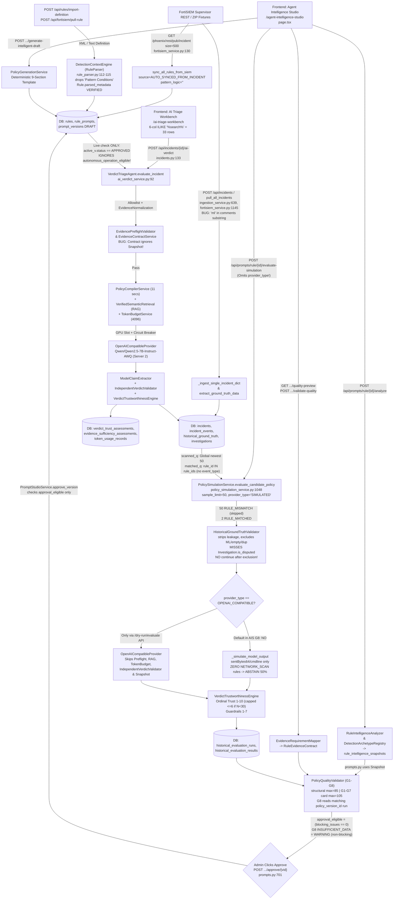

# AIS 2.0 Actual Implemented Architecture & Execution Flow Audit

**Audit Mode:** Strictly Read-Only (Code + Local Dev DB + Safe Tests)  
**Codebase Baseline:** Commit `9616971` (with pre-existing uncommitted formatting diff in `frontend/src/app/agent-intelligence-studio/page.tsx`)  
**Target Reference Rule:** `PH_RULE_HEAVY_TCP_HOST_SCAN` (`9839fa49-40ac-4676-abcc-4c5581ae9e09`, Archetype: `NETWORK_SCAN`)

---

## 1. Architectural Overview & Stage Status Classification

The codebase implements **three parallel evaluation/triage pipelines** across Frontend, Backend APIs, Services, and Database tables rather than one unified execution path:

1. **Agent Intelligence Studio (AIS 2.0) Policy & G1–G8 Pipeline** (`/agent-intelligence-studio` -> `/api/prompts/*` + `/api/verdict-intelligence/*`)
2. **AI Triage Workbench & Live Triage Pipeline (`VerdictTriageAgent`)** (`/ai-triage-workbench` + background scheduler/worker -> `/api/incidents/{id}/ai-verdict`)
3. **Legacy Validation Engine / Dry-Run Lab & Rule Maturity Pipeline** (`/agent-simulation-lab` -> `/api/dry-run/*`)

### Stage Implementation Classification

| Stage | Status | Implemented Reality |
| :--- | :--- | :--- |
| SIEM Rule Sync / Ingestion | **PARTIALLY IMPLEMENTED** | `FortiSIEMService.sync_all_rules_from_siem` (`fortisiem_service.py:102-295`) discovers rules strictly from recent incidents (`/phoenix/rest/pub/incident?size=500`, 180d window), storing `source="AUTO_SYNCED_FROM_INCIDENT"`, `pattern_logic=""`, and `definition_status="INCOMPLETE"`. Manual XML/text import endpoints exist (`POST /api/rules/import-definition`, `POST /api/fortisiem/pull-rule`). |
| Rule Parser & Intelligence | **PARTIALLY IMPLEMENTED** | `RuleIntelligenceAnalyzer` (`rule_intelligence_analyzer.py:38`) and `DetectionArchetypeRegistry` (`detection_archetype_registry.py:644`) extract conditions/archetypes. However, `DetectionContextEngine` (`rule_parser.py:46,112-115`) captures `"pattern conditions"` headings without copying them to `pattern_logic`, and `EvidenceContractService.get_contract_for_rule` (`evidence_contract_service.py:83`) ignores persisted `RuleIntelligenceSnapshot` rows. |
| Policy Generation & Compiler | **IMPLEMENTED (NON-LLM TEMPLATE)** | `PolicyGenerationService` (`policy_generation_service.py`) deterministically synthesizes 9-section policy templates (`ENTERPRISE_SOC_BASELINE_V2`), not LLM synthesis. `PolicyCompilerService` v3.0.0 compiles into 11 sections with delimited schema injection. |
| Evidence Contract Mapping | **IMPLEMENTED** | `EvidenceRequirementMapper.map_evidence_contract` (`evidence_requirement_mapper.py`) maps archetype mandatory fields + threshold + observed fields into `RuleEvidenceContract` in memory. |
| Quality Gates G1–G7 | **IMPLEMENTED (SCORING BUG)** | `PolicyQualityValidator` (`policy_quality_validator.py:55-672`) evaluates G1–G7, but G1 (`max_score=20`) and G2 (`max_score=20`) share a single `score_breakdown["detection_semantics"]` (20 pts), creating an `85` vs `105` structural denominator mismatch. |
| Historical Incident Retrieval (AIS) | **DEFECTIVE / PARTIAL** | `PolicySimulationService.evaluate_candidate_policy` (`policy_simulation_service.py:1084-1090`) passes `sample_limit=50`; `run_dry_run_intelligence_evaluation` merges `matched_q` (`Incident.rule_id.in_(rule_ids)`, ignoring `event_type`) + unfiltered global `scanned_q` (newest 50 across all rules -> `2 + 50 = 52`). |
| Rule Matching | **PARTIAL / INCONSISTENT** | AIS filters by `Incident.rule_id.in_(rule_ids)`; `rules.get_rule_detail` checks `rule_id OR event_type`; Workbench search uses 6-column `ILIKE`; `AgentPolicyEngine` internal methods mix `Rule.id` and `Rule.rule_id`. |
| Ground Truth Verification | **IMPLEMENTED WITH BUGS** | `HistoricalGroundTruthValidator` strips leakage, checks synthetic/empty/ML/ambiguous exclusions, and collapses duplicate closure clusters. Bugs: `"ml"` substring check at ingest/sync (`ingestion_service.py:639`, `fortisiem_service.py:1145`), ML flag overriding human `cleared_user`/`cleared_reason`, omitted `Investigation.is_disputed` in simulation, and excluded rows still evaluated. |
| AIS G8 Simulation Execution | **MOCKED BY DEFAULT** | `evaluate_candidate_policy` never passes `provider_type` -> defaults to `"SIMULATED"` -> `_simulate_model_output()` (`policy_simulation_service.py:937-1045`) only has byte-transfer/cmdline/backup heuristics and **zero `NETWORK_SCAN` rules** (always abstains at 50%). Even with `OPENAI_COMPATIBLE`, G8 skips Preflight, RAG, TokenBudget, and `IndependentVerdictValidator`. |
| AI Triage Workbench Live Inference | **GENUINELY IMPLEMENTED** | `VerdictTriageAgent.evaluate_incident` (`ai_verdict_service.py:92-800`) runs distributed lock, normalization, allowlist, Preflight, PolicyCompiler, RAG, TokenBudget, GPU circuit breaker, vLLM/Qwen (`/v1/chat/completions`), `ModelClaimExtractor`, `IndependentVerdictValidator`, and `VerdictTrustworthinessEngine`. Gap: accepts any `status="APPROVED"` policy even if `autonomous_operation_eligible=False` (G8 `INSUFFICIENT_DATA`). |
| G8 Assessment & Approval | **IMPLEMENTED WITH GATING GAP** | `PolicyQualityValidator._evaluate_gate_8_simulation` (`:675-737`) checks `N >= 5`, regressions, and `decision_coverage`, returning `GateStatus.WARNING` on `INSUFFICIENT_DATA`. `AgentPolicyEngine.approve_version` (`prompt_studio_service.py:333`) only checks `approval_eligible` (zero blocking issues), allowing `APPROVED` status without empirical pass. |

---

## 2. Mermaid Flowchart — Actual Implemented Architecture

---

## 3. Stage-by-Stage Architecture Matrix

| Stage | Frontend Component & API Endpoint | Backend Function / Service | DB Table / Model | Relevant Configuration | Input / Output Data | Dependencies & Failure Behavior |
| :--- | :--- | :--- | :--- | :--- | :--- | :--- |
| **1. SIEM Rule Sync & Import** | Studio sync controls; `POST /api/rules/sync`, `POST /api/rules/import-definition` | `FortiSIEMService.sync_all_rules_from_siem` (`fortisiem_service.py:102`) | `rules` (`Rule`), `rule_prompts`, `prompt_versions` | `FORTISIEM_HOST`, `FORTISIEM_TIMEOUT`, `FORTISIEM_VERIFY_SSL`, `FORTISIEM_MOCK_FALLBACK` | In: `/pub/incident?size=500` JSON or fixture ZIP. Out: `Rule` rows + `DRAFT` prompt. | Offline fallback reads `fixtures/Incident json.zip`; REST discovery misses rules absent from latest 500 alerts and marks `INCOMPLETE`. |
| **2. Rule Parser & Intelligence** | Studio Overview / Semantics; `GET /api/prompts/rule/{id}/intelligence`, `POST /api/prompts/rule/{id}/analyze` | `DetectionContextEngine.parse_rule_text` (`rule_parser.py:13`), `RuleIntelligenceAnalyzer.analyze_rule` (`rule_intelligence_analyzer.py:38`), `DetectionArchetypeRegistry.classify_rule` | `rules`, `rule_intelligence_snapshots` | 12 Archetypes in `detection_archetype_registry.py`; typo `"PH_RULE_HEAVY_TCP_HOST_SCAN_FIXED_PORT"` at L691 | In: `Rule` (`raw_rule_text`, `pattern_logic`, `parsed_metadata`). Out: `DetectionSemantics` + archetype classification. | `DetectionContextEngine` omits `"pattern conditions"` section copy (`L112-115`); auto-synced rules remain `INCOMPLETE`. |
| **3. Policy Generation** | Studio `"Generate Intelligent Draft"`; `POST /api/prompts/rule/{id}/generate-intelligent-draft` | `AgentPolicyEngine.generate_template_draft` (`prompt_studio_service.py:89`) -> `PolicyGenerationService` | `rule_prompts`, `prompt_versions` | `ENTERPRISE_SOC_BASELINE_V2` (`prompt_studio_service.py:31`) | In: `Rule`, semantics, archetype, contract. Out: 9-section `PromptVersion` (`status="DRAFT"`). | Non-LLM deterministic synthesis. `generate_template_draft` queries `Rule.id == rule_id` only (`L99`). |
| **4. Evidence Contract** | Studio Evidence Contract view; embedded in `GET /intelligence` & `quality-preview` | `EvidenceRequirementMapper.map_evidence_contract` (`evidence_requirement_mapper.py:141`), `EvidenceContractService.get_contract_for_rule` (`evidence_contract_service.py:53`) | Dynamically computed (not persisted as a table) | `NETWORK_SCAN` `mandatory_core_fields` (`detection_archetype_registry.py:119-124`) | In: `Rule`, `DetectionSemantics`, `PromptVersion`. Out: `RuleEvidenceContract`. | Live helper (`EvidenceContractService`) ignores `RuleIntelligenceSnapshot`, evaluating raw `Rule` fields directly. |
| **5. Quality Gates G1–G7** | Studio Quality Gates tab + Export JSON/MD/CSV; `GET /quality-preview`, `POST /validate-quality` | `PolicyQualityValidator.validate_policy_quality` (`policy_quality_validator.py:55`), `prompts._compute_policy_quality_readonly` (`:376`), `qualityExport.ts:132` | `policy_quality_assessments`, `prompt_versions` | Structural breakdown sum `85.0`; G1–G7 gate `max_score` sum `105.0` | In: `Rule`, `PromptVersion`, `RuleEvidenceContract`, `DetectionSemantics`, optional `simulation_results`. Out: `PolicyQualityAssessmentResponse`. | `approval_eligible = (len(blocking_issues) == 0)`. G1+G2 double-count 20 pts in gate `max_score`; `qualityExport.ts:170` emits `validation_status: null`. |
| **6. Historical Incident Retrieval (AIS)** | Studio Simulation Lab tab; `POST /api/prompts/rule/{id}/evaluate-simulation` | `PolicySimulationService.run_dry_run_intelligence_evaluation` (`policy_simulation_service.py:191`) | `incidents`, `historical_ground_truth`, `incident_events` | `sample_limit=50` (`policy_simulation_service.py:1089`, `verdict_intelligence.py:282`) | In: `rule_id`, `policy_version_id`, `sample_limit=50`. Out: `matched_rows + scanned_rows`. | Unfiltered global top-50 `scanned_q` inflates scanned count (`2+50=52`), omits `event_type` matches in `matched_q`, truncates >50 matched rules. |
| **7. Rule Matching & Search (Workbench)** | `/ai-triage-workbench`; `GET /api/incidents`, `GET /api/rules`, `GET /api/rules/{id}` | `IncidentService.list_incidents` (`incident_service.py:70`), `rules.list_rules` (`rules.py:20`), `rules.get_rule_detail` (`rules.py:197`) | `incidents`, `rules` | Workbench `search` `ILIKE` across 6 columns; Studio `getRules({ page_size: 100 })` (`page.tsx:241`) | In: query string / UUID / rule_id. Out: paginated rows. | Workbench text search merges distinct rules sharing substrings (`33` hits); `list_rules` misses `event_type`-only unlinked incidents. |
| **8. Ground Truth Verification** | Studio 6-step Funnel & Exclusions modals; `GET /api/verdict-intelligence/eligibility-report` | `HistoricalGroundTruthValidator`, `HistoricalEligibilityService`, `PolicySimulationService:501-580` | `historical_ground_truth`, `investigations`, `ground_truth_validations` | Duplicate key (`rule\|label\|epoch\|reason_norm>=8`), ML keyword checks | In: `Incident`, `HistoricalGroundTruth`. Out: `VERIFIED_TP`/`FP` + 7 exclusion reason codes. | `"ml" in comments` false positives at ingest; ML text overrides `cleared_user`/`cleared_reason`; simulation omits `Investigation.is_disputed` & has no `continue` after exclusion. |
| **9. Simulation / Live LLM Inference** | Studio `Run Simulation` vs Workbench `Analyze with AI` (`POST /incidents/{id}/ai-verdict`) | AIS: `_simulate_model_output` (`:937`); Live: `VerdictTriageAgent.evaluate_incident` (`ai_verdict_service.py:211-580`) | `historical_evaluation_runs`, `historical_evaluation_results`, `token_usage_records` | `LOCAL_LLM_BASE_URL`, `LOCAL_LLM_MODEL_NAME`, `LOCAL_LLM_TIMEOUT`, `LOCAL_LLM_ALLOW_MOCK_FALLBACK`, `LOCAL_LLM_CONTEXT_BUDGET=4096` | In: Allowlist payload + canonical evidence. Out: Model JSON verdict + claims. | AIS defaults to mock `SIMULATED` (no `NETWORK_SCAN` logic). Live uses distributed lock, preflight, RAG, budget, circuit breaker (`fail>=5 -> open 30s`). |
| **10. AI Verdict Validation & Trust** | Workbench AI Verdict modal, `/verdict-intelligence`; `GET /incident/{id}/trust` | `ModelClaimExtractor`, `IndependentVerdictValidator`, `EvidenceSufficiencyEngine`, `VerdictClaimValidator`, `VerdictGuardrailsEngine`, `VerdictTrustworthinessEngine` | `evidence_sufficiency_assessments`, `verdict_trust_assessments`, `incidents.ai_verdict` | Uncalibrated trust cap `<=6` (`sample_count < 30`), auto decision threshold `>=7/10` (`raw >=70`), `MIN_HISTORICAL_SAMPLES=5` | In: Model output + canonical evidence + rule calibration stats. Out: `TRUE_POSITIVE`/`FALSE_POSITIVE`/`REQUIRES_ATTENTION`, trust 1–10. | Live runs `IndependentVerdictValidator`; AIS skips it. `EvidenceNormalizationService` omits `"Destination Port"` / `"dstPort"`. |
| **11. G8 Gate & Policy Approval** | Studio Approve modal; `POST /api/prompts/rule/{id}/approve/{vid}` | `PolicyQualityValidator._evaluate_gate_8_simulation` (`:675`), `AgentPolicyEngine.approve_version` (`prompt_studio_service.py:242`) | `policy_quality_assessments`, `prompt_versions`, `audit_logs`, `rule_maturity_evaluations` (separate) | `MIN_HISTORICAL_SAMPLES=5`, acc `>=0.80` & `critical_fn==0`, role `Administrator` | In: Latest `HistoricalEvaluationRunRecord` for `policy_version_id`. Out: `APPROVED` policy + `_trigger_bounded_rule_reevaluation` (`max_batch=15`). | Structural approval succeeds despite `G8=INSUFFICIENT_DATA`; `VerdictTriageAgent` executes live triage using that policy while `autonomous_operation_eligible=False`. |

