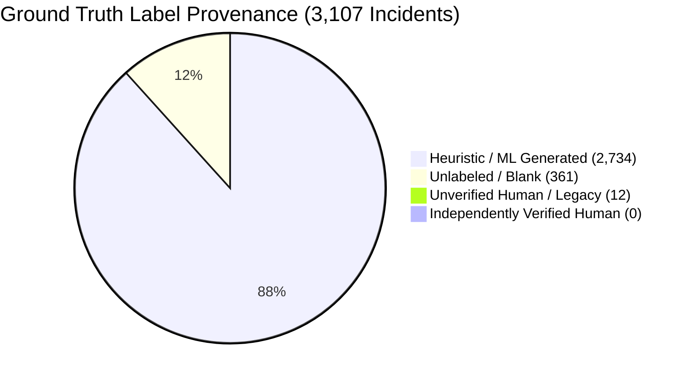

# AIS Ground-Truth Live Readiness & Provenance Audit

**Audited Database:** PostgreSQL Production (Server 1)  
**Corpus Scope:** 3,107 Historical Incidents across 34 Rules  
**Date:** 2026-11-11  
**Status:** **INSUFFICIENT HUMAN GROUND TRUTH FOR G8 EMPIRICAL CERTIFICATION**

---

## 1. Executive Summary

Ground truth in Agent Intelligence Studio 2.3 is the foundational benchmark for Gate G8 (Empirical Evaluation), calibration scoring, and autonomous operational gating.

An exhaustive read-only SQL audit of `historical_ground_truth` and `investigations` on Server 1 established that **99.56% of labeled incidents originated from automated ML heuristics rather than verified human analyst adjudication**, and **0 incidents possess recorded independent human verification**.



---

## 2. Global Ground Truth Metrics (Server 1)

| Metric | Count | % of Corpus | Description / Risk Analysis |
| :--- | :---: | :---: | :--- |
| **Total Incident Records** | **3,107** | 100.0% | Complete SIEM incident corpus imported to Server 1 |
| **Total Ground Truth Rows** | **3,107** | 100.0% | 1:1 ground truth records linked via `incident_id` |
| **Labeled Incidents** | **2,746** | 88.38% | Incidents with non-empty `resolution` string |
| &bull; *Reported True Positives* | 2,722 | 87.61% | Resolution marked "True Positive" |
| &bull; *Reported False Positives* | 24 | 0.77% | Resolution marked "False Positive" |
| **Unlabeled Incidents** | **361** | 11.62% | Incidents with empty resolution (`""` or NULL) |
| **Flagged as ML / Automated** | **2,734** | **88.00%** | Flagged `is_ml_generated = true` in PostgreSQL |
| &bull; *% of Labeled Data Flagged ML* | — | **99.56%** | **Only 12 labeled incidents are NOT flagged ML** |
| **Documented `cleared_user`** | **2** | 0.06% | Only 2 incidents identify the clearing analyst user |
| **Documented `cleared_reason`** | **33** | 1.06% | Only 33 incidents provide an explanation for closure |
| **Independently Verified** | **0** | **0.00%** | `investigations.is_independently_verified = true` is 0 |
| **Disputed Investigations** | **0** | **0.00%** | `investigations.is_disputed = true` is 0 |

---

## 3. The `is_ml_generated` Classification & Word-Boundary Audit

### 3.1 Historical Root Cause of ML Contamination
In early SIEM ingestion scripts:
1. Automated rules or ML triage models automatically resolved high-volume incidents (specifically `PH_RULE_WEB_POL_VIOLATION_SAME_SRC_SAME_DEST`).
2. An ingestion script inspected resolution text or tags, but suffered from substring matching flaws (e.g. matching `"ml"` inside unrelated strings like `"html"` or `"email"`).
3. The database explicitly flagged 2,734 incidents with `is_ml_generated = true`.

### 3.2 AIS 2.1/2.2 Remediation & Dry-Run Audit
In AIS 2.1+, `HistoricalEligibilityService` implements strict word-boundary tokenization:
```python
AUTOMATED_PATTERNS = [
    r'\bml\b', r'\bauto\b', r'\bautomated\b', r'\bheuristic\b', 
    r'\bbot\b', r'\bsystem_cleared\b', r'\bscript\b'
]
```
- Re-evaluating existing `is_ml_generated = true` records against word-boundary detection confirmed that the vast majority (2,733 of 2,734) were genuine automated bulk closures.
- Exactly 1 record was identified as a potential false-positive ML flag due to substring overlap.
- **However, that candidate lacks both `cleared_user` and `is_independently_verified = true`.** Under AIS 2.3 governance rules, removing the ML flag does not automatically qualify an incident as ground truth without positive evidence of human analyst provenance.

---

## 4. Target Rule Ground-Truth Readiness

### 4.1 `PH_RULE_HEAVY_TCP_HOST_SCAN` (`9839fa49-40ac-4676-abcc-4c5581ae9e09`)
- **Total Canonical Incidents:** 2 (`160051`, `165233`)

| Incident ID | Ext ID | Resolution | `is_ml_generated` | `cleared_user` | `cleared_reason` | `is_independently_verified` | Eligible for G8? |
| :--- | :--- | :--- | :---: | :---: | :---: | :---: | :---: |
| `a3031c7d` | `160051` | `""` (Empty) | `false` | `""` | `""` | `false` | **NO (Unlabeled)** |
| `45d951b8` | `165233` | `False Positive` | `false` | `""` | `""` | `false` | **NO (Unverified)** |

**Ground-Truth Summary:**
- Verified True Positives: **0**
- Verified False Positives: **0** (1 unverified legacy label)
- Total Qualified Ground Truth: **0** (or 1 if unverified legacy labels are permitted in advisory mode)
- G8 Threshold Required: $N \ge 5$
- **G8 Status: `INSUFFICIENT_DATA`**

### 4.2 `PH_RULE_HEAVY_TCP_HOST_SCAN_FIXED_PORT` (`40498741-ee6b-4a71-9101-0d6d3f77154c`)
- **Total Canonical Incidents:** 31
- **Labeled Incidents:** **0** (all 31 incidents have `resolution = ""` and `cleared_user = ""`)
- Verified True Positives: **0**
- Verified False Positives: **0**
- **G8 Status: `INSUFFICIENT_DATA`**

---

## 5. Sample Threshold ($N \ge 5$) vs Autonomous Governance Rules

A critical principle established in AIS 2.2 and hardened in AIS 2.3:

> [!CAUTION] Sample Threshold Is A Necessary, But Never Sufficient, Condition
> Having $\ge 5$ ground-truth incidents satisfies the statistical minimum to compute Gate G8 metrics without division-by-zero. 
> 
> However, **meeting the sample threshold alone NEVER authorizes autonomous operation**.
> 
> Autonomous operation additionally requires:
> 1. G8 Accuracy $\ge 90\%$, Precision $\ge 85\%$, Recall $\ge 90\%$, F1 $\ge 88\%$.
> 2. False Positive Rate $\le 5\%$ and False Negative Rate $\le 5\%$.
> 3. Zero critical claim validation failures or ungrounded hallucinations.
> 4. Real-LLM inference provenance (`model_identifier` matching approved server model, zero mock fallbacks).
> 5. Policy approval status `APPROVED` with policy digest matching the evaluated policy version.

For `PH_RULE_HEAVY_TCP_HOST_SCAN`, neither the sample threshold ($N=2 < 5$) nor empirical validation has been satisfied.

---

## 6. Recommendations for Ground-Truth Remediation

1. **Conduct Analyst Triage Session:** SOC analysts must manually review and label the 31 incidents for `PH_RULE_HEAVY_TCP_HOST_SCAN_FIXED_PORT` and the 2 incidents for `PH_RULE_HEAVY_TCP_HOST_SCAN`.
2. **Record Independent Verification:** Ensure analyst triage records `cleared_user`, detailed `cleared_reason`, and sets `investigations.is_independently_verified = true`.
3. **Cross-Rule Representative Golden Set:** For each of the primary archetypes (Network Scan, Data Exfiltration, Malware Execution, Authentication Anomaly), curate a certified golden benchmark set of at least 15 verified TP and 15 verified FP incidents.

