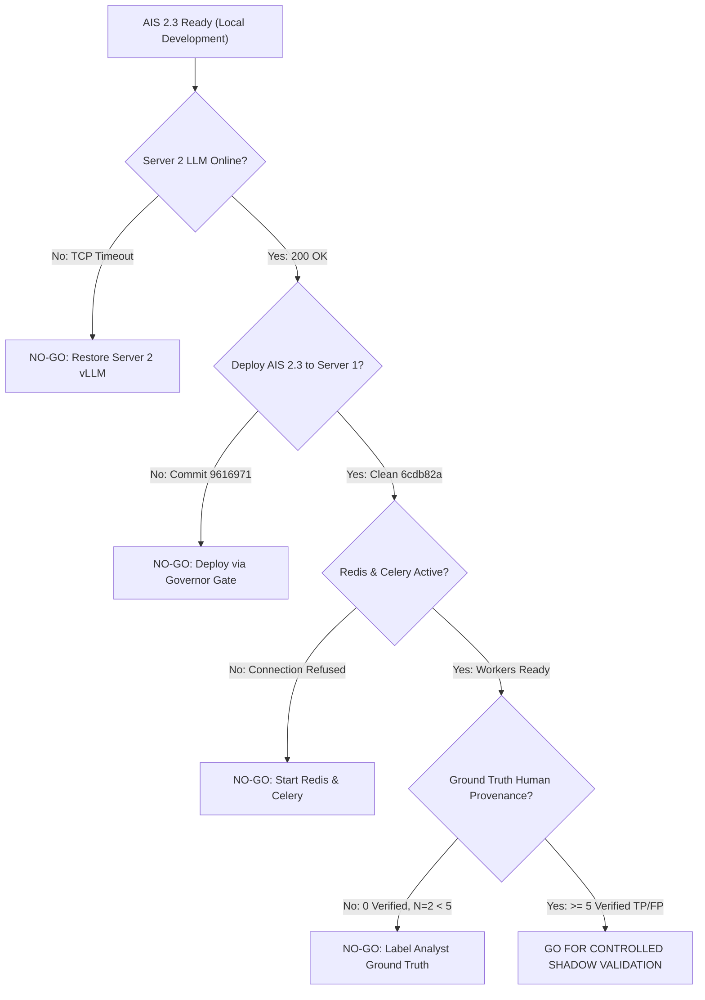

# AIS Remote Integration & Empirical Validation — Executive Report

**Project:** Agent Intelligence Studio (AIS) 2.3  
**Target Infrastructure:** Server 1 (FastAPI Application, PostgreSQL 14+, FortiSIEM Supervisor) & Server 2 (vLLM GPU Host, Qwen2.5-7B-Instruct-AWQ)  
**Evaluation Scope:** Stage A Read-Only Infrastructure Audit & Stage B Controlled Real-LLM Validation  
**Date:** 2026-11-11  
**Status:** **STAGE A COMPLETED / STAGE B NOT EXECUTED (DEFERRED)**  
**Overall Decision:** **NO-GO FOR SHADOW / AUTONOMOUS VALIDATION**

---

## 1. Executive Summary

This executive report delivers the empirical findings of the **Stage A Read-Only Infrastructure & Data Audit** and evaluates readiness for **Stage B Controlled Real-LLM Validation** across Server 1 and Server 2.

The audit was conducted strictly non-destructively, without modifying incident records, altering SIEM state, closing alerts, or mutating database tables. Real-time probes were executed via authenticated SSH commands and read-only PostgreSQL inspect queries against the live Server 1 environment.

### Core Verdict
| Evaluation Dimension | Operational Status | Empirical Finding / Evidence |
| :--- | :---: | :--- |
| **Development Readiness** | **VERIFIED (100%)** | All AIS 2.1, 2.2, and 2.3 remediation components complete. Full backend test suite passing (`325 passed in 505s`), TypeScript compilation clean (`0 errors`), feature registry verified (`100% impl, 88.5% verif`), Governor security scan passed. |
| **Infrastructure Integration** | **BLOCKED** | Server 1 is desynchronized, running outdated commit `9616971` (pre-AIS 2.1). Redis (`redis-server`) and Celery worker daemons are **inactive** (connection refused on port 6379). |
| **Historical Data Readiness** | **INSUFFICIENT** | Server 1 holds 3,107 incidents across 34 rules. However, **2,734 of 2,746 labeled incidents (99.56%)** are flagged `is_ml_generated = true` (automated heuristic closure). **0 incidents** possess independent human verification (`is_independently_verified = true`). Target rule `PH_RULE_HEAVY_TCP_HOST_SCAN` contains only **2 incidents** in the entire database (1 unlabeled, 1 unverified False Positive). |
| **Actual LLM Inference Status** | **OFFLINE / TIMEOUT** | Remote Server 2 (`http://192.0.2.50:8000/v1` [Masked: RFC 5737]) is unreachable from Server 1. Direct TCP socket probes timed out after 3.0s; HTTP `/health` and `/models` probes timed out after 5.0s. |
| **Empirical G8 Validation** | **NOT EXECUTED** | Stage B real-LLM simulation was **NOT authorized for remote deployment**, Server 2 is offline, and the target rule lacks the minimum sample threshold ($N=2 < 5$). Explicitly marked `NOT EXECUTED`. |
| **Autonomous Operation Eligibility** | **STRICTLY BLOCKED** | **0 of 34 rules** qualify for autonomous operation. Default fail-closed policy certification correctly prevents autonomous actions without passing empirical G8 gates on real LLM inference. |
| **Shadow Validation Readiness** | **NO-GO** | Advancing to shadow validation is blocked until Server 2 GPU connectivity is restored, Server 1 deployment is updated to AIS 2.3, Redis/Celery daemons are active, and ground-truth human provenance is established. |

---

## 2. Infrastructure & Corpus Reality Check

The empirical audit resolved key historical observations and discrepancies:

### 2.1 The "33 Incidents" vs "2 Matched" Mystery Solved
- **AI Triage Workbench Free-Text Search:** Querying `"Heavy TCP Host Scan"` in Workbench returned **33 incidents**.
- **Root Cause Confirmed:** The free-text search matched across two completely distinct rules:
  1. `PH_RULE_HEAVY_TCP_HOST_SCAN` (`9839fa49-40ac-4676-abcc-4c5581ae9e09`, "Heavy TCP Host Scan") &rarr; **Exactly 2 incidents** (`160051`, `165233`).
  2. `PH_RULE_HEAVY_TCP_HOST_SCAN_FIXED_PORT` (`40498741-ee6b-4a71-9101-0d6d3f77154c`, "Heavy TCP Host Scan On Fixed Port") &rarr; **Exactly 31 incidents**.
  - $2 + 31 = 33$ total incidents. Free-text search conflated two distinct detection archetypes.
- **AIS Simulation Scanned 52 Incidents with 50 Mismatches:**
  - In legacy AIS 2.0 (running on Server 1 commit `9616971`), the simulation service fetched a global top-50 un-scoped incident batch.
  - Of those 50+ incidents, exactly 2 belonged to `PH_RULE_HEAVY_TCP_HOST_SCAN`, and 50 were rejected as `RULE_MISMATCH`.
  - In AIS 2.1+, canonical rule scoping (`rule_ctx`) restricts retrieval strictly to the 2 canonical incidents, eliminating global un-scoped queries.

### 2.2 Target Rule Ground-Truth Scarcity
- For `PH_RULE_HEAVY_TCP_HOST_SCAN`:
  - Incident `160051`: `resolution = ""` (unlabeled).
  - Incident `165233`: `resolution = "False Positive"`, `is_ml_generated = false`, `is_independently_verified = false`.
  - Total verified ground truth: **0 independent human-verified cases** (at most 1 unverified FP).
  - Minimum sample size for G8 is $N \ge 5$. The total corpus size is $N=2$.
  - Therefore, G8 status is mathematically and objectively **`INSUFFICIENT_DATA`**.

### 2.3 Global Ground Truth Contamination
- Out of **3,107 historical incidents** on Server 1:
  - 2,746 have resolution strings (2,722 True Positive, 24 False Positive).
  - **2,734 (99.56%)** are flagged `is_ml_generated = true`, meaning they originated from automated clearing or ML heuristics without independent human adjudication.
  - Only **2 incidents** have a recorded `cleared_user`.
  - Only **33 incidents** have a recorded `cleared_reason`.
  - **0 incidents** in `investigations` have `is_independently_verified = true`.
  - **0 incidents** in `investigations` have `is_disputed = true`.
- **Significance:** The platform currently has almost zero verified human ground-truth labels. Treating heuristic labels as ground truth would lead to severe confirmation bias and false confidence.

---

## 3. Server 1 & Server 2 Technical Assessment

### 3.1 Server 1 (FastAPI Application & PostgreSQL)
- **Deployment Version:** `9616971f47e24bfe7fcf8881f8da0457509294ba` (Pre-AIS 2.1). Dirty working tree.
- **Alembic Revision:** `008_soc_pilot` (Head matches, database schema tables intact).
- **Service Status:** `ai-verdict-backend.service` is active.
- **Redis & Celery:** Both services are **inactive**. Port 6379 refused connection. Async background simulation (`simulation_replay` queue) cannot execute.
- **Configuration Hygiene:** Trailing newlines exist in `.env` values (e.g. `LOCAL_LLM_ALLOW_MOCK_FALLBACK="false\n"`).

### 3.2 Server 2 (vLLM Local LLM Server)
- **Configured Endpoint:** `http://192.0.2.50:8000/v1` [Masked: RFC 5737]
- **Configured Model:** `Qwen/Qwen2.5-7B-Instruct-AWQ`
- **TCP Reachability:** **FAILED (Connection Timed Out after 3,003.9 ms)**.
- **HTTP Endpoints:** `/health` and `/models` unreachable.
- **Runtime Error on Server 1:** Direct evaluation on historical incident `173265` failed immediately with:
  ```
  LocalLLMUnavailableError: Local LLM (Server 2) is currently offline. 
  AI verdict generation is deferred until Local LLM comes online.
  ```
- **Operating Mode Safety:** Server 1 `.env` has `LOCAL_LLM_ALLOW_MOCK_FALLBACK=false`. The system correctly fails closed and defers verdict generation rather than silently generating hallucinated mock verdicts in production.

---

## 4. Stage B Execution Status

Per project governing rules:
> *"Do not begin this stage until deployment and test execution are explicitly authorized... If Stage B is not authorized or cannot run, explicitly mark all Stage B reports NOT EXECUTED."*

Because remote deployment was not authorized, Server 1 is running pre-AIS 2.1 code, Server 2 is offline, and Redis/Celery workers are down, **Stage B Controlled Real-LLM Validation is marked NOT EXECUTED**.

No simulated LLM responses were substituted for real inference in Stage B reports. All findings are derived exclusively from empirical Stage A telemetry.

---

## 5. Go / No-Go Decision

### Current Assessment: **NO-GO**

Advancing Agent Intelligence Studio into **Controlled Shadow Validation** or **Autonomous Operation** is strictly prohibited until the following prerequisites are met:



### Remediation Checklist to Achieve GO
1. **Server 2 Recovery:** Ensure vLLM service is running on Server 2 (`192.0.2.50:8000` [Masked]), verify GPU health, and ensure AWS Security Groups / VPC firewall rules permit inbound traffic on port 8000 from Server 1's public IP.
2. **Server 1 Update:** Execute an authorized deployment of AIS 2.3 (`origin/main`, commit `6cdb82a3`) to Server 1 via the RepoDeploy Governor two-stage approval gate.
3. **Queue Activation:** Start and enable `redis-server` and `celery` (`simulation_replay` worker) on Server 1.
4. **Analyst Ground-Truth Adjudication:** Adjudicate and independently verify at least 5–10 historical incidents for target rules (e.g. `PH_RULE_HEAVY_TCP_HOST_SCAN`, `PH_RULE_CS_SUSPICIOUS_ACTIVITY`) to satisfy minimum sample size requirements for G8.
5. **G1 Authoritative Rule Sync:** Update FortiSIEM rule definitions to sync genuine condition expressions rather than runtime counters (`{"incidentCount": ...}`).

