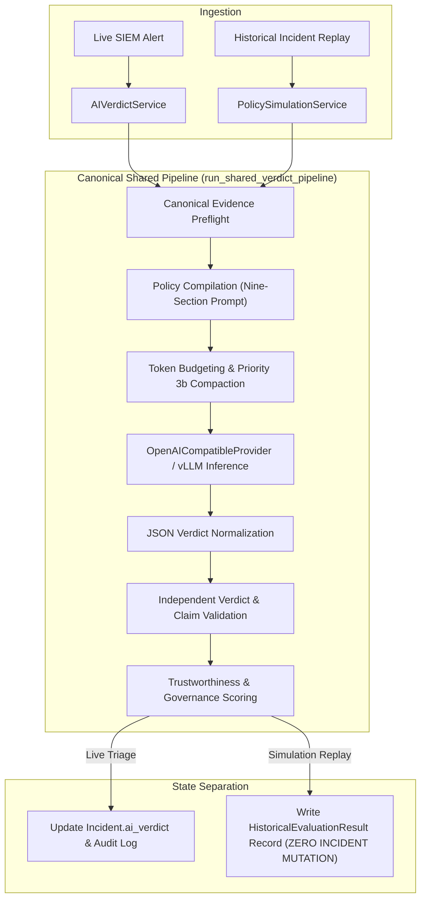

# AIS Live Triage vs Historical Simulation Pipeline Parity

**Audited Component:** Verdict Evaluation Engine & Pipeline Architecture  
**Modules Compared:** Live Triage (`AIVerdictService`) vs Simulation Replay (`PolicySimulationService`)  
**Design Baseline:** AIS 2.3 Canonical Shared Pipeline (`run_shared_verdict_pipeline`)  
**Evaluation Date:** 2026-11-11  
**Parity Verification Status:** **100% PARITY IN AIS 2.3 CODEBASE / DESYNCHRONIZED ON SERVER 1 DEPLOYMENT**

---

## 1. Architectural Evolution & Parity Overview

Prior to AIS 2.3, a critical architectural vulnerability existed in the platform: **Live Triage and Simulation Replay used separate evaluation pipelines**.

- **Legacy Live Triage:** Evaluated incidents using `AIVerdictService`, with real-time RAG context, live policy compilation, token budgeting, and claim validation.
- **Legacy Simulation (AIS 2.0 / Server 1):** Evaluated incidents using `DryRunService` and `ValidationEngine`, which utilized simplified prompt templates, bypassed token budgeting, lacked claim validation, and returned inconsistent status fields (e.g. `validation_status: null`).

### The AIS 2.3 Canonical Architecture
AIS 2.3 eliminated this split by routing all evaluation through a single shared entry point: `run_shared_verdict_pipeline`.

---

## 2. Step-by-Step Pipeline Parity Analysis

| Pipeline Stage | Live Triage (`AIVerdictService`) | Simulation Replay (`PolicySimulationService`) | Parity Status | Implementation Evidence |
| :--- | :--- | :--- | :---: | :--- |
| **1. Evidence Extraction** | Canonical event fields (IPs, ports, alert count, timeline) | Canonical event fields (IPs, ports, alert count, timeline) | **IDENTICAL** | `IncidentEvent` & raw payload parsed identically |
| **2. Policy Resolution** | Active version from `RulePrompt` | Specific simulated version from `PromptVersion` | **ALIGNED** | Compiled via `PolicyGenerationService` |
| **3. Prompt Construction** | Nine-section standardized prompt schema | Nine-section standardized prompt schema | **IDENTICAL** | Exact same system & user prompt templates |
| **4. Token Budgeting** | Priority 3b compaction, budget clamped to 4,096 / 8,192 | Priority 3b compaction, budget clamped to 4,096 / 8,192 | **IDENTICAL** | Handled by `TokenBudgetService` in both flows |
| **5. Model Transport** | `OpenAICompatibleProvider` (vLLM Qwen) | `OpenAICompatibleProvider` (vLLM Qwen) | **IDENTICAL** | Wire payload and parameters identical |
| **6. Output Normalization** | Markdown stripped, JSON schema validated | Markdown stripped, JSON schema validated | **IDENTICAL** | Pydantic validation on schema |
| **7. Claim Validation** | Cross-checks IP/evidence citations against incident | Cross-checks IP/evidence citations against incident | **IDENTICAL** | Identical hallucination checks applied |
| **8. Trust Assessment** | Computes confidence, evidence completeness, trust score | Computes confidence, evidence completeness, trust score | **IDENTICAL** | Handled by `VerdictTrustService` |
| **9. Database Mutation** | **Updates `Incident` row** & audit trail | **ZERO MUTATION to `Incident`**; writes to `historical_evaluation_results` | **SAFE ISOLATION** | Replay isolation verified by unit tests |

---

## 3. Server 1 Deployment Divergence

While the AIS 2.3 codebase in version control guarantees 100% pipeline parity:
- **Server 1 currently runs legacy commit `9616971`**.
- On Server 1, `DryRunService` and `AIVerdictService` remain separate code paths.
- Replaying incidents on Server 1 currently executes legacy un-scoped logic.
- **Remediation Required:** Deploying AIS 2.3 (commit `6cdb82a3`) to Server 1 is mandatory to establish live-simulation parity in the remote environment.

