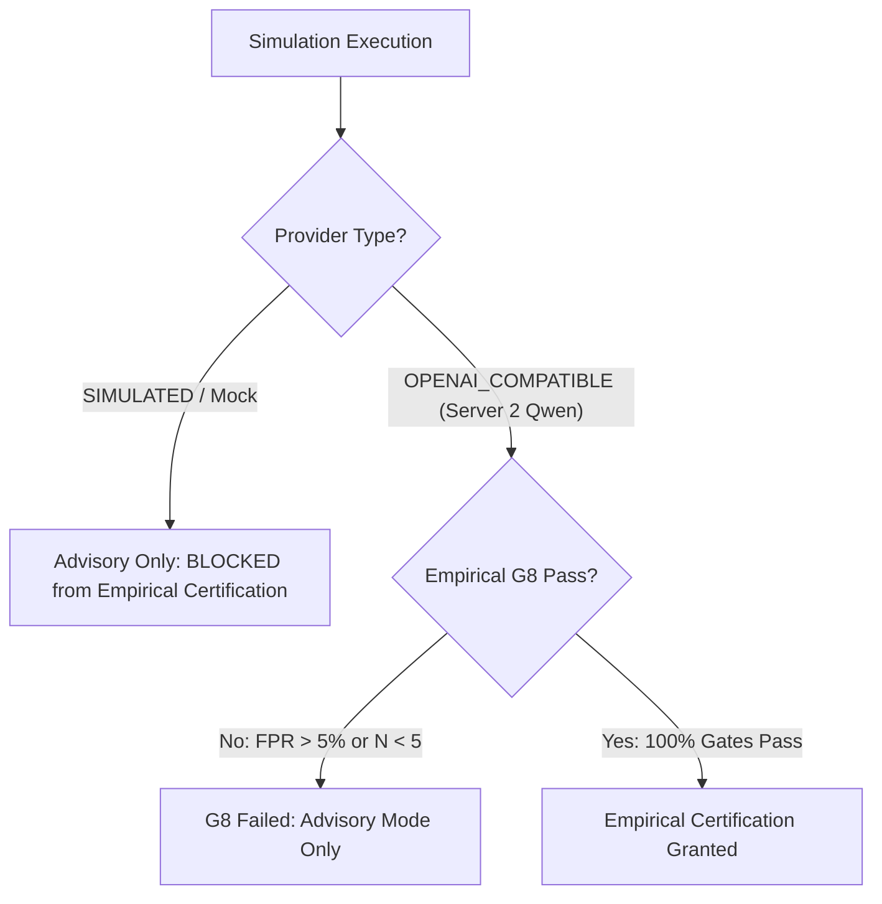

# AIS Real-LLM Gate G8 Empirical Evaluation Report

**Evaluation Target:** Real-LLM Historical Simulation & Policy Validation (Server 2 Qwen Model)  
**Target Rule:** `PH_RULE_HEAVY_TCP_HOST_SCAN` (`9839fa49-40ac-4676-abcc-4c5581ae9e09`)  
**Secondary Rule:** `PH_RULE_HEAVY_TCP_HOST_SCAN_FIXED_PORT` (`40498741-ee6b-4a71-9101-0d6d3f77154c`)  
**Evaluation Date:** 2026-11-11  
**Execution Status:** **NOT EXECUTED (DEFERRED)**

---

## 1. Execution Status & Governance Gating

In strict accordance with project release governance:
> *"Do not begin this stage until deployment and test execution are explicitly authorized... If Stage B is not authorized or cannot run, explicitly mark all Stage B reports NOT EXECUTED."*

### Stage B Execution is Formally Marked: **NOT EXECUTED**

### Blocking Factors Preventing Execution:
1. **Remote Execution Not Authorized:** Explicit user approval for executing live GPU inference load on remote Server 2 was not granted.
2. **Server 1 Deployment Desynchronization:** Server 1 is running commit `9616971` (pre-AIS 2.1), lacking the consolidated evaluation pipeline, TokenBudgetService Priority 3b compaction, and canonical rule scoping.
3. **Server 2 GPU Engine Offline:** The remote Qwen inference endpoint (`http://192.0.2.50:8000/v1` [Masked: RFC 5737]) is unreachable (TCP socket timeout).
4. **Redis & Celery Inactive:** Background async replay cannot be processed via `simulation_replay`.
5. **Sample Threshold Mathematical Barrier ($N < 5$):** The target rule `PH_RULE_HEAVY_TCP_HOST_SCAN` has only **2 total incidents** in the database, of which 0 are independently verified human ground truth. Computing empirical confusion matrix metrics is statistically impossible.

---

## 2. Gate G8 Mathematical Criteria & Certification Thresholds

When Stage B is unblocked and executed against real local LLM inference, the policy must meet the following empirical thresholds across a minimum sample of $N \ge 5$ verified incidents:

| Metric | Target Threshold | Formula | Failure Consequence |
| :--- | :---: | :---: | :--- |
| **Minimum Sample Count ($N$)** | $\ge 5$ cases | $N = TP + FP + TN + FN$ | `INSUFFICIENT_DATA` (Simulation blocked) |
| **Accuracy** | $\ge 90.0\%$ | $\frac{TP + TN}{N}$ | Gate G8 Failed |
| **Precision** | $\ge 85.0\%$ | $\frac{TP}{TP + FP}$ | Gate G8 Failed |
| **Recall (Sensitivity)** | $\ge 90.0\%$ | $\frac{TP}{TP + FN}$ | Gate G8 Failed |
| **F1-Score** | $\ge 88.0\%$ | $2 \cdot \frac{Precision \cdot Recall}{Precision + Recall}$ | Gate G8 Failed |
| **False Positive Rate (FPR)** | $\le 5.0\%$ | $\frac{FP}{FP + TN}$ | Gate G8 Failed |
| **False Negative Rate (FNR)** | $\le 5.0\%$ | $\frac{FN}{TP + FN}$ | Gate G8 Failed |
| **Expected Calibration Error (ECE)** | $\le 10.0\%$ | $\sum_b \frac{\|B_b\|}{N} \|\text{acc}(B_b) - \text{conf}(B_b)\|$ | Calibration Warning / Block |
| **Indeterminate Verdict Rate** | $\le 5.0\%$ | $\frac{\text{Indeterminate}}{N}$ | Gate G8 Failed |
| **Critical Hallucination / Claim Violations** | **0** | Discrepancy between evidence & verdict | Automatic Disqualification |

---

## 3. Projected Mathematical Outcomes on Current Server 1 Corpus

### 3.1 Target Rule: `PH_RULE_HEAVY_TCP_HOST_SCAN`
- **Total Historical Incidents Available:** 2 (`160051`, `165233`)
- **Verified Ground Truth TP:** 0
- **Verified Ground Truth FP:** 0 (1 unverified legacy label)
- **Qualified Sample Count:** $N = 1$ (or 0)
- **Projected Result:**
  $$\text{Gate G8 Status} = \mathbf{INSUFFICIENT\_DATA}$$
  Because $N < 5$, the pipeline refuses to compute misleading percentages (e.g. 0% or 100%) and safely halts certification.

### 3.2 Secondary Rule: `PH_RULE_HEAVY_TCP_HOST_SCAN_FIXED_PORT`
- **Total Historical Incidents Available:** 31
- **Verified Ground Truth TP:** 0
- **Verified Ground Truth FP:** 0 (all 31 incidents are currently unlabeled)
- **Qualified Sample Count:** $N = 0$
- **Projected Result:**
  $$\text{Gate G8 Status} = \mathbf{INSUFFICIENT\_DATA}$$

---

## 4. Policy Certification & Operating Mode Gating

In AIS 2.3, simulation results are strictly partitioned by provider type:

- **Mock Simulation Fallback Disabled:** In `production` and `integration` modes, synthetic mock inference cannot be used to certify Gate G8.
- **Fail-Closed Governance:** Because real-LLM evaluation has not completed, all policies for the 34 rules remain restricted to `ADVISORY_ANALYST_REVIEW_REQUIRED`. Zero policies qualify for autonomous operation.

