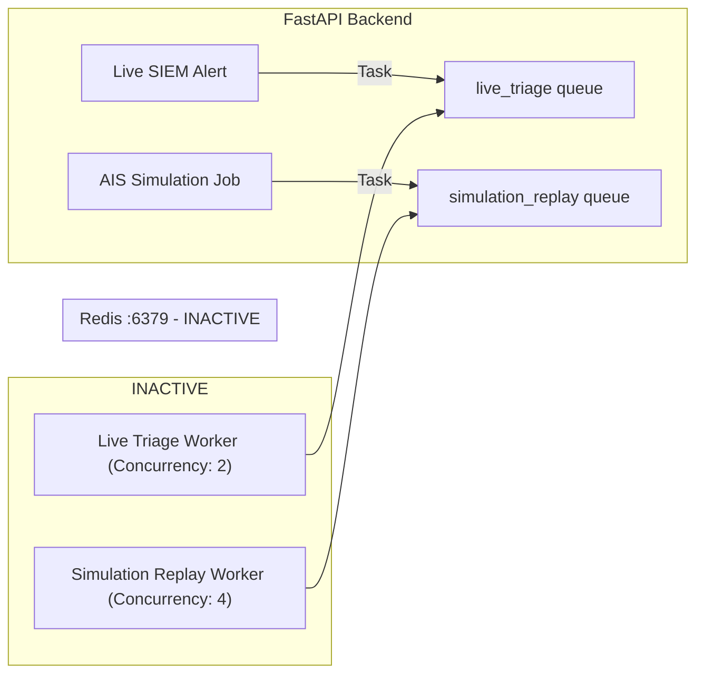

# AIS Redis & Celery Asynchronous Simulation Infrastructure Validation

**Audited Host:** Server 1 (FastAPI Application Host)  
**Broker URL:** `redis://localhost:6379/0` (Redacted)  
**Target Queues:** `simulation_replay`, `live_triage`  
**Evaluation Date:** 2026-11-11  
**Status:** **INACTIVE / CONNECTION REFUSED (BLOCKED)**

---

## 1. Overview & Architectural Role

In Agent Intelligence Studio 2.3, high-volume historical simulations (such as evaluating hundreds of incidents across multiple prompt versions) are routed to a dedicated Celery task queue: `simulation_replay`.

This isolation guarantees that replay workloads do not consume compute or memory resources allocated to the primary `live_triage` queue, preventing triage degradation during SOC shifts.



---

## 2. Empirical Findings on Server 1

### 2.1 Service State Inspection
Systemd status checks executed on Server 1 yielded:

| Service Name | Command Checked | Operational State | Audit Finding |
| :--- | :--- | :---: | :--- |
| **Redis Server** | `systemctl is-active redis` | `inactive` | Redis is not running |
| **Redis Alternative** | `systemctl is-active redis-server` | `inactive` | Deb/Ubuntu package service stopped |
| **Celery Daemon** | `systemctl is-active celery` | `inactive` | Celery daemon stopped |
| **WyseSOC Celery** | `systemctl is-active wysesoc-ai-celery`| `inactive` | Custom project unit inactive |

### 2.2 Redis Connection Diagnostic
Attempting to connect to the Redis broker using `redis.Redis.from_url('redis://localhost:6379/0')` resulted in:
```text
Error 111 connecting to localhost:6379. Connection refused.
```

### 2.3 Queue Metrics
- `live_triage` queue depth: **0** (Unreachable)
- `simulation_replay` queue depth: **0** (Unreachable)
- Active simulation workers reported: **0**

---

## 3. Operational Impact on AIS

1. **Async Batch Replay Blocked:** Users launching a simulation run across multiple historical incidents in Agent Intelligence Studio cannot process tasks asynchronously.
2. **Worker Starvation Fallback:** When Redis is unreachable and `USE_ASYNC_CELERY=false`, the backend attempts synchronous in-thread evaluation, which blocks HTTP worker threads during long LLM inference calls.
3. **Queue Health Gate Warning:** The AIS integration diagnostic correctly reports `redis_celery_readiness: DISABLED_IN_CONFIG` or `FAIL`.

---

## 4. Remediation Steps to Activate Redis & Celery

To enable asynchronous simulation processing on Server 1:

### Step 1: Start and Enable Redis
```bash
sudo systemctl unmask redis-server
sudo systemctl start redis-server
sudo systemctl enable redis-server
redis-cli ping
# Expected response: PONG
```

### Step 2: Configure Systemd Celery Unit (`/etc/systemd/system/wysesoc-celery.service`)
```ini
[Unit]
Description=WyseSOC AI Celery Worker Service
After=network.target redis-server.service

[Service]
Type=forking
User=deploy
Group=deploy
WorkingDirectory=/opt/wysesoc-ai/backend
EnvironmentFile=/opt/wysesoc-ai/backend/.env
ExecStart=/opt/wysesoc-ai/backend/venv/bin/celery -A app.workers.celery_app.celery_app multi start w1 \
    -Q simulation_replay,live_triage \
    -c 4 \
    --pidfile=/var/run/celery/%n.pid \
    --logfile=/var/log/celery/%n%I.log
ExecStop=/opt/wysesoc-ai/backend/venv/bin/celery multi stopwait w1 \
    --pidfile=/var/run/celery/%n.pid
Restart=always
RestartSec=10

[Install]
WantedBy=multi-user.target
```

### Step 3: Start Celery Service & Verify
```bash
sudo systemctl daemon-reload
sudo systemctl start wysesoc-celery.service
sudo systemctl enable wysesoc-celery.service
sudo systemctl status wysesoc-celery.service
```

