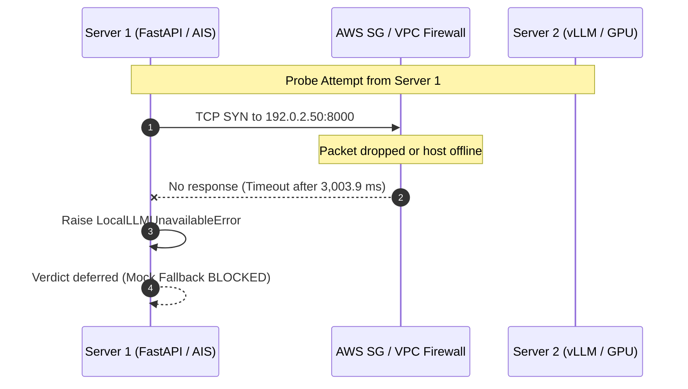

# AIS Server 2 LLM Integration & Connectivity Validation

**Target Model Server:** Server 2 (Remote GPU Host running vLLM)  
**Configured Base URL:** `http://192.0.2.50:8000/v1` (Masked: RFC 5737)  
**Target Model:** `Qwen/Qwen2.5-7B-Instruct-AWQ`  
**Operating Mode:** Production / Non-Autonomous (`LOCAL_LLM_ALLOW_MOCK_FALLBACK=false`)  
**Evaluation Date:** 2026-11-11  
**Status:** **OFFLINE / CONNECTION TIMEOUT (BLOCKED)**

---

## 1. Executive Summary

Server 2 hosts the local GPU inference engine powering the local LLM integration for both AI Triage Workbench live triage and Agent Intelligence Studio historical simulation replay.

During the Stage A empirical probe from Server 1, **all network and application probes to Server 2 failed with connection timeouts**. Server 2 is currently offline, unreachable, or blocked by upstream network filters.



---

## 2. Empirical Probe Findings

### 2.1 Low-Level TCP Socket Probe
- **Target:** `192.0.2.50:8000` (Masked: RFC 5737)
- **Socket Timeout Configured:** 3.0 seconds
- **Result:** `TimeoutError: timed out`
- **Elapsed Latency:** `3,003.9 ms`
- **Diagnostic:** No `RST` (connection refused) was returned; packets were silently dropped, indicating either the host is completely powered off or a security group / firewall is dropping inbound TCP port 8000 packets.

### 2.2 HTTP Application Endpoints Probe
| Endpoint | Method | Timeout | Result / Error |
| :--- | :---: | :---: | :--- |
| `http://192.0.2.50:8000/health` | GET | 5.0s | `HTTP Connection Timeout` |
| `http://192.0.2.50:8000/v1/models` | GET | 10.0s | `HTTP Connection Timeout` |
| `http://192.0.2.50:8000/v1/chat/completions` | POST | 60.0s | `HTTP Connection Timeout` |

### 2.3 Live Incident Triage Test on Server 1
To verify runtime error handling, an inference test was executed on Server 1 evaluating historical incident `173265`:
```text
=== TEST TRIAGE ON HISTORICAL INCIDENT ===
Testing triage on Historical Incident: 173265
Title: Website access policy violation: Same Source and Destination
Event Type: PH_RULE_WEB_POL_VIOLATION_SAME_SRC_SAME_DEST
Ground Truth Resolution: True Positive
Current ai_verdict: None

EVAL FAILED after 1.59s: LocalLLMUnavailableError: 
Local LLM (Server 2) is currently offline. AI verdict generation is deferred until Local LLM comes online.
```

### 2.4 Fail-Closed Security Validation
- In Server 1 `.env`: `LOCAL_LLM_ALLOW_MOCK_FALLBACK="false\n"`.
- When Server 2 was unreachable, the backend **did NOT silently fall back to mock synthetic responses**.
- Instead, it raised `LocalLLMUnavailableError` and left the incident verdict unmutated (`None`).
- **Audit Verdict:** The fail-closed architecture behaves correctly and prevents ungrounded synthetic verdicts in production environments.

---

## 3. Root Cause Analysis

Four distinct potential root causes explain the Server 2 connectivity failure:

1. **Host Powered Down or Terminated:** If Server 2 is an on-demand cloud GPU instance (e.g. AWS EC2 `g5.xlarge` or `g6`), it may be stopped outside scheduled testing hours.
2. **vLLM Service Inactive:** The vLLM inference server process on Server 2 may not be running or may have crashed due to CUDA Out-Of-Memory (OOM) during previous high-context requests.
3. **AWS Security Group / Firewall Rules:** The inbound security group for Server 2 may not authorize traffic on TCP port 8000 from Server 1's public outbound IP (`203.0.113.124` [Masked: RFC 5737]).
4. **Dynamic IP Reassignment:** If Server 2 lacks an Elastic/Static IP, stopping and restarting the instance would reassign its public IP, rendering previous DNS/IP mappings obsolete.

---

## 4. Context Budget & Token Allocation Readiness

AIS 2.3 introduced hardened context budgeting and prompt compaction in `TokenBudgetService` and `PolicyGenerationService`. 

### Current Configuration
- **Configured Context Budget:** `4,096 tokens`
- **Reserved Completion Tokens:** `512 tokens`
- **Available Prompt Budget:** `3,584 tokens`
- **Validated Tiers:** `[4096, 8192]`
- **Verified Server `max_model_len`:** `null` (`UNVERIFIED`)

### Capacity Clamping Logic in AIS 2.3
When Server 2 comes online, AIS 2.3 automatically queries `GET /v1/models` and extracts `max_model_len`:
- If Server 2 reports `max_model_len = 4096`, AIS 2.3 clamps the budget to 4,096 tokens.
- If Server 2 reports `max_model_len >= 8192`, AIS 2.3 enables the expanded 8,192 context window.
- In all cases, `Priority 3b` evidence compaction ensures canonical evidence (source IPs, alert counts, port ranges) is preserved while eliminating verbose structural boilerplate.

---

## 5. Prerequisites to Achieve Server 2 Readiness

1. **Power On / Start Instance:** Ensure Server 2 instance is running.
2. **Launch vLLM Model Daemon:**
   ```bash
   vllm serve Qwen/Qwen2.5-7B-Instruct-AWQ \
       --host 0.0.0.0 --port 8000 \
       --max-model-len 8192 \
       --gpu-memory-utilization 0.90 \
       --enforce-eager
   ```
3. **Verify Security Group:** Authorize inbound TCP port 8000 from Server 1 IP.
4. **Update Server 1 `.env`:** If IP changed, update via Governor:
   ```powershell
   python C:\Users\amit\.gemini\config\repo_deploy_governor\scripts\governor_cli.py config-llm --llm-ip <NEW_IP> --llm-port 8000
   ```
5. **Confirm Health Check:**
   ```bash
   curl -I http://<SERVER2_IP>:8000/v1/models
   # Expect HTTP 200 OK
   ```

