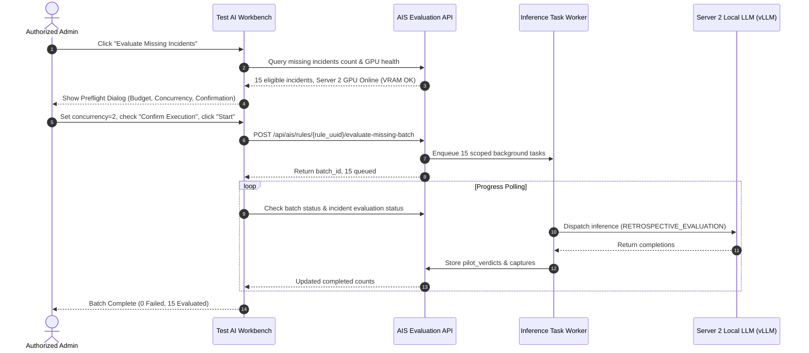

# Phase 5: Test AI & Controlled Batch Inference Workflow

## 1. Test AI Preflight Status Checks
The **Test AI** workbench (`frontend/src/components/compact/AiTestWorkbench.tsx`) was upgraded with dynamic preflight checks:

1. **Pre-Evaluation Check:**
   When an incident is selected, the workbench immediately queries `GET /api/ais/incidents/{incident_id}/evaluation-history`.
2. **Context-Aware Action Buttons:**
   - If **Evaluated — Decisive**: Prominently shows "Incident already evaluated under v7. Stored verdict: FALSE_POSITIVE (Confidence: 94.0%)". Primary action: "View History". Secondary: "Rerun AI Test (Admin Override)".
   - If **Abstained**: Shows "Incident abstained (Effective verdict: REQUIRES_ATTENTION)". Action: "Rerun Test".
   - If **Validation Rejected**: Shows "Validation rejected on previous run: Evidence grounding failed". Action: "Retry AI Test".
   - If **Not Evaluated**: Primary action: "Run Real AI Test".

---

## 2. Controlled Batch Inference Workflow

To eliminate manual one-by-one testing while strictly preventing unmonitored GPU execution, an administrative **Controlled Batch Inference** modal was implemented.

### Safety Controls in Batch Workflow:
- **No Accidental Execution:** Requires explicit confirmation checkbox.
- **Strict Concurrency Limit:** Configurable concurrency (1 to 4) prevents GPU out-of-memory or high latency on Server 2.
- **Provenance Tagging:** Stored executions are marked with `execution_type = 'RETROSPECTIVE_EVALUATION'`.
- **Graceful Cancellation:** Cancellation stops subsequent queued items without corrupting completed ones.
