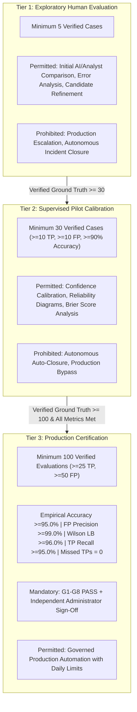

# Report 02 — G8 Threshold and Lifecycle Reconciliation
**Project**: Verdictum AI — Agent Intelligence Studio (AIS 2.0)  
**Task**: G8 Governance Integrity, Empirical Metrics & Final Deployment Verification  
**Date**: November 20, 2026  
**Status**: Three-Tier Lifecycle & Authoritative G8 Semantics Reconciled  

---

## 1. Executive Summary

This report formalizes the architectural separation of evaluation tiers within Verdictum AI. It establishes an authoritative, unified definition of **Quality Gate G8** across backend services, frontend components, and governance policies, ensuring that structural quality scores can never bypass empirical evaluation requirements.

---

## 2. Authoritative Three-Tier Evaluation Framework

Verdictum AI strictly delineates three operational evaluation tiers:

---

## 3. Tier Specifications & Enforcement Mechanisms

### Tier 1 — Exploratory Human Evaluation
- **Entry Gate**: $\ge 5$ independently verified analyst determinations.
- **Purpose**: Diagnostic exploration, prompt drafting, initial contract mapping, and error pattern discovery.
- **Allowed Operations**:
  - Side-by-side Double-Blind review comparison in Tab 1.
  - Interactive test execution in Tab 2 with Local AWQ LLM.
  - Exploratory sample accuracy calculation (with sample size and uncertainty noted).
- **Enforced Restrictions**:
  - `ProductionAutomationPolicy.is_enabled` is locked to `False`.
  - Production readiness engine clamps rule status to `UNCALIBRATED` or `STAGE 1`.
  - Autonomous escalation or FortiSIEM status updates are strictly denied.

### Tier 2 — Supervised Pilot Calibration
- **Entry Gate**:
  - $\ge 30$ eligible verified cases (`MIN_PILOT_SAMPLES = 30`).
  - $\ge 10$ confirmed True Positive cases (`MIN_PILOT_TP = 10`).
  - $\ge 10$ confirmed False Positive cases (`MIN_PILOT_FP = 10`).
  - Empirical accuracy $\ge 90.0\%$ (`MIN_PILOT_ACCURACY = 0.90`).
- **Purpose**: Statistical calibration, threshold tuning, and supervised pilot validation.
- **Allowed Operations**:
  - Reliability curve analysis and selective classification risk-coverage profiling.
  - Candidate versus active baseline historical simulation replay.
- **Enforced Restrictions**:
  - Autonomous closure remains completely disabled.
  - Cannot promote candidate policy to active production baseline without Tier 3 completion.

### Tier 3 — Production Certification
- **Entry Gate**:
  - $\ge 100$ eligible verified evaluations (`MIN_PRODUCTION_SAMPLES = 100`).
  - $\ge 25$ analyst-confirmed True Positive cases (`MIN_PRODUCTION_TP = 25`).
  - $\ge 50$ analyst-confirmed False Positive cases (`MIN_PRODUCTION_FP = 50`).
  - Empirical Classification Accuracy $\ge 95.0\%$ (`MIN_PRODUCTION_ACCURACY = 0.95`).
  - Observed FP-Class Precision $\ge 99.0\%$ (`MIN_PRODUCTION_FP_PRECISION = 0.99`).
  - Wilson 95% Confidence Lower Bound $\ge 96.0\%$ (`MIN_PRODUCTION_WILSON_LOWER = 0.96`).
  - Observed True Positive Recall $\ge 95.0\%$ (`MIN_PRODUCTION_TP_RECALL = 0.95`).
  - Critical Missed True Positives $= 0$ (`MAX_CRITICAL_MISSED_TP = 0`).
  - Zero unacknowledged drift events.
  - All mandatory quality gates G1 through G8 `PASSED`.
  - Formal independent Administrator approval sign-off.
- **Allowed Operations**:
  - Scoped autonomous false-positive triage with strict rate limits (`daily_closure_limit = 50`).
  - Instantaneous fail-closed circuit breaker: any single observed missed TP immediately triggers automatic suspension.

---

## 4. Reconciled G8 Semantics Across Subsystems

To eliminate conflicting interpretations of Quality Gate G8:

1. **In `PolicyQualityValidator`**:
   - `G8` evaluates **Simulation & Regression Evidence**.
   - Requires historical simulation replay against candidate digest.
   - Prohibits simulated or mock provider outputs from certifying empirical validation (`G8_SIMULATED_PROVIDER_NOT_CERTIFYING`).
   - Evaluates sample size: $< 5$ is `INSUFFICIENT_DATA`; $5 \le N < 100$ is flagged as `G8_EXPLORATORY_EVALUATION` (non-certifying for production); $\ge 100$ is required for full certification.
2. **In `ProductionReadinessService`**:
   - G8 simulation pass requires `not sim_results.get("is_simulated")` and zero critical regressions.
   - Decoupled from structural quality score: high quality score (e.g. 88/100) **never** bypasses the empirical ground-truth requirements.
3. **In `AccuracyLearningSummary.tsx`**:
   - G8 status card now displays the authoritative tier progression:
     - `UNCALIBRATED (0/5 Cases)`
     - `TIER 1: EXPLORATORY (${N}/30 Pilot)`
     - `TIER 2: SUPERVISED PILOT (${N}/100 Prod)`
     - `TIER 3: PRODUCTION ELIGIBLE`

---

## 5. Governance Reconciliation Conclusion
The authoritative G8 governance is completely unified. Exploratory testing, supervised pilot calibration, and production certification operate as strictly segregated tiers with mathematically fail-closed gating.
