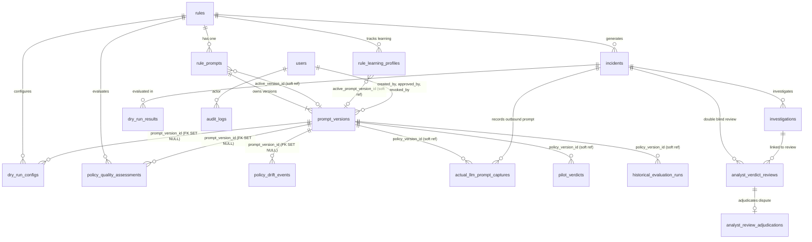

# 02 — PostgreSQL Policy Version Schema & Relationship Map
**Verdictum AI — Agent Intelligence Studio 2.0**
**Audit Date:** November 19, 2026
**Target Database:** PostgreSQL 16 (`ai_verdict` database on Server 1 / SQLite development replica)

---

## 1. Authoritative Table & Entity Relationship Map

The following map defines all tables, columns, foreign keys, and soft reference dependencies that intersect with policy versioning, inference provenance, and learning:

---

## 2. Table-by-Table Schema Specification

### 2.1 `rule_prompts`
- **Table Name**: `rule_prompts`
- **Model**: `RulePrompt` (`backend/app/models/prompt.py`)
- **Primary Key**: `id VARCHAR(36)` (UUID)
- **Columns**:
  - `rule_id VARCHAR(36)`: Foreign key `rules.id` (`ON DELETE CASCADE`), unique, indexed.
  - `title VARCHAR(256)`: Display title.
  - `active_version_id VARCHAR(36)`: String UUID referencing the active `prompt_versions.id`. Nullable.
  - `ai_execution_suspended BOOLEAN`: Emergency kill-switch flag (`default=False`).
  - `suspension_reason VARCHAR(256)`: Reason when suspended.
  - `created_at DATETIME`, `updated_at DATETIME`.

### 2.2 `prompt_versions`
- **Table Name**: `prompt_versions`
- **Model**: `PromptVersion` (`backend/app/models/prompt.py`)
- **Primary Key**: `id VARCHAR(36)` (UUID)
- **Columns**:
  - `prompt_id VARCHAR(36)`: Foreign key `rule_prompts.id` (`ON DELETE CASCADE`), indexed.
  - `version_number INTEGER`: 1-based sequential version number.
  - `status VARCHAR(32)`: Lifecycle status (`DRAFT`, `APPROVED`, `ARCHIVED`).
  - `is_template_draft BOOLEAN`: Template draft indicator.
  - `quality_status VARCHAR(32)`: Assessment status (`GENERATED_DRAFT`, `PASSED_QUALITY_GATES`, `BLOCKED`, etc.).
  - `quality_score FLOAT`: Aggregate quality score (0.0 to 100.0).
  - `quality_assessment_id VARCHAR(64)`: Foreign key / ID of latest assessment.
  - Prompt Component Texts: `common_prompt`, `rule_specific_prompt`, `detection_conditions`, `required_evidence`, `tp_indicators`, `fp_indicators`, `missing_info_criteria`, `escalation_conditions`, `analyst_questions` (`JSON`).
  - `change_summary VARCHAR(512)`: Notes on changes.
  - User and Audit Metadata:
    - `created_by_user_id VARCHAR(36)`: FK `users.id` (`ON DELETE SET NULL`).
    - `approved_by_user_id VARCHAR(36)`: FK `users.id` (`ON DELETE SET NULL`).
    - `approved_at DATETIME`: Timestamp of formal approval.
    - `revoked_by_user_id VARCHAR(36)`: FK `users.id` (`ON DELETE SET NULL`).
    - `revoked_at DATETIME`: Timestamp of revocation.
    - `revocation_reason TEXT`: Reason for revocation.
    - `previous_status VARCHAR(32)`: Status prior to archival or revocation.
    - `archived_by_user_id VARCHAR(36)`: FK `users.id` (`ON DELETE SET NULL`) (added in migration 014).
    - `archived_at DATETIME`: Timestamp of archival (added in migration 014).
    - `archival_reason TEXT`: Administrator justification for archiving (added in migration 014).
    - `created_at DATETIME`.

### 2.3 Foreign Key Cascading vs. Soft String References

| Referencing Table | Referencing Column | Target Column | Link Type | Deletion Impact & Invariant |
| :--- | :--- | :--- | :--- | :--- |
| `rule_prompts` | `active_version_id` | `prompt_versions.id` | Soft String UUID | **Active Policy Binding**. If deleted, causes runtime lookup failure. **DELETION STRICTLY PROHIBITED.** |
| `rule_learning_profiles` | `active_prompt_version_id` | `prompt_versions.id` | Soft String UUID | **Learning State Binding**. If deleted, breaks evaluation calibration. **DELETION STRICTLY PROHIBITED.** |
| `actual_llm_prompt_captures` | `policy_version_id` | `prompt_versions.id` | Soft String UUID | **Inference Provenance**. Contains exact outbound prompt sent to GPU server. **DELETION STRICTLY PROHIBITED.** |
| `pilot_verdicts` | `policy_version_id` | `prompt_versions.id` | Soft String UUID | **Pilot Audit Record**. If deleted, creates orphaned verdict telemetry. **DELETION STRICTLY PROHIBITED.** |
| `historical_evaluation_runs`| `policy_version_id` | `prompt_versions.id` | Soft String UUID | **G8 Benchmark Record**. If deleted, invalidates benchmark certification. **DELETION STRICTLY PROHIBITED.** |
| `dry_run_configs` | `prompt_version_id` | `prompt_versions.id` | FK `SET NULL` | **Simulation Config**. Deleting nullifies config binding. |
| `policy_quality_assessments`| `prompt_version_id` | `prompt_versions.id` | FK `SET NULL` | **Quality Evaluation**. Assessment records for drafts can be safely purged if the draft is deleted. |
| `policy_drift_events` | `prompt_version_id` | `prompt_versions.id` | FK `SET NULL` | **Drift Audit Log**. Deleting nullifies version link. |

---

## 3. Safe Deletion Invariants & Eligibility Matrix

| Version Status | Is Active? | Referenced by Inference / Benchmark? | Eligible for Archive? | Eligible for Permanent Delete? | Required Operation & Constraints |
| :--- | :--- | :--- | :--- | :--- | :--- |
| **APPROVED** | **YES** | Any | **NO** | **NO** | Active policy binding must be preserved. Permanent deletion prohibited; archive prohibited. |
| **APPROVED** | **NO** | Yes | **YES** | **NO** | Historical approved baseline. Immutable execution history. Reversible archival allowed; physical deletion prohibited. |
| **APPROVED** | **NO** | No | **YES** | **NO** | Approved historical version. Preserve approval audit trail. Reversible archival allowed; physical deletion prohibited. |
| **DRAFT** | **YES** | Any | **NO** | **NO** | Cannot delete while bound as active candidate under evaluation. |
| **DRAFT** | **NO** | **YES** (Inference captures, pilot verdicts, eval runs) | **YES** | **NO** | Protected by execution provenance. Archival permitted; permanent deletion blocked with dependency explanation. |
| **DRAFT** | **NO** | **NO** (Unreferenced) | **YES** | **YES** | **Eligible for Permanent Deletion**. Requires admin confirmation, server-side dependency check, typed confirmation, and audit log. |
| **ARCHIVED** | **NO** | Yes | N/A (Already Archived) | **NO** | Protected by historical references. Eligible for Restore. |
| **ARCHIVED** | **NO** | No | N/A (Already Archived) | **YES** | Eligible for Restore or Permanent Delete after confirmation. |
