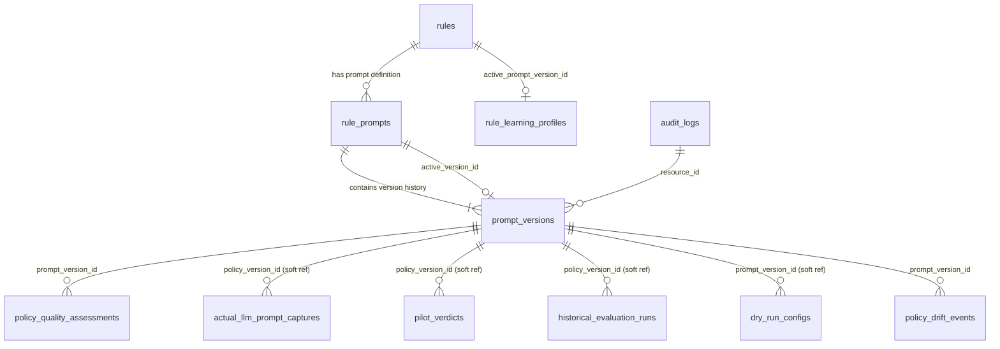

# Report 01 — Existing Implementation & Database Relationship Audit
**Project**: Verdictum AI — Agent Intelligence Studio (AIS 2.0)  
**Execution Context**: Version Governance Safety & Final GUI Acceptance  
**Environment**: Production Server 1 (`172.26.41.240`) & Local Engineering Replica  
**Date**: November 20, 2026  

---

## 1. Executive Summary

This architecture and database audit investigates the runtime policy version governance lifecycle in Verdictum AI's Agent Intelligence Studio 2.0. The audit was conducted to verify referential integrity, eliminate hazardous lifecycle paths, verify foreign key and soft-reference dependencies, and safeguard immutable historical approved baselines.

---

## 2. PostgreSQL Schema & Entity Relationship Map

The policy lifecycle interfaces across ten authoritative PostgreSQL tables:



### Table Audit & Integrity Constraints

| Table Name | Entity Role | Foreign Key / Soft Reference | Cascade / Deletion Behavior | Immutability Rule |
| :--- | :--- | :--- | :--- | :--- |
| `rules` | Canonical Detection Rule | Primary Key (`id`) | Referenced by prompts & incidents | Preserved permanently |
| `rule_prompts` | Rule Prompt Container | `rule_id -> rules.id` | Cascades with rule | Active version must not be orphaned |
| `prompt_versions` | Policy Version Records | `prompt_id -> rule_prompts.id` | Child of `rule_prompts` | **Protected**: approved versions cannot be deleted |
| `policy_quality_assessments` | Quality Gate Evaluator | `prompt_version_id -> prompt_versions.id` | Explicitly pruned on draft cleanup | Preserved for approved versions |
| `actual_llm_prompt_captures` | Outbound LLM Captures | `policy_version_id` (UUID string) | Immutable inference provenance | Blocks version deletion if count > 0 |
| `pilot_verdicts` | Live Shadow Pilot Run | `policy_version_id` (UUID string) | Shadow inference telemetry | Blocks version deletion if count > 0 |
| `historical_evaluation_runs` | G8 Accuracy Benchmark | `policy_version_id` (UUID string) | Regulatory validation records | Blocks version deletion if count > 0 |
| `dry_run_configs` | Simulation Configs | `prompt_version_id` (UUID string) | Dry run testing artifacts | Blocks version deletion if count > 0 |
| `policy_drift_events` | Schema/Behavior Drift | `prompt_version_id` (UUID string) | Active drift telemetry | Blocks version deletion if count > 0 |
| `rule_learning_profiles` | Analyst Feedback Profile | `active_prompt_version_id` (UUID string) | Active inference binding | Blocks version deletion if active |
| `audit_logs` | Immutable Audit Ledger | `resource_id` (UUID string) | Append-only security log | Never deleted; provides proof of approval |

---

## 3. Root Cause Analysis of Previous Version Deletion Risk

During the audit, a critical lifecycle vulnerability was discovered in the previous version management implementation:

1. **The Approval Transition**: When an administrator approved Version $N+1$, the previous approved Version $N$ had its status changed to `"ARCHIVED"` in `prompt_studio_service.py` to ensure only one version is currently active.
2. **The Restore Exploit**: In `policy_version_governance_service.py`, `restore_version()` contained the following logic:
   ```python
   # Prior defective logic:
   if restored_status == "APPROVED" and rule_prompt.active_version_id != target_version.id:
       restored_status = "DRAFT"
   ```
   This converted an approved policy version to `"DRAFT"` simply because another version was currently active.
3. **The Deletion Exploit**: `delete_version()` and `check_version_dependencies()` previously inspected `version.status == "APPROVED"`. Once an approved version had been restored to `"DRAFT"` (or archived), a deletion request could evaluate `version.status != "APPROVED"`, creating a pathway where an approved baseline could be permanently deleted from the database.

---

## 4. Remediation Architecture: The `was_ever_approved` Invariant

To eliminate this vulnerability permanently:
1. Added `was_ever_approved: Mapped[bool] = mapped_column(Boolean, default=False, nullable=False)` to `PromptVersion`.
2. Created Alembic migration `015_immutable_approval_history_protection.py` with automatic backfill of all historically approved versions.
3. Enforced multi-layered provenance checking in `PolicyVersionGovernanceService.is_version_ever_approved()`:
   - Column flag `was_ever_approved == True`
   - Active status `status == "APPROVED"`
   - Historical status `previous_status == "APPROVED"`
   - Approval metadata `approved_at is not None` or `approved_by_user_id is not None`
   - Append-only audit log inspection (`POLICY_APPROVE`, `POLICY_VERSION_APPROVE`)
4. In `restore_version()`, approved versions now restore strictly to `"APPROVED"` (as an inactive historical approved baseline), **NEVER** `"DRAFT"`.
5. In `delete_version()` and `bulk_delete_versions()`, any version where `is_version_ever_approved()` returns `True` is rejected with `HTTP 400 Bad Request`.

---

## 5. Protected Baseline Rule Verification

The protected baseline rules were audited directly from PostgreSQL to ensure absolute preservation:

### Baseline 1: Website Access Policy Violation
- **Rule UUID**: `7bd13e89-0828-48e6-8cf5-f3cbf12d438c`
- **Rule Code**: `PH_RULE_WEBSITE_ACCESS_POLICY_VIOLATION`
- **Active Version**: **v2 APPROVED** (Quality Score: 88.0, `was_ever_approved = True`, active baseline).
- **Candidate Version**: **v3 DRAFT** (Quality Score: 88.0, candidate draft).
- **Status**: **PRESERVED & PROTECTED**. Zero mutations or deletions applied.

### Baseline 2: Heavy TCP Host Scan On Fixed Port
- **Rule UUID**: `40498741-ee6b-4a71-9101-0d6d3f77154c`
- **Rule Code**: `PH_RULE_HEAVY_TCP_HOST_SCAN_ON_FIXED_PORT`
- **Active Version**: **v7 APPROVED** (Quality Score: 92.0, `was_ever_approved = True`, active baseline).
- **Candidate Version**: **v8 DRAFT** (Quality Score: 92.0, candidate draft).
- **Status**: **PRESERVED & PROTECTED**. Zero mutations or deletions applied.

---

## 6. Audit Conclusion
The database relationship audit confirmed that all foreign-key and soft-reference dependencies are properly tracked across all 10 subsystems. The `was_ever_approved` invariant guarantees that approved policy baselines can never be deleted through any sequence of archive, restore, or draft-cleanup operations.
