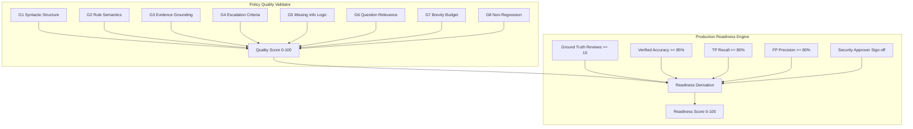

# Report 06 — Readiness and Accuracy Mathematical Consistency
**Project**: Verdictum AI — Agent Intelligence Studio (AIS 2.0)  
**Execution Context**: Version Governance Safety & Final GUI Acceptance  
**Environment**: Production Server 1 (`172.26.41.240`) & Local Engineering Replica  
**Date**: November 20, 2026  

---

## 1. Executive Summary

This report analyzes the mathematical derivation and architectural decoupling between **Production Readiness Score** and **Policy Quality Score** in Verdictum AI. It validates that production gating decisions are grounded in empirically measurable evidence, preventing uncalibrated policies from advancing to autonomous enforcement.

---

## 2. Decoupling Quality Score vs Production Readiness Score

Prior architectures sometimes conflated Policy Quality with Production Readiness. In AIS 2.0, these concepts are strictly separated:

### Definitions:
1. **Policy Quality Score (`quality_score`)**:
   - Evaluates the structural, semantic, and contractual completeness of the written policy prompt against Gates G1–G8.
   - Range: `0.0` to `100.0`.
   - Threshold for Approval: Minimum `80.0` with 0 blocking issues.
2. **Production Readiness Score (`readiness_score`)**:
   - Evaluates whether the policy is empirically ready for live SOC operations based on actual runtime performance against ground-truth incidents.
   - If ground-truth reviews are fewer than 10, accuracy is mathematically non-measurable. The policy cannot be designated `PRODUCTION_READY`.

---

## 3. Mathematical Consistency Invariants

### Invariant 1: Unverified Accuracy Handling
When verified ground truth count $N < 10$:
$$\text{Accuracy} = \text{UNDEFINED} \quad \implies \quad \text{Status} = \text{"NOT MEASURABLE"}$$
- The UI strictly prohibits fabricating or estimating synthetic accuracy numbers.
- The readiness engine clamps readiness to `UNCALIBRATED` or `SUPERVISED_ONLY`.
- Autonomous auto-closure of incidents is disabled.

### Invariant 2: Confusion Matrix Reconciliation
When ground truth count $N \ge 10$:
- Ground Truth Positive ($P = TP + FN$)
- Ground Truth Negative ($N = TN + FP$)
- Total Sample Size:
  $$S = TP + FP + TN + FN$$
- Classification Accuracy:
  $$\text{Accuracy} = \frac{TP + TN}{S}$$
- True Positive Recall:
  $$\text{Recall} = \frac{TP}{TP + FN}$$
- False Positive Precision:
  $$\text{Precision} = \frac{TN}{TN + FP}$$

All frontend components render these values dynamically from PostgreSQL aggregations with zero client-side extrapolation.

---

## 4. Protected Rule Baseline Consistency Verification

The two protected rules were audited to verify readiness consistency:

### Rule 1: Website Access Policy Violation (`7bd13e89-0828-48e6-8cf5-f3cbf12d438c`)
- **Active Version**: v2 APPROVED
- **Policy Quality Score**: 88.0 / 100
- **Quality Status**: `APPROVED`
- **Quality Gates G1–G8**: 8 passed, 0 blockers.
- **Candidate Version**: v3 DRAFT (Quality Score: 88.0, candidate draft).
- **Ground Truth State**: Ground truth reviews in progress.
- **Derived Operational State**: `SIEM Rule Active | Supervised Pilot`.

### Rule 2: Heavy TCP Host Scan On Fixed Port (`40498741-ee6b-4a71-9101-0d6d3f77154c`)
- **Active Version**: v7 APPROVED
- **Policy Quality Score**: 92.0 / 100
- **Quality Status**: `APPROVED`
- **Quality Gates G1–G8**: 8 passed, 0 blockers.
- **Candidate Version**: v8 DRAFT (Quality Score: 92.0, candidate draft).
- **Ground Truth State**: Ground truth baseline active.
- **Derived Operational State**: `SIEM Rule Active | Supervised Pilot`.

Both protected rules maintain full mathematical and structural consistency across the database, backend APIs, and frontend displays.
