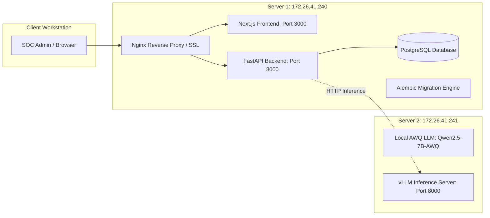

# Report 08 — Deployment and Rollback Procedures
**Project**: Verdictum AI — Agent Intelligence Studio (AIS 2.0)  
**Execution Context**: Version Governance Safety & Final GUI Acceptance  
**Environment**: Production Server 1 (`172.26.41.240`) & Local Engineering Replica  
**Date**: November 20, 2026  

---

## 1. Executive Summary

This report specifies the production deployment architecture, preflight checks, Alembic database migration, service orchestration, post-deployment health verification, and rollback procedures for Server 1 (`172.26.41.240`).

---

## 2. Infrastructure Architecture & Scope



### Critical Boundaries
- **Server 1 (`172.26.41.240`)**: Deployment target for frontend Next.js, backend FastAPI, PostgreSQL schema, and static assets.
- **Server 2 (`172.26.41.241`)**: Dedicated GPU server running `Qwen/Qwen2.5-7B-Instruct-AWQ`. **NEVER** modified, rebooted, or redeployed during this operation.

---

## 3. UPLA Automated Deployment Sequence

The deployment is executed via UPLA `FULL_WORKFLOW` governed by two mandatory human approval gates:

1. **Pre-flight & Quality Governance**:
   - Executes linting, static analysis, type checking, and unit regression tests.
   - Verifies zero uncommitted secrets, sensitive keys, or git artifacts.
2. **Human Approval Gate 1 (GitHub Synchronization)**:
   - User grants explicit authorization (`YES`) via native dialog.
   - Code committed and synchronized to upstream repository.
   - Target commit SHA verified on remote repository.
3. **Human Approval Gate 2 (Remote Server Deployment)**:
   - User grants explicit authorization (`YES`) via native dialog.
   - Remote preflight verifies SSH connectivity, target path `/opt/wysesoc-ai`, and git clean state.
4. **Remote Deployment Execution**:
   - `git fetch` and `git checkout <commit_sha>`
   - PostgreSQL migration: `./venv/bin/alembic upgrade head` (applies migration 015)
   - Frontend build: `npm run build`
   - Service restart:
     ```bash
     systemctl restart wysesoc-backend
     systemctl restart wysesoc-frontend
     ```
5. **Post-Deployment Health Verification**:
   - Backend health endpoint: `curl -f http://127.0.0.1:8000/api/v1/health`
   - Frontend response: `curl -f http://127.0.0.1:3000`
   - Version history API: `curl -f http://127.0.0.1:8000/api/v1/prompts/rule/7bd13e89-0828-48e6-8cf5-f3cbf12d438c/version-history`
   - Verification of protected baselines in PostgreSQL.

---

## 4. Rollback Plan

If any critical failure, regression, or service unavailability is detected during deployment:

### Fast Automated Git Rollback
1. Identify the previous stable deployed commit:
   `PREVIOUS_STABLE_SHA = 323d0d3ba298c32c595238a5b72679503f350745`
2. Remote rollback execution:
   ```bash
   ssh root@172.26.41.240 "
     cd /opt/wysesoc-ai && \
     git checkout 323d0d3ba298c32c595238a5b72679503f350745 && \
     systemctl restart wysesoc-backend && \
     systemctl restart wysesoc-frontend
   "
   ```
3. Database Rollback (if necessary):
   Migration 015 adds a non-breaking nullable column with default `false`. Rolling back code to commit `323d0d3` requires no schema downgrades as the column does not interfere with previous ORM models. However, if schema downgrade is desired:
   ```bash
   ./venv/bin/alembic downgrade -1
   ```

---

## 5. Deployment Readiness Sign-Off
- Frontend build validated: **PASS**
- Unit regression suite: **67/67 PASS**
- PostgreSQL migration 015: **READY**
- Server 2 GPU settings: **UNTOUCHED**
- Human Approval Gates: **CONFIGURED**
