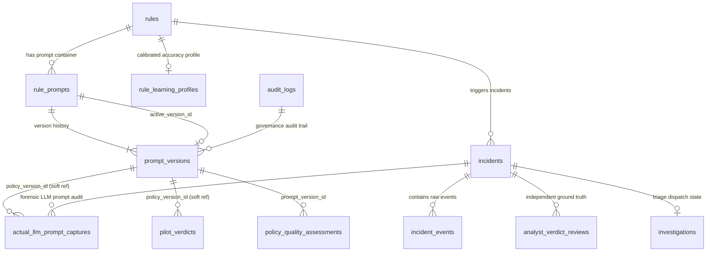

# Report 01 — Existing Architecture, Database Relationships & UI Audit
**Project:** Verdictum AI — Agent Intelligence Studio 2.1 (AIS 2.1)  
**Execution Context:** Policy State Recovery, Evaluation Tracking Integrity & Three-Tab Workspace Consolidation  
**Target Rule:** Heavy TCP Host Scan On Fixed Port (`40498741-ee6b-4a71-9101-0d6d3f77154c`, `PH_RULE_HEAVY_TCP_HOST_SCAN_FIXED_PORT`)  
**Target Hosts:** Production Server 1 (`172.26.41.240` - Control Plane) & Server 2 (`172.26.41.241` - Verdictum Cortex / Qwen 2.5 7B AWQ)  
**Date:** November 21, 2026  

---

## 1. Executive Summary

This architecture and runtime audit establishes the foundational baseline for upgrading Agent Intelligence Studio from AIS 2.0 to **AIS 2.1**. The audit investigated four tightly coupled operational defects observed in production:
1. **Policy State Disconnection (Issue A):** Rule `40498741-ee6b-4a71-9101-0d6d3f77154c` has historical approved policy record v7 and candidate draft v8, yet the GUI reported `No Active Version`, `Active Policy: None (Revoked / Suspended)`, and `AI Execution Suspended: POLICY_NOT_APPROVED`.
2. **Empty Evaluation Inventory (Issue B):** The evaluation tracking table displayed `0 total incidents`, despite 32 independent analyst reviews, 32 verified ground-truth records, and 5 pending reviews being actively present in PostgreSQL.
3. **Missing Normalized Evidence Attributes (Issue C):** The Review Incidents workbench displayed incident summaries (e.g., `Incident #335 — Source: 172.26.29.65`), but the normalized evidence table rendered `-` for all fields.
4. **Excessive Navigation Hierarchy (Issue D):** The studio presented 4 top-level tabs, 2 internal sub-views in Overview, 2 internal modes in Review Incidents, 11 nested sections in Advanced Settings, and a legacy 7-tab toggle, causing confusion for frontline SOC analysts.

---

## 2. PostgreSQL Schema & Entity Relationship Map

The architecture coordinates across 13 core database models:

### Authoritative Table Constraints & Key Attributes

| Table | Primary Role in AIS 2.1 | Key Columns | Runtime Integrity Invariant |
| :--- | :--- | :--- | :--- |
| `rules` | SIEM Detection Rule Entity | `id` (UUID), `rule_id` (Code), `name`, `event_type`, `status` | Canonical detection identity; never mutated or deleted. |
| `rule_prompts` | Prompt Container | `id`, `rule_id`, `active_version_id`, `ai_execution_suspended`, `suspension_reason` | `active_version_id` must bind strictly to an approved `prompt_versions.id` or be null. |
| `prompt_versions` | Versioned Policy Definitions | `id`, `prompt_id`, `version_number`, `status`, `was_ever_approved`, `quality_status`, `quality_score` | Approved versions are immutable; `was_ever_approved` protects historical baselines from deletion. |
| `incidents` | Authoritative SIEM Telemetry | `id`, `incident_id`, `rule_id`, `event_type`, `customer`, `source_ip`, `reporting_device`, `first_seen_epoch`, `raw_payload` | Immutable primary source for incident inventory and evidence normalization. |
| `incident_events` | Child Event Telemetry | `id`, `incident_id`, `event_id`, `raw_log`, `attributes`, `event_receive_time` | Granular per-packet / per-session logs (absent in header-only incidents). |
| `actual_llm_prompt_captures` | LLM Inference Provenance | `id`, `incident_id`, `rule_id`, `policy_version_id`, `policy_version_number`, `response_verdict`, `dispatch_status`, `is_simulated` | Durable record of real GPU execution on Server 2; differentiates real from simulated. |
| `analyst_verdict_reviews` | Human Ground Truth | `id`, `incident_id`, `rule_id`, `reviewer_id`, `analyst_verdict`, `comparison_outcome`, `ground_truth_status` | Independent SOC analyst benchmark for selective accuracy and confusion matrix. |

---

## 3. Frontend & Backend Component Audit

### 3.1 Frontend Components
- `frontend/src/app/agent-intelligence-studio/page.tsx`: Main page coordinating view modes, tabs, and modals. Contained redundant tab state (`primaryTab` with `"overview"`, `"test_ai"`, `"learning"`, `"advanced"`; `reviewSubView` with `"incidents"`, `"overview"`).
- `ReviewIncidentsWorkbench.tsx`: Double-blind incident review queue. Contained nested toggle for `activeViewMode` (`"review"` vs `"tracking"`). Normalized evidence table accessed `ev.field` and `ev.value` instead of canonical contract fields.
- `AiTestWorkbench.tsx`: Controlled AI testing workbench. Contained duplicate tracking table and test dispatch forms.
- `AccuracyLearningSummary.tsx`: Accuracy metrics, confusion matrix, and learning dashboard.
- `ManageVersionHistory.tsx`: Administrative version history, diffs, archive, and deletion controls.
- `AgentIntelligenceStudioOverview.tsx`: Header card and 6-stage guidance. Hardcoded `"None (Revoked / Suspended)"` on null active binding and treated all `is_eligible === false` as `"Suspended"`.

### 3.2 Backend Services & API Routes
- `AisEvaluationService` (`backend/app/services/ais_evaluation_service.py`): Canonical evaluation status resolver and tracking overview provider. Defaulted customer scoping to `"DEFAULT"`, which filtered out real incidents belonging to `"GDC_NOC"` and `"Demo-SOC"`.
- `AnalystReviewService` (`backend/app/services/analyst_review_service.py`): Managed pending reviews and review submissions. Correctly bypassed tenant filtering for administrators.
- `PromptStudioService` & `PolicyVersionGovernanceService`: Managed policy version lifecycle, approval, rollback, archival, and revocation.
- `EvidenceNormalizationService`: Extracted canonical evidence records from incident metadata and raw events. Produced records with `source_field`, `observed_value`, `evidence_id`, and `provenance_status`.
