# 01. PERMANENT POSTGRESQL TEST ISOLATION REPORT

## Verdictum AI — Agent Intelligence Studio 2.1a
**Execution Mode:** Production Database Safety & Automated Test Hardening  
**Target Rule:** Heavy TCP Host Scan On Fixed Port (`40498741-ee6b-4a71-9101-0d6d3f77154c`)  
**Deployment Target:** Server 1 (`172.26.41.240`)  
**Verified Git SHA:** `f41c7a82c05ef98f4d4d12b5db8e57d002582522`

---

## 1. Executive Summary

During prior AIS development cycles, an critical operational defect was observed: automated backend test fixtures (`test_ais_evaluation_tracking.py`) created temporary policy versions (`pv-eval-v7-6f67baf9`) and directly bound them to `rule_prompts.active_version_id`. During fixture teardown, the temporary policy record was deleted without restoring the real approved baseline binding, leaving `rule_prompts.active_version_id` referencing a dangling ghost ID.

This investigation determined that tests had executed against the operational database because test files directly imported `AsyncSessionLocal` from `app.database`, which was bound to `settings.DATABASE_URL` instead of an isolated test harness.

In AIS 2.1a, this class of defect is **permanently eliminated at the architectural and infrastructure levels**.

---

## 2. Root Cause Analysis

```mermaid
flowchart TD
    subgraph Defect["Defect Mechanism Prior to AIS 2.1a"]
        T1["Test Runner Launches pytest"] --> T2["Test imports from app.database import AsyncSessionLocal"]
        T2 --> T3["AsyncSessionLocal points to settings.DATABASE_URL"]
        T3 --> T4["Fixture inserts temporary pv-eval-v7 row into Operational DB"]
        T4 --> T5["Fixture sets rule_prompts.active_version_id = 'pv-eval-v7'"]
        T5 --> T6["Fixture teardown executes DELETE WHERE id='pv-eval-v7'"]
        T6 --> T7["Corrupted State: active_version_id points to deleted ghost ID"]
    end

    subgraph Defense["AIS 2.1a Multi-Tier Fail-Closed Defense"]
        G1["Test Runner Launches pytest"] --> G2["conftest.py sets APP_ENV='testing' and AI_VERDICT_TEST_ENV"]
        G2 --> G3["db_guard.enforce_database_safety inspects target connection"]
        G3 -->|Operational Target Detected| G4["BLOCKED — OPERATIONAL DATABASE TEST EXECUTION PROHIBITED"]
        G3 -->|Isolated In-Memory Target| G5["test_engine = sqlite+aiosqlite:///:memory:"]
        G5 --> G6["conftest rebinds app.database.AsyncSessionLocal = TestSessionLocal"]
        G6 --> G7["Zero Operational Mutation Guarantee"]
    end
```



### Key Contributing Defects Identified:
1. **Unprotected Direct Session Imports:** Several test suites imported `AsyncSessionLocal` directly from `app.database`. Although `conftest.py` overrode FastAPI's `get_db` dependency for HTTP endpoints, internal service calls made directly via `AsyncSessionLocal()` accessed whatever database was configured in `settings.DATABASE_URL`.
2. **Missing Referential Integrity Constraint:** In `backend/app/models/prompt.py`, `active_version_id` was defined as `mapped_column(String(36), nullable=True)` without an explicit foreign key to `prompt_versions.id`. Consequently, deleting a version row left dangling string references in `rule_prompts`.
3. **Execution on Server 1 During Deployment:** Previous UPLA deployment scripts executed `./venv/bin/pytest` directly on Server 1 without an explicit isolated test database setting, exposing production tables to fixture mutations.

---

## 3. Implementation Details

### A. Dedicated In-Memory Isolated Test Database
In `backend/tests/conftest.py`:
- `os.environ["DATABASE_URL"] = "sqlite+aiosqlite:///:memory:"`
- `os.environ["SYNC_DATABASE_URL"] = "sqlite:///:memory:"`
- `os.environ["AI_VERDICT_TEST_ENV"] = "test-session-isolated"`
- `test_engine = create_async_engine(TEST_DB_URL, connect_args={"check_same_thread": False})`
- Direct session rebinding:
  ```python
  import app.database as app_db
  app_db.async_engine = test_engine
  app_db.AsyncSessionLocal = TestSessionLocal
  ```
  Any test module that imports `from app.database import AsyncSessionLocal` is automatically redirected to the isolated in-memory test database.

### B. Database Referential Integrity
In `backend/app/models/prompt.py`:
- Added database-level foreign key constraint on `RulePrompt.active_version_id`:
  ```python
  active_version_id: Mapped[Optional[str]] = mapped_column(
      String(36),
      ForeignKey("prompt_versions.id", ondelete="SET NULL", use_alter=True, name="fk_rule_prompts_active_version"),
      nullable=True
  )
  ```
- Explicit relationship mappings with `foreign_keys` disambiguation:
  ```python
  versions: Mapped[List["PromptVersion"]] = relationship(
      "PromptVersion",
      back_populates="prompt",
      cascade="all, delete-orphan",
      order_by="desc(PromptVersion.version_number)",
      foreign_keys="[PromptVersion.prompt_id]",
  )
  ```
- Result: If any policy version is deleted, `active_version_id` is automatically set to `NULL` via `ondelete="SET NULL"`, preventing dangling ghost string pointers.

---

## 4. Verification Evidence

1. **Safety Guard Catches Operational Targets at Module Load:**
   When running pytest with `settings.DATABASE_URL` resolving to `ai_verdict.db`, the guard halted execution immediately:
   ```
   OperationalDatabaseProtectionError: BLOCKED — OPERATIONAL DATABASE TEST EXECUTION PROHIBITED:
   Default operational SQLite file 'ai_verdict.db' detected. Automated tests must execute only against isolated test databases.
   ```
2. **Mandatory Automated Test Suite (`backend/tests/test_database_isolation.py`):**
   8/8 tests passed in 27.70s:
   - `test_operational_server1_target_is_blocked` -> **PASSED**
   - `test_operational_db_name_on_any_remote_host_is_blocked` -> **PASSED**
   - `test_operational_user_is_blocked` -> **PASSED**
   - `test_dbname_containing_test_on_operational_host_is_still_blocked` -> **PASSED**
   - `test_production_sqlite_file_is_blocked_in_test_mode` -> **PASSED**
   - `test_isolated_in_memory_sqlite_passes` -> **PASSED**
   - `test_isolated_dedicated_test_db_with_marker_passes` -> **PASSED**
   - `test_zero_mutation_guarantee_on_blocked_target` -> **PASSED**
