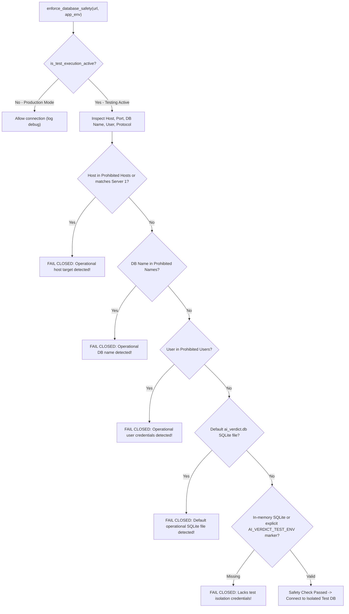

# 02. FAIL-CLOSED DATABASE IDENTITY GUARD SPECIFICATION & AUDIT

## Verdictum AI — Agent Intelligence Studio 2.1a
**Component:** `backend/app/core/db_guard.py`  
**Execution Context:** Pre-Engine Initialization & Test Runner Hook  
**Security Classification:** P0 Operational Database Protection

---

## 1. Guard Purpose & Invariants

The **Fail-Closed Database Identity Guard** enforces strict operational boundaries preventing automated tests, test fixtures, synthetic benchmark scripts, or development harnesses from executing against operational databases.

### Invariant Rules Enforced:
1. **Never Trust Database Name Alone:** A database name containing `"test"` (e.g. `ai_verdict_test`) is **NOT** sufficient to permit execution if the host is an operational server (`172.26.41.240`).
2. **Prohibited Operational Hosts:** Any connection resolving to Server 1 (`172.26.41.240`), `server1`, or production domain names triggers immediate execution abortion.
3. **Prohibited Operational Databases:** Any connection targeting `ai_verdict` or `wysesoc` in a test context triggers immediate abortion.
4. **Prohibited Operational Users:** Any connection using `ai_verdict_prod` or production database credentials triggers immediate abortion.
5. **Zero Mutation Guarantee:** Execution halts before any engine, pool, socket connection, or transaction is established.

---

## 2. Guard Architecture

```python
# backend/app/core/db_guard.py

PROHIBITED_OPERATIONAL_HOSTS: Set[str] = {
    "172.26.41.240",
    "server1",
    "server-1",
    "prod.wysesoc.internal",
    "production.wysesoc.internal",
}

PROHIBITED_OPERATIONAL_DB_NAMES: Set[str] = {
    "ai_verdict",
    "wysesoc",
    "wysesoc_ai",
    "production_ai_verdict",
}

PROHIBITED_OPERATIONAL_USERS: Set[str] = {
    "ai_verdict_prod",
    "wysesoc_prod",
    "postgres_prod",
}
```

### Fail-Closed Evaluation Logic:


---

## 3. Integration Points

1. **`backend/app/database.py`:**
   Executed during module import prior to `create_async_engine`:
   ```python
   from app.core.db_guard import enforce_database_safety
   enforce_database_safety(settings.DATABASE_URL, settings.APP_ENV)
   ```
2. **`backend/tests/conftest.py`:**
   Executed at test harness initialization:
   ```python
   os.environ["APP_ENV"] = "testing"
   os.environ["AI_VERDICT_TEST_ENV"] = "test-session-isolated"
   os.environ["DATABASE_URL"] = "sqlite+aiosqlite:///:memory:"
   enforce_database_safety(TEST_DB_URL, "testing")
   ```
3. **Mandatory Test Verification:**
   Tested in `backend/tests/test_database_isolation.py` across all 8 failure vectors.
