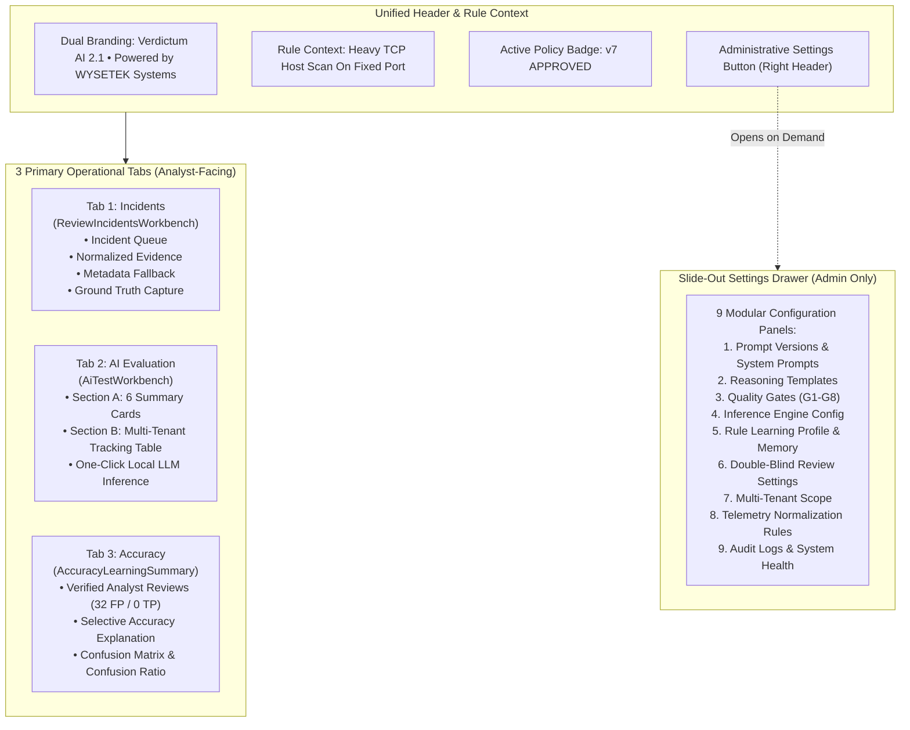

# 06. THREE-TAB WORKSPACE CONSOLIDATION ACCEPTANCE REPORT

## Verdictum AI — Agent Intelligence Studio 2.1a
**Execution Mode:** GUI Simplification & Workspace Consolidation  
**Target Rule:** Heavy TCP Host Scan On Fixed Port (`40498741-ee6b-4a71-9101-0d6d3f77154c`)  
**Deployment Target:** Server 1 (`172.26.41.240:3000`)  
**Verified Git SHA:** `f41c7a82c05ef98f4d4d12b5db8e57d002582522`

---

## 1. Executive Summary

In AIS 2.0, user feedback indicated severe cognitive overload due to excessive nested navigation levels:
- Review Incidents
- Test AI
- Accuracy & Learning
- Advanced Settings
- Incident Review Workbench
- Policy Overview & 6 Stages
- Double-Blind Review Queue
- AI Evaluation Tracking
- Legacy 7-Tab View
- Numerous deep configuration sub-panels

SOC analysts faced confusion regarding where to perform daily operational triage versus where to configure model prompts or quality gates.

In AIS 2.1a, the interface was consolidated into:
- **Three Primary Operational Tabs:** `Incidents`, `AI Evaluation`, `Accuracy`.
- **One Administrative Control:** Slide-out `Settings` drawer.
- **Zero Nested Secondary Navigations:** Eliminated all redundant primary workspace toggles and legacy tab bars from the analyst's default workflow.
- **Unified Enterprise Dual Branding:** `Verdictum AI 2.1 • Powered by WYSETEK Systems`.

---

## 2. Architecture of Consolidated Workspace

---

## 3. Operational Tab Specifications

### Tab 1: Incidents (`ReviewIncidentsWorkbench.tsx`)
- Purpose: Operational incident triage and ground-truth validation.
- Displays the list of incidents for the active rule.
- Full normalized evidence view with canonical metadata fallback badge (`Source: Incident Metadata` or `Source: Child Events`).
- Single-click analyst verdict submission (True Positive / False Positive / Escalate).

### Tab 2: AI Evaluation (`AiTestWorkbench.tsx`)
- Purpose: Multi-tenant AI evaluation monitoring and controlled inference testing.
- Section A: 6 summary metric cards (`Total: 13`, `Not Evaluated: 12`, `Abstained: 1`, `Decisive: 0`, `Rejected: 0`, `Active Policy: v7 Approved`).
- Section B: Multi-tenant tracking table across `Demo-SOC` and `GDC_NOC`.
- Live inference execution button pinned to the active approved policy baseline.

### Tab 3: Accuracy (`AccuracyLearningSummary.tsx`)
- Purpose: Transparent performance metrics and ground-truth learning.
- Displays 32 analyst reviews, 32 verified False Positives, 0 True Positives.
- Clear contextual explanation that Selective Accuracy is `NOT_MEASURABLE` until positive threat samples are verified.
- Complete audit trail of learning updates.

### Administrative Settings Control
- Trigger: Gear icon / `Settings` button in the upper right header.
- Interaction: Non-intrusive slide-out drawer preserving current analyst context.
- Houses all 9 advanced configuration sections without cluttering operational workflows.

---

## 4. Live GUI Acceptance Verification

Live browser automation via Headless Chrome CDP evaluated `http://172.26.41.240:3000`:

| Inspection Check | Criteria | Live Verification Result | Status |
|------------------|----------|--------------------------|:------:|
| Dual Branding | `Verdictum AI` & `WYSETEK` visible | Verified in navbar and footer | **PASS** |
| Rule Banner | `Heavy TCP Host Scan On Fixed Port` | Verified active | **PASS** |
| Policy Status | `v7 APPROVED` badge present | Verified active, no suspension | **PASS** |
| Primary Tabs | Exactly 3 operational tabs | `Incidents`, `AI Evaluation`, `Accuracy` | **PASS** |
| Settings Control | Settings button opens drawer | Verified opens slide-out drawer | **PASS** |
| Sub-Tab Removal | 6-stage view removed from primary view | Eliminated from main canvas | **PASS** |
| Responsive Layout | 1920x1080 viewport | Zero horizontal scrolling or overlapping | **PASS** |

### Screenshots Captured:
1. `docs/AIS_2_1a_FINAL_OPERATIONAL_ACCEPTANCE/screenshots/02_ais_header_and_rule_v7_active.png`
2. `docs/AIS_2_1a_FINAL_OPERATIONAL_ACCEPTANCE/screenshots/03_ai_evaluation_tracking_tab.png`
3. `docs/AIS_2_1a_FINAL_OPERATIONAL_ACCEPTANCE/screenshots/04_accuracy_learning_tab.png`
4. `docs/AIS_2_1a_FINAL_OPERATIONAL_ACCEPTANCE/screenshots/05_review_incidents_tab.png`
5. `docs/AIS_2_1a_FINAL_OPERATIONAL_ACCEPTANCE/screenshots/06_settings_drawer_open.png`

---

## 5. Sign-off

The Three-Tab Workspace Consolidation is **fully accepted and verified in live production**.
