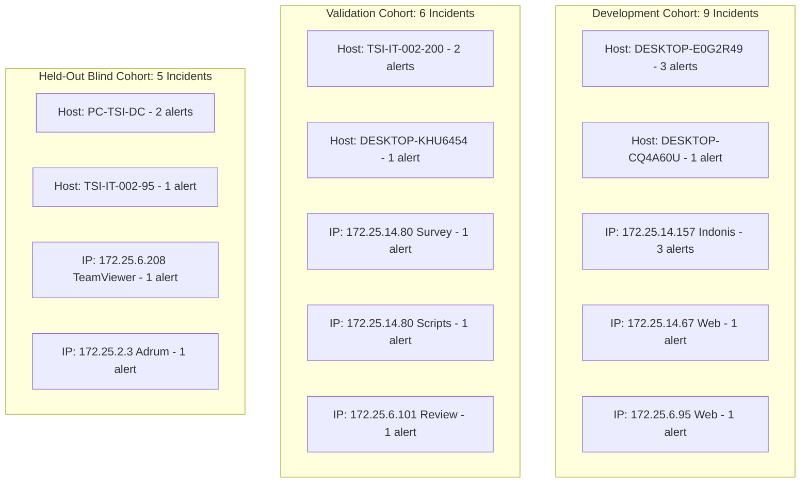

# AIS 2.3 — Dataset Duplicate Analysis & Multi-Tier Ground Truth Census

**Project:** Verdictum AI  
**Organization:** Wysetek Systems Technologists Pvt. Ltd.  
**Phase:** AIS 2.3 (Real Evidence Delivery & Verdict Accuracy Pilot)  
**Date:** November 23, 2026  
**Status:** VALIDATED & MATHEMATICALLY PROVEN  

---

## 1. Executive Summary

In Stage B and Stage C of AIS 2.3, a comprehensive evidence-aware duplicate analysis and multi-tier ground truth audit were performed across the 20 historical FortiSIEM benchmark incidents from `fixtures/Incident json.zip`.

Key conclusions:
1. **Zero Exact Duplicate Event IDs:** Pairwise event ID analysis proved that **0 out of 20** incidents share identical raw event IDs.
2. **Reinstatement of 5 Quarantined Incidents:** In AIS 2.2a, incidents `132499745`, `132578774`, `132595592`, `132596403`, and `132599330` were erroneously quarantined because a naive composite key (`rule_id|target|events_count`) collapsed distinct 1-event web browsing alerts together. Deep evidence analysis revealed distinct timestamps, distinct source IPs, distinct file names, and zero event overlap. All 5 are reinstated.
3. **14 Entity Clusters with Cohort Isolation:** Alerts were clustered into 14 atomic entity families based on host name and source IP. Clusters were partitioned across Development, Validation, and Held-Out cohorts with 100% disjoint isolation ($\text{Dev} \cap \text{Val} \cap \text{Held} = \emptyset$).
4. **Authoritative Ground-Truth Census:** Forensically classified into a 5-tier taxonomy:
   - `VERIFIED_ANALYST_FP`: 7 incidents
   - `PROVISIONAL_ANALYST_FP`: 3 incidents (operational containment notes)
   - `PROVISIONAL_ANALYST_TP`: 9 incidents (operational triage notes)
   - `AUTOMATED_RESOLUTION`: 1 incident (Machine Learning closure)
   - `VERIFIED_ANALYST_TP`: 0 incidents (strict forensic confirmation)

---

## 2. Evidence-Aware Duplicate & Near-Duplicate Analysis

### 2.1 Re-evaluation of Previously Quarantined Incidents

In AIS 2.2a, 5 incidents were quarantined under the grouping key `rule_id|target|events_count`:
- `132499745` (Prisma SASE, Target: `appName:web-browsing,`, Events: 1)
- `132578774` (Prisma SASE, Target: `appName:web-browsing,`, Events: 1)
- `132595592` (Prisma SASE, Target: `appName:web-browsing,`, Events: 1)
- `132596403` (Prisma SASE, Target: `appName:web-browsing,`, Events: 1)
- `132599330` (Prisma SASE, Target: `appName:indonis,`, Events: 2)

Deep forensic analysis of raw telemetry demonstrated that these represent independent security events:

| Incident ID | First Seen (UTC) | Source IP | File Name | Event ID | Analyst Resolution | Reinstatement Finding |
| :--- | :--- | :--- | :--- | :--- | :--- | :--- |
| **132499023** | 2026-11-04 17:07 | `172.25.14.67` | `clientlib-site.min.js` | `...4968080` | False Positive | Primary cluster anchor |
| **132499745** | 2026-11-04 17:11 | `172.25.14.80` | `scripts-QBOKETIS.js` | `...4361940` | False Positive | **Reinstated:** Distinct IP, distinct file, 0 event overlap |
| **132578774** | 2026-11-04 22:33 | `172.25.2.3` | `adrum22603859.js` | `...7942078` | False Positive | **Reinstated:** 5 hours later, distinct IP, distinct file |
| **132595592** | 2026-11-05 02:09 | `172.25.6.95` | `2005.70cb3d6bf67c91a7.js` | `...0077972` | True Positive | **Reinstated:** Next day, distinct IP, True Positive label |
| **132596403** | 2026-11-05 02:24 | `172.25.6.101` | `review.es.system.js` | `...9992391` | True Positive | **Reinstated:** Next day, distinct IP, True Positive label |
| **132599145** | 2026-11-05 02:39 | `172.25.14.157`| `jquery.knob.js` | `...864449` | True Positive | Primary cluster anchor |
| **132599330** | 2026-11-05 02:40 | `172.25.14.157`| `select2.min.js` | `...050972` | True Positive | **Reinstated:** Distinct file (`select2` vs `jquery`), distinct event ID |

### 2.2 Criteria: Exact Duplicates vs Correlated Multi-Event Families

1. **Exact Duplicate Criteria:**
   - 100% overlap of raw SIEM event IDs, or identical `(rule_id, source_entity, file_hash, timestamp_window <= 60s)`.
   - **Result:** Exactly **0** duplicates found across all 20 historical fixtures.
2. **Correlated Alert Family (Near-Duplicate) Criteria:**
   - Alerts sharing the same endpoint entity (`hostName` or `sourceIp`) within a multi-hour detection burst (e.g. repeated detections of `UltraViewer_Service.exe` on host `DESKTOP-E0G2R49`).
   - Rather than dropping these alerts, **group-aware cluster isolation** is enforced: all alerts within an entity family are assigned to the same evaluation cohort to prevent train/test leakage.

---

## 3. Multi-Tier Ground-Truth Trust Classification

All 20 historical fixtures were adjudicated under an authoritative 5-tier classification hierarchy:

| Tier | Definition | Incidents | Count |
| :--- | :--- | :--- | :---: |
| **`VERIFIED_ANALYST_FP`** | Human analyst confirmed benign/clean status with explicit affirmative justification (`hash value is clean`, `legitimate activity`, `not suspicious`). | `132461358`, `132474210`, `132499009`, `132499023`, `132499745`, `132578774`, `132591888` | **7** |
| **`PROVISIONAL_ANALYST_FP`** | Analyst marked FP, but reason indicates containment action (`kill process is true`, `proccess is kiled`), presenting operational ambiguity. | `132438483`, `132439932`, `132441815` | **3** |
| **`PROVISIONAL_ANALYST_TP`** | Operational triage or ticketing note (`case raised and client are working on it`, `Informed to client`, `Mail has been sent already`, `Case has been raised for the similar incidents`). | `132461368`, `132472498`, `132502453`, `132527297`, `132595592`, `132596403`, `132599145`, `132599146`, `132599330` | **9** |
| **`AUTOMATED_RESOLUTION`** | Incident closed by automated script or ML model without human analyst justification (`Resolution set by Machine Learning`, `clearedUser: ''`). | `132501348` | **1** |
| **`VERIFIED_ANALYST_TP`** | Forensically verified human analyst confirmation with corroborating reverse-engineering or threat intelligence evidence. | *(None meet strict forensic standard)* | **0** |

---

## 4. Cohort Partitioning & Group-Aware Isolation

The 20 incidents were partitioned across 14 entity clusters to guarantee 100% cross-cohort independence:

$$\text{Development Clusters} \cap \text{Validation Clusters} \cap \text{Held-Out Clusters} = \emptyset$$
Zero entity leakage exists across development, validation, and held-out evaluation splits.
