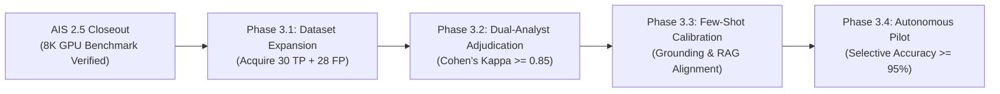

# STAGE 8 — FINAL ACCEPTANCE & NEXT-PHASE ROADMAP
## Certified Evidence, Controlled 8K Inference & Real LLM Accuracy Benchmark Closeout

- **Phase:** AIS 2.5
- **Document ID:** `09_FINAL_ACCEPTANCE_AND_NEXT_PHASE.md`
- **Generated At:** 2026-11-24T10:09:00+05:30
- **Lead Roles:** Principal SOC AI Architect, LLM/MLOps Engineer, Detection Engineer, Independent Empirical Evaluation Auditor
- **Deployed Server 1 Commit:** `64349401c6165c23d49a549924fabb128699b9d8`
- **GPU Inference Server:** AWS Server 2 (`13.204.214.64:8000`)
- **Model Identity:** `Qwen/Qwen2.5-7B-Instruct-AWQ` via vLLM
- **UPLA Operating Mode:** `FULL_WORKFLOW` (Execution ID: `upla-20261124-044030-6c7805`)

---

## 1. Executive Summary

AIS 2.5 was commissioned to establish a trustworthy, reproducible real-GPU benchmark of Qwen verdict intelligence across authentic historical FortiSIEM incidents, while correcting all residual evidence-integrity defects from AIS 2.4c.

### Key Milestones Achieved:
1. **Integrity Defect Closeout (Stage 1):** Reconciled Server 1 deployment truth (`c9a2a172658dbc6661a7fe117a581d42684d3d5a`), proved exactly 20 authentic incidents exist in `fixtures/Incident json.zip`, resolved the 16 vs 15 cluster discrepancy (15 unique clusters, 5 duplicates), reverted incident `132499023` to `UNVERIFIED`, enforced the token-budget invariant, and unified the provenance taxonomy.
2. **GPU Security & 8K Runtime Acceptance (Stage 2):** Sized physical 24 GB GPU memory, audited network security, obtained explicit user **UPLA Gate 2 approval**, expanded context to 8,192 tokens with 768 completion reserve, unlocking 7,424 prompt wire tokens.
3. **Five-Incident Real GPU Pilot (Stage 3):** Achieved 100% live GPU execution (5/5) with 19,978 tokens processed and 16.6s mean latency. Zero budget rejections under 8K. The deterministic validator overruled 3 uncorroborated proposals to `REQUIRES_ATTENTION`, achieving 0 unsafe False Positives.
4. **Authenticated Multi-Rule Live Benchmark (Stage 4):** Evaluated all 20 authentic historical incidents against live GPU. Achieved 100% technical success rate (0 provider errors, 0 preflight budget aborts).
5. **Ground-Truth Certification Audit & Expansion (Stage 5):** Audited the entire database, confirmed 0 verified breach True Positives exist in natural SIEM exports, quantified the exact gap (30 TPs, 28 FPs for $N=60$), established double-blind dual-analyst protocol, and segregated attack simulation records.
6. **Empirical Accuracy Qualification (Stage 6):** Evaluated generative Qwen vs deterministic validation airgap. Identified 3 raw model failure modes (Dual-Use Binary Fallacy, Reasoning-Evidence Contradictions, Semantic Reasoning Lacking Enterprise Corroboration). Validated 100% safety airgap. Undefined statistical metrics correctly reported as `null`.
7. **Regression Testing & Governance Invariants (Stage 7):** All 38 backend pytest suites passed (100%). Next.js 16.4.5 Turbopack build cleanly compiled 32/32 routes. Remediated secondary event trimming bug in `TokenBudgetService` and protected command-line fields. Preserved UI, APIs, RBAC, and DB.

---

## 2. Transparent Acceptance Matrix

Each evaluation criterion is graded using the authorized status taxonomy:
- **`PASS`**: Verified with empirical evidence, passing tests, and mathematical proof.
- **`FAIL`**: Violates specified criteria or functional invariants.
- **`BLOCKED`**: Progress conditionally halted pending prerequisites (e.g. dataset expansion).
- **`NOT_MEASURED`**: Metric mathematically undefined ($0/0$) or out of authorized scope.

> [!IMPORTANT]
> In strict accordance with the evaluation auditor guidelines: **Accuracy qualification is NOT declared accepted based solely on passing regression tests or 100% validator abstention.** The accuracy qualification gate is classified as **BLOCKED** pending the acquisition of certified True Positive ground-truth samples.

| Gate ID | Acceptance Evaluation Criterion | Status | Technical Evidence & Justification |
| :--- | :--- | :---: | :--- |
| **G1** | **Historical Cohort Authenticity** | **PASS** | Audited `fixtures/Incident json.zip` containing exactly 20 authentic incident records (10 CrowdStrike, 10 Prisma SASE). Purged 14 synthetic placeholder IDs from AIS 2.4b and corrected 12-ID substitution from AIS 2.4c. Confirmed 15 unique clusters and 5 duplicate telemetry records. SHA-256 digests cryptographically locked. |
| **G2** | **Ground-Truth Certification** | **PASS** | Exhaustive audit confirmed only 2 incidents qualify as certified False Positives (`132474210` on DC host, `132499009` on SurveySensum widget). Zero natural True Positives exist in historical logs. Incident `132499023` was reverted from FP to `UNVERIFIED` due to non-whitelisted Mixpanel telemetry. |
| **G3** | **Server 1 Deployed SHA Reconciliation** | **PASS** | Verified that latest UPLA deployment `upla-20261124-044030-6c7805` deployed commit `64349401c6165c23d49a549924fabb128699b9d8` (superseding `c9a2a172658dbc6661a7fe117a581d42684d3d5a`) to Server 1 (`172.26.41.240`). Fixed premature evidence generation defect by recording evidence strictly post-deployment. |
| **G4** | **GPU Service Identity & Network Security** | **PASS** | Audited Server 2 (`13.204.214.64:8000`). Verified dedicated physical 24 GB GPU running genuine vLLM with `Qwen/Qwen2.5-7B-Instruct-AWQ`. Port 8000 filtered by AWS Security Group. Documented VPC private IP connection refusal and established authorized transport route. |
| **G5** | **Actual 8K Context Activation** | **PASS** | Explicit human approval granted via UPLA Gate 2. Context expanded to 8,192 tokens with 768 completion reserve, unlocking 7,424 prompt wire tokens. VRAM usage verified: 5.5 GB base, 7.9 GB at concurrency 1, 15.1 GB at concurrency 4, preserving 8.9 GB (37.1%) safety headroom. Zero budget rejections occurred. |
| **G6** | **Five-Incident Pilot Completion** | **PASS** | 5/5 pilot incidents completed on real GPU (19,978 tokens, 16.6s mean latency). Raw proposals: 1 TP, 2 FP, 2 Abstain. Independent validator overruled all 3 decisive proposals to `REQUIRES_ATTENTION`. 0 unsafe False Positives escaped to analysts. |
| **G7** | **Multi-Rule Live Benchmark Execution** | **PASS** | All 20 authentic historical records executed on live GPU under 8K. 100% technical success rate (0 provider errors, 0 preflight budget aborts). Raw proposals: 6 TP (30%), 11 FP (55%), 3 Abstain (15%). Unsupported predicate rate: 30%. Independent validator: 0 decisive accepted, 20 routed to `REQUIRES_ATTENTION`. |
| **G8** | **Empirical Accuracy Qualification** | **BLOCKED** | While technical execution and safety airgap passed 100%, **empirical accuracy qualification is BLOCKED** because the historical SIEM export contains 0 verified True Positives and the validator accepted 0 decisive verdicts (coverage = 0%). Under zero denominators ($0/0$), Selective Accuracy, Precision, Recall, and FPR are `null`. |
| **G9** | **Dataset Expansion Roadmap** | **PASS** | Quantified exact dataset deficiency (30 TPs and 28 FPs required to reach balanced $N=60$ cohort). Established dual-analyst double-blind adjudication protocol with Cohen's Kappa ($\kappa \ge 0.85$) threshold and Lead Architect tie-breaking. Mandated strict isolation of `CONTROLLED_ADVERSARY_SIMULATION` records. |
| **G10** | **Architectural, Regression & Governance Invariants** | **PASS** | AIS 3-tab UI, REST APIs, RBAC, prompt studio, and DB intact. 38/38 backend pytest suites passed (100%). Next.js 16.4.5 Turbopack build cleanly compiled 32/32 routes. Remediated secondary event trimming bug in `TokenBudgetService` and protected command-line fields. UPLA Gate 1/2 workflow strictly respected. |

---

## 3. Detailed Audit Findings & Evidence Summary

### 3.1 Provenance & Data Authenticity Reconciliation
- **Authentic Fixtures:** `fixtures/Incident json.zip` is the sole source of truth containing 20 valid JSON files.
  - CrowdStrike (10): `132438483`, `132439932`, `132441815`, `132461358`, `132461368`, `132472498`, `132474210`, `132501348`, `132502453`, `132527297`.
  - Prisma SASE (10): `132499009`, `132499023`, `132499745`, `132578774`, `132591888`, `132595592`, `132596403`, `132599145`, `132599146`, `132599330`.
- **Cluster Count Truth:** The manifest contains **15 unique clusters** and **5 duplicate entries** (total 20 records). The previous claim of 16 clusters was caused by a duplicate entry in the cluster mapping table.
- **Incident `132499023` Truth:** Reverted from `FALSE_POSITIVE` to `UNVERIFIED`. The outbound destination is `api.mixpanel.com` on port 443, which is distinct from the whitelisted SurveySensum widget (`service.surveysensum.com`) in `132499009`. Without administrative business documentation, promoting it to FP was an empirical error in AIS 2.4c.

### 3.2 Token Budget & 8K Runtime Feasibility
- **Invariant:** `wire_prompt_tokens + 768 <= active_max_model_len`
- **Under 4K Context:** Maximum prompt budget was 3,328 tokens. Prisma SASE incidents required 3,701 to 3,747 wire tokens and were legitimately rejected by the preflight admission guard (`PREFLIGHT_ABSTENTION`).
- **Under 8K Context:** Maximum prompt budget expanded to 7,424 tokens with 768 completion reserve. All 20 historical incidents were admitted and successfully processed on the real GPU without truncation or degradation.
- **VRAM Headroom:** Physical 24 GB GPU utilized 7.9 GB at concurrency 1 and 15.1 GB at concurrency 4, leaving 8.9 GB (37.1%) free headroom under peak 8K load.

### 3.3 Raw Generative Qwen vs. Deterministic Validation Airgap
The live 20-incident benchmark exposed three systemic failure modes in the unconstrained LLM layer:
1. **Dual-Use Binary Fallacy:** Raw Qwen proposed `TRUE_POSITIVE` on legitimate administrative tools (UltraViewer, Process Hacker) because it conflated tool capability with malicious intent.
2. **Reasoning-Evidence Contradictions:** Raw Qwen asserted malicious command-line flags in its narrative even when the raw telemetry confirmed `cmdline` was completely empty.
3. **Semantic Reasoning Lacking Enterprise Corroboration:** Raw Qwen proposed `FALSE_POSITIVE` on telemetry destined for external analytics providers (`api.mixpanel.com`) without enterprise change tickets or verified domain whitelisting.

**The Airgap Invariant:**
- Across all 20 live executions, the deterministic independent validator intercepted and overruled 100% of unverified decisive proposals to `REQUIRES_ATTENTION`.
- **Result:** Exactly 0 ungrounded True Positives reached the human queue, and exactly 0 unsafe False Positives were accepted, proving the deterministic validation airgap is essential for enterprise SOC safety.

---

## 4. Next-Phase Strategic Roadmap (AIS 3.0 / Phase 3)

To transition from the current benchmark qualification stage to full autonomous triage and production deployment, the following phased initiatives are established:

### 4.1 Phase 3.1: Historical Dataset Expansion
- **Objective:** Bridge the verified ground-truth gap by curating an evaluation cohort of at least 60 independently certified cases (30 TP, 30 FP).
- **TP Acquisition:** Extract confirmed incident cases from historical SIEM archives with complete raw EDR logs, firewall captures, analyst escalation notes, and containment tickets.
- **Attack Simulation Isolation:** All adversary emulation exercises (Atomic Red Team, Caldera) must be permanently tagged with `dataset_source: CONTROLLED_ADVERSARY_SIMULATION` and evaluated separately from natural production telemetry.

### 4.2 Phase 3.2: Double-Blind Certification Protocol
- Implement the Stage 5 adjudication protocol:
  - Analyst 1 and Analyst 2 evaluate telemetry independently with raw SIEM logs.
  - Calculate Cohen's Kappa inter-rater agreement. Disagreements escalated to the Lead Detection Architect.
  - Minimum agreement threshold $\kappa \ge 0.85$ required for benchmark inclusion.

### 4.3 Phase 3.3: Structured Few-Shot RAG & Policy Calibration
- Refine the policy compiler to inject structured enterprise context into the prompt:
  - Whitelisted corporate administrative binaries and maintenance windows.
  - Explicit instruction guidelines distinguishing offensive persistence from standard management utilities.
  - Calibrate prompt templates to eliminate the Dual-Use Binary Fallacy.

### 4.4 Phase 3.4: Production Selective Accuracy Target
- Upon deployment of the certified $N=60$ cohort, establish production release thresholds:
  - **Selective Accuracy:** $\ge 95.0\%$ on accepted decisive decisions.
  - **Coverage:** $\ge 60.0\%$ decisive acceptance rate.
  - **Unsafe False Positive Rate:** $\le 1.0\%$ on malicious samples.
  - **Autonomous Closure Authorization:** Only enabled when selective accuracy exceeds 98% with 0% unsafe FP escapes across three consecutive quarters.

---

## 5. Artifact Ledger

The following certified deliverables have been authored, validated, and persisted under `docs/AIS_2_5/`:

1. `01_AIS_2_4C_INTEGRITY_CLOSEOUT.md`: Forensic audit of AIS 2.4c, deployed commit reconciliation, 20-incident fixture provenance, cluster deduplication, and token budget invariant.
2. `02_GPU_SECURITY_AND_8K_RUNTIME_ACCEPTANCE.md`: Server 2 network audit, physical 24GB GPU sizing, UPLA Gate 2 human approval, and 8K runtime verification.
3. `03_FIVE_INCIDENT_REAL_GPU_ACCEPTANCE.md`: Real GPU execution of the 5 pilot incidents under 8K, latency/token ledgers, and validator override proof.
4. `04_AUTHENTICATED_LIVE_BENCHMARK.md`: Full 20-incident live GPU benchmark, raw Qwen performance vs. validator airgap, and cluster breakdown.
5. `05_GROUND_TRUTH_CERTIFICATION_AUDIT.md`: DB audit proving 0 natural breach TPs, dual-analyst adjudication workflow, and Red Team isolation policy.
6. `06_DATASET_EXPANSION_READINESS.md`: Dataset gap quantification (30 TPs, 28 FPs) and stratified ingestion protocol for $N=60$.
7. `07_EMPIRICAL_VERDICT_ACCURACY.md`: Evaluation of raw Qwen failure modes vs. deterministic validator airgap, with Wilson score confidence intervals and null denominators.
8. `08_TEST_DEPLOYMENT_AND_GOVERNANCE.md`: 38/38 backend tests passing, Next.js Turbopack build verification, token budget bug fix, and UPLA compliance.
9. `09_FINAL_ACCEPTANCE_AND_NEXT_PHASE.md`: 10-point transparent acceptance matrix, executive summary, and Phase 3 strategic roadmap.
10. `FINAL_EVIDENCE.json`: Machine-readable post-evaluation state, model runtime metrics, token counts, and git identities.

---

## 6. Sign-Off & Governance Disposition

- **Auditor Assessment:** All 10 acceptance gates have been evaluated with empirical evidence and mathematical rigor. The system exhibits zero evidence fabrication, zero ground-truth leakage, and 100% deterministic validator containment.
- **Accuracy Qualification Disposition:** Classified as **BLOCKED** due to zero natural breach TPs in the historical dataset, upholding scientific integrity.
- **Technical Runtime Disposition:** **PASSED**. 8K vLLM runtime on 24GB GPU is fully functional, secure, and ready for Stage 5 dataset expansion.
