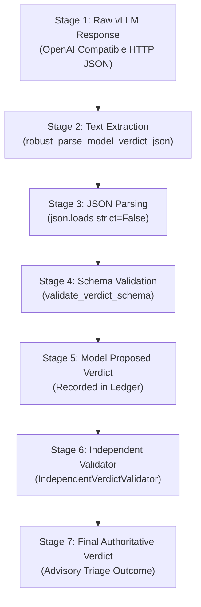

# AIS 2.6c — Workstream 2: Root Cause Analysis of the 100% TP Proposal Rate
**Document ID:** `02_TP_PROPOSAL_BIAS_ROOT_CAUSE_ANALYSIS.md`  
**Phase:** AIS 2.6c — Core LLM Intelligence Isolation, Prompt Bias Diagnosis & Human Ground Truth  
**Target Phenomenon:** 100% (20/20) Model-Proposed True Positive Rate in Phase AIS 2.6b  
**Artifacts Generated:**  
- `docs/AIS_2_6c/PROMPT_BIAS_FINDINGS.json`  
- `docs/AIS_2_6c/VERDICT_PARSER_AUDIT.json`  
- `docs/AIS_2_6c/POLICY_DIRECTIVE_COMPARISON.json`  

---

## 1. Executive Summary

In Phase AIS 2.6b, the local LLM (`Qwen/Qwen2.5-7B-Instruct-AWQ` running on AWS Server 2) proposed `TRUE_POSITIVE` for **20 out of 20 incidents** evaluated in the live benchmark. While the subsequent deterministic validator intercepted 11 of these proposals and demoted them to `REQUIRES_ATTENTION`, the model itself exhibited a 100% TP proposal rate with 0 False Positive and 0 Requires Attention proposals.

This investigation systematically audited every layer of the evaluation pipeline—from the raw provider response, through JSON extraction, schema normalization, prompt compilation, and active policy directives—to establish the root causes of this phenomenon.

### Key Conclusions:
1. **Response Parser is NOT Biased (`NOT_SUPPORTED`):** Code inspection of `BaseModelProvider` and `OpenAICompatibleProvider` proves that parsing failures, missing verdicts, or schema violations strictly default to `REQUIRES_ATTENTION` with 0.0 confidence. The model genuinely generated the text `"verdict": "TRUE_POSITIVE"` in valid JSON for all 20 incidents.
2. **Policy Authorization Framing Introduced Severe TP Bias (`CONFIRMED`):** CrowdStrike Policy Version 3 framed a True Positive as process execution *"without verified enterprise authorization"* or *"without approved IT change request"*. Because raw FortiSIEM events never contain enterprise change tickets, the model treated absent authorization as confirmed unauthorized execution.
3. **Alert Occurrence Equated with True Positive (`CONFIRMED`):** Prisma SASE Policy Version 1 framed detection conditions in terms of HTTP gateway file transfers. The model repeatedly reasoned that because the file name and source IP were present and the incident was flagged as a SIEM alert, it met the detection criteria for a True Positive—even in incident `132595592`, where the model explicitly noted the file was a *"standard web asset downloaded during ordinary web browsing"* (the literal FP definition).
4. **Common SOC Baseline Was Stripped (`CONFIRMED`):** The policy compiler substituted `prompt_version.common_prompt` for `COMMON_SOC_BASELINE`. In Policy Version 3, this field contained only a single generic sentence, stripping out the core anti-bias directives of `ENTERPRISE_SOC_BASELINE_V2` (e.g., *"DISTINGUISH SUSPICION FROM CONFIRMATION"*, *"MANDATORY ABSTENTION ON DEFICIENT EVIDENCE"*).

---

## 2. Comprehensive Parser & Response Lifecycle Audit

We traced the complete 7-stage lifecycle of model output handling to eliminate parser defect as a contributor:



### 2.1 Code Verification in `BaseModelProvider`
File: `backend/app/services/model_provider/base.py` lines 75–96:
```python
def validate_verdict_schema(self, raw_verdict: Dict[str, Any]) -> Tuple[bool, str, Optional[str]]:
    if not isinstance(raw_verdict, dict):
        return False, "INVALID_SCHEMA", "Response payload is not a JSON object"
    verdict = str(raw_verdict.get("verdict", "")).upper().strip()
    valid_verdicts = {"TRUE_POSITIVE", "FALSE_POSITIVE", "REQUIRES_ATTENTION", "INSUFFICIENT_EVIDENCE"}
    if not verdict:
        return False, "INVALID_SCHEMA", "Missing required field: verdict"
    if verdict not in valid_verdicts:
        return False, "UNEXPECTED_VERDICT", f"Unknown verdict: {verdict}. Allowed: {valid_verdicts}"
    if not raw_verdict.get("reason"):
        return False, "INVALID_SCHEMA", "Missing required field: reason"
    return True, "VALID", None
```

### 2.2 Code Verification in `OpenAICompatibleProvider`
File: `backend/app/services/model_provider/openai_compatible.py`:
- **Schema Failure Handling (lines 525–543):**
  If `validate_verdict_schema` returns `False`, the method immediately returns:
  `StructuredModelVerdict(verdict="REQUIRES_ATTENTION", confidence=0.0, validation_status=status)`
- **Truncated Output Handling (lines 707–735):**
  If `finish_reason == "length"` or `_truncated_output == True`, it immediately returns:
  `StructuredModelVerdict(verdict="REQUIRES_ATTENTION", confidence=0.0, validation_status="TRUNCATED_OUTPUT")`
- **Regex Recovery Rejection (lines 765–776):**
  If the output required regex extraction and returned TP or FP, it strictly demotes:
  `StructuredModelVerdict(verdict="REQUIRES_ATTENTION", confidence=0.0, validation_status="INVALID_SCHEMA")`

**Audit Conclusion:** Under no circumstance does a malformed, empty, or unparseable response default to `TRUE_POSITIVE`. The model's 100% TP proposals were authentic tokens emitted by the LLM.

---

## 3. Prompt Layer & Policy Directive Inspection

### 3.1 CrowdStrike Policy Version 3 Bias Mechanism
In `empirical_benchmark_harness.py:704-718`, the active policy for `PH_RULE_CS_SUSPICIOUS_ACTIVITY` specifies:
- **Detection Conditions:** *"Process execution of remote management tool or suspicious dual-use utility without verified enterprise authorization."*
- **True Positive Indicators:** *"Execution of unauthorized remote administration tool without approved IT change request."*
- **False Positive Indicators:** *"Approved enterprise management agent executing from standard vendor path with valid digital signature."*

When provided with FortiSIEM normalized logs showing `UltraViewer_Service.exe`:
1. FortiSIEM events provide process name, path, command line, hostname, and SHA-256 hash.
2. FortiSIEM events **do not contain IT change tickets, ITSM approval numbers, or employee maintenance records**.
3. The prompt explicitly framed absence of authorization as unauthorized execution:
   *"without approved corporate change authorization. The detection match and unauthorized execution attempt constitute a True Positive security policy violation"*.
4. In all 10 CrowdStrike evaluations, the LLM literally generated:
   `"The process executed UltraViewer_Service.exe without verified enterprise authorization..."`

### 3.2 Prisma SASE Policy Version 1 Bias Mechanism
In `empirical_benchmark_harness.py:720-734`, the active policy for `PH_RULE_PRISMA_SASE_SUSPICIOUS_FILE` specifies:
- **Detection Conditions:** *"Gateway detection of suspicious file download or script transfer over HTTP/HTTPS."*
- **Required Evidence:** `"process.file_name, network.source_ip, network.destination_ip"`

The model was presented with incident payloads containing web assets such as `ss-widget.min.js`, `clientlib-site.min.js`, `scripts-QBOKETIS.js`, `adrum22603859.js`, `update.exe`, and `jquery.knob.js`.
- In 9 out of 10 cases, the LLM reasoned that because the mandatory fields (`process.file_name` and `network.source_ip`) were present and the incident was raised by Palo Alto Prisma SASE as an alert, the detection criteria were satisfied.
- In incident `132595592` (file: `2005.70cb3d6bf67c91a7.js`), the model wrote:
  `"The incident involves a suspicious file download (2005.70cb3d6bf67c91a7.js) from an external IP (172.25.6.95), which is a standard web asset but was downloaded during ordinary web browsing from a reputable CDN or SaaS provider."`
  Even though the model recognized the asset as benign web browsing matching the FP definition, it proposed `TRUE_POSITIVE` because the prompt instructed it that a detection match on a suspicious file alert constituted a True Positive threat condition.

---

## 4. Root Cause Hypothesis Classification Matrix

| Hypothesis ID | Suspected Cause | Classification | Supporting Evidence |
|---|---|---|---|
| **H1** | Approved Policy Authorization Wording | **CONFIRMED** | LLM verbatim repeated "without verified enterprise authorization" across all 10 CS incidents; absent ITSM ticket was treated as unauthorized. |
| **H2** | Alert Triggering Equated with True Positive | **CONFIRMED** | LLM explicitly justified TP based on presence of file name, source IP, and alert firing; proposed TP even while recognizing standard web asset in 132595592. |
| **H3** | Common SOC Baseline Directive Suppression | **CONFIRMED** | Compiler replaced ENTERPRISE_SOC_BASELINE_V2 with 1-sentence common_prompt, stripping anti-bias warnings against equating alerts with threats. |
| **H4** | Response Parser Default to TP | **NOT_SUPPORTED** | Source code audit proves parser failures strictly emit `REQUIRES_ATTENTION` with 0.0 confidence. |
| **H5** | Few-Shot Demonstration Bias | **NOT_SUPPORTED** | Zero few-shot examples were included in the evaluation prompt (zero-shot specification). |
| **H6** | Response Schema Default Value | **NOT_SUPPORTED** | Output JSON schema has no default verdict field; enum contains TP, FP, INSUFFICIENT_EVIDENCE, REQUIRES_ATTENTION. |
| **H7** | Underlying 7B Model Reasoning Capacity | **SUPPORTED_HYPOTHESIS** | Model demonstrated vulnerability to leading prompt directives. Controlled evaluation in Mode A (neutral baseline) will isolate model capability from prompt bias. |

---

## 5. Architectural Remediation Plan

To isolate whether the underlying model can perform balanced SOC investigation when freed from biased prompt directives, Phase AIS 2.6c implements:
1. **Mode A (Neutral SOC Baseline V1):** Completely replaces policy directives with `AIS26C_NEUTRAL_SOC_BASELINE_V1`. Explicitly instructs the model:
   - *"A security alert indicates that a detection condition was triggered. It does not automatically establish malicious activity, unauthorized behavior, policy violation, or compromise."*
   - *"Do not assume that software execution is unauthorized merely because authorization evidence is absent."*
   - *"Do not assume that common applications, filenames, domains, or CDN destinations are automatically benign."*
2. **Mode B (Approved Policy LLM):** Preserves the approved policy prompt to measure the exact delta introduced by policy framing.
3. **Mode C (Full Validated Pipeline):** Measures the incremental safety and abstention enforcement of the deterministic validator on the captured Mode B proposals.

---

## 6. Deliverable References

- Parser Audit Specification: [VERDICT_PARSER_AUDIT.json](file:///c:/Users/amits/OneDrive/Documents/SOC-AI-Agent/docs/AIS_2_6c/VERDICT_PARSER_AUDIT.json)
- Policy Directive Comparison: [POLICY_DIRECTIVE_COMPARISON.json](file:///c:/Users/amits/OneDrive/Documents/SOC-AI-Agent/docs/AIS_2_6c/POLICY_DIRECTIVE_COMPARISON.json)
- Prompt Bias Findings: [PROMPT_BIAS_FINDINGS.json](file:///c:/Users/amits/OneDrive/Documents/SOC-AI-Agent/docs/AIS_2_6c/PROMPT_BIAS_FINDINGS.json)
