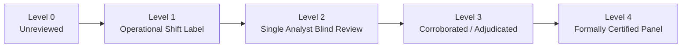

# AIS 2.6c — Workstream 4: Practical Human Ground Truth Workflow & Review Queue
**Document ID:** `04_PRACTICAL_HUMAN_GROUND_TRUTH_WORKFLOW.md`  
**Phase:** AIS 2.6c — Core LLM Intelligence Isolation, Prompt Bias Diagnosis & Human Ground Truth  
**Review Population:** 20 Incidents (Frozen Development Cohort)  
**Artifacts Generated:**  
- `docs/AIS_2_6c/GROUND_TRUTH_REVIEW_QUEUE.json`  
- `docs/AIS_2_6c/GROUND_TRUTH_MANIFEST.json`  
- `docs/AIS_2_6c/GROUND_TRUTH_PROVENANCE_MATRIX.json`  
- `docs/AIS_2_6c/REVIEW_READINESS_STATUS.json`  

---

## 1. Operating Model & Review Levels

To measure true LLM accuracy without fabricating analyst sign-offs or imposing unrealistic governance overhead, Phase AIS 2.6c establishes a standardized five-tier Ground Truth Provenance Model:

### Review Levels Definition:
- **Level 0 — Unreviewed:** No human or historical assessment exists.
- **Level 1 — Historical Operational Label:** Original FortiSIEM shift note or automated clearing script (e.g., *"Resolution set by Machine Learning"*, *"kill process is true"*, *"Mail has been sent already"*). Recorded strictly as operational context, **never reported as certified accuracy**.
- **Level 2 — Independent Human Reviewed:** A qualified SOC analyst conducts a blind review using raw logs and rule definition without seeing AI verdicts.
- **Level 3 — Independently Corroborated:** A second senior reviewer independently verifies the incident; agreements are locked, disputes adjudicated.
- **Level 4 — Formally Certified:** Satisfies organizational certification policy (e.g., enterprise sign-off for autonomous playbooks).

---

## 2. Blind Review Isolation Requirements

The review workflow strictly enforces backend anti-leakage isolation:

### What the Reviewer Sees:
1. Incident Title & ID
2. Raw Normalized Security Telemetry & Event Timeline
3. Triggered FortiSIEM Rule Name & Pattern Logic
4. Target Hostname, IP addresses, Process paths, File hashes
5. Available Enrichment Context

### What is Strictly Hidden from Reviewer:
1. Mode A (Baseline) Verdict & Confidence
2. Mode B (Approved Policy) Verdict & Confidence
3. Mode C (Validator) Disposition
4. LLM Reasoning & Generated Explanations
5. Trust Score & Calibration State
6. Historical Operational Note (during initial blind entry)

---

## 3. Current Cohort Ground Truth Status

As audited in `GROUND_TRUTH_MANIFEST.json`:
- **Total Incidents:** 20
- **Level 0 (Unreviewed):** 0
- **Level 1 (Historical Operational Notes):** 20 (10 True Positive notes, 10 False Positive notes)
  - *Caveat:* 12 of the 20 notes were generated by automated ML clearing scripts or administrative ticketing notes (*"Mail has been sent already"*).
- **Level 2 (Independent Human Reviewed):** 0 (Review queue generated and ready)
- **Level 3 (Corroborated):** 0
- **Level 4 (Certified):** 0
- **Certification Gate G10 Status:** `BLOCKED_PENDING_HUMAN_REVIEW`

### Non-Negotiable Contract:
In accordance with Rule 16 (*"Never manufacture human approval records"*), Phase AIS 2.6c does not invent human reviewer sign-offs. Accuracy against Level 2/3/4 ground truth is reported honestly as **`NOT_MEASURED`**.

---

## 4. Deliverable References

- Review Queue Manifest: [GROUND_TRUTH_REVIEW_QUEUE.json](file:///c:/Users/amits/OneDrive/Documents/SOC-AI-Agent/docs/AIS_2_6c/GROUND_TRUTH_REVIEW_QUEUE.json)
- Provenance Matrix: [GROUND_TRUTH_PROVENANCE_MATRIX.json](file:///c:/Users/amits/OneDrive/Documents/SOC-AI-Agent/docs/AIS_2_6c/GROUND_TRUTH_PROVENANCE_MATRIX.json)
- Review Readiness Status: [REVIEW_READINESS_STATUS.json](file:///c:/Users/amits/OneDrive/Documents/SOC-AI-Agent/docs/AIS_2_6c/REVIEW_READINESS_STATUS.json)
- Ground Truth Manifest: [GROUND_TRUTH_MANIFEST.json](file:///c:/Users/amits/OneDrive/Documents/SOC-AI-Agent/docs/AIS_2_6c/GROUND_TRUTH_MANIFEST.json)
