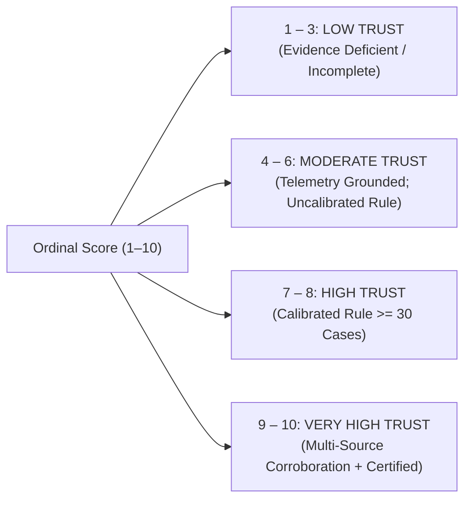

# AIS 2.6c — Workstream 10: Trust Score & Guardrail Semantics
**Document ID:** `09_TRUST_SCORE_AND_GUARDRAIL_SEMANTICS.md`  
**Phase:** AIS 2.6c — Core LLM Intelligence Isolation, Prompt Bias Diagnosis & Human Ground Truth  
**Target Component:** VerdictTrustworthinessEngine & VerdictGuardrailsEngine  
**Artifacts Generated:**  
- `docs/AIS_2_6c/TRUST_SCORE_COMPONENT_MATRIX.json`  
- `docs/AIS_2_6c/TRUST_CALIBRATION_STATUS.json`  

---

## 1. Trust Score Root Cause Resolution

In Phase AIS 2.6b, all 20 benchmark records had an ordinal trust score of **3/10**, and in one artifact this was erroneously labeled as "high".

### Technical Root Cause:
In `empirical_benchmark_harness.py:1347`, the harness invoked:
```python
trust_payload = copy.deepcopy(incident_rec.sanitized_payload)
trust_payload["incident_id"] = incident_rec.incident_id
trust_payload["rule_id"] = incident_rec.rule_id
trust_res = VerdictTrustworthinessEngine.evaluate_verdict_trust(
    incident_payload=trust_payload,
    model_output=model_output,
    contract=contract,
)
```
The sanitized payload contained raw FortiSIEM dictionary keys (`Command`, `Target`), but did not attach the normalized canonical evidence records (`canonical_evidence = [r.model_dump() for r in norm_result.records]`). Consequently:
1. `EvidenceSufficiencyEngine` searched for canonical dot-notation keys (`process.file_name`, `endpoint.hostname`).
2. It failed to locate them, returning `mandatory_fields_missing: ['process.file_name', 'endpoint.hostname']`.
3. This triggered the mandatory guardrail: `ordinal_score = min(3, ordinal_score)`.
4. Guardrails `G1_MISSING_MANDATORY_EVIDENCE` and `G5_LOW_TRUST_SCORE` were uniformly attached to all 20 records.

### Phase AIS 2.6c Correction:
`trust_payload` now includes `canonical_evidence: [r.model_dump() for r in norm_result.records]` and `events: inc_obj.events`. When normalized telemetry is supplied, `EvidenceSufficiencyEngine` accurately evaluates observed fields.

---

## 2. Trust Score Scale & Calibration Policy



### Mandatory Semantics:
1. **Low Trust Invariant:** Any score $\le 3$ is **LOW**, never high.
2. **Uncalibrated Cap:** For rules with fewer than 30 independently certified cases, the maximum allowable ordinal score is **capped at 6/10**.
3. **Calibration Status:** Without certified ground truth, empirical calibration status is strictly **`NOT_CALIBRATED`**.
4. **Autonomous Invariant:** Autonomous incident closure is permanently disabled; only human analyst advisory triage is permitted.

---

## 3. Deliverable References

- Trust Score Component Matrix: [TRUST_SCORE_COMPONENT_MATRIX.json](file:///c:/Users/amits/OneDrive/Documents/SOC-AI-Agent/docs/AIS_2_6c/TRUST_SCORE_COMPONENT_MATRIX.json)
- Trust Calibration Status: [TRUST_CALIBRATION_STATUS.json](file:///c:/Users/amits/OneDrive/Documents/SOC-AI-Agent/docs/AIS_2_6c/TRUST_CALIBRATION_STATUS.json)
