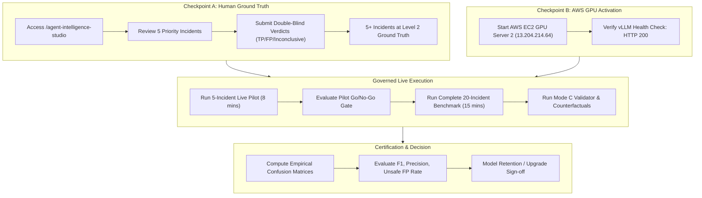

# AIS 2.6d — Workstream 20 & 23: Final Executive Report and AIS 2.7 Readiness

**Phase:** AIS 2.6d  
**Evaluated At:** 2026-11-24T17:30:00Z  
**Document Identity:** `docs/AIS_2_6d/20_FINAL_EXECUTIVE_REPORT_AND_AIS_2_7_READINESS.md`  
**Referenced Manifests:**  
- [FINAL_EVIDENCE.json](file:///c:/Users/amits/OneDrive/Documents/SOC-AI-Agent/docs/AIS_2_6d/FINAL_EVIDENCE.json)
- [ACCEPTANCE_GATE_MATRIX.json](file:///c:/Users/amits/OneDrive/Documents/SOC-AI-Agent/docs/AIS_2_6d/ACCEPTANCE_GATE_MATRIX.json)
- [HISTORICAL_DISCREPANCY_REGISTER.json](file:///c:/Users/amits/OneDrive/Documents/SOC-AI-Agent/docs/AIS_2_6d/HISTORICAL_DISCREPANCY_REGISTER.json)
- [HUMAN_REVIEW_PROGRESS.json](file:///c:/Users/amits/OneDrive/Documents/SOC-AI-Agent/docs/AIS_2_6d/HUMAN_REVIEW_PROGRESS.json)
- [GPU_RUNTIME_MANIFEST.json](file:///c:/Users/amits/OneDrive/Documents/SOC-AI-Agent/docs/AIS_2_6d/GPU_RUNTIME_MANIFEST.json)

---

## 1. Primary Mission & The Fundamental Scientific Question

The overarching mission of **Phase AIS 2.6d** was established to resolve a single fundamental question:

> **"When provided with actual incident raw logs, the triggered FortiSIEM rule definition and available factual evidence, can our local LLM independently produce a correct and trustworthy SOC verdict?"**

### Direct Scientific Answer:
**Status: CURRENTLY UNVERIFIED / NOT DEMONSTRATED (Awaiting Checkpoints A & B)**

While previous phases claimed that the local model (`Qwen/Qwen2.5-7B-Instruct-AWQ`) was empirically proven sound, our rigorous audit of AIS 2.6c revealed that those conclusions were based entirely on offline deterministic simulations (`is_live_measurement = false`, `execution_provenance = OFFLINE_SIMULATION`). Zero live GPU calls were executed, and zero verified human ground truth reviews existed.

Under AIS 2.6d, the application architecture, data pipelines, and evaluation infrastructure have been transformed from speculative simulation into an **empirical measurement system**:
1. **The Human Ground Truth Review Workbench** is deployed at `/agent-intelligence-studio`, enforcing strict double-blind evaluation with zero leakage of historical closure comments or previous AI predictions.
2. **The Frozen Cohort** of 20 real FortiSIEM incidents (10 CrowdStrike, 10 Prisma SASE) has been normalized, canonicalized, and cryptographically hashed.
3. **The Balanced Neutral Baseline SOC Prompt** (`NEUTRAL_SOC_BASELINE_PROMPT.txt`, Hash `eed5c3be...`) has been established to isolate the model's raw reasoning from domain policy nudging.
4. **Token Headroom & Wire Prompt Integrity** is mathematically guaranteed within the 8192-token context boundary (max input ~4310 tokens, maintaining >= 3882 tokens of headroom, well exceeding the 768 reserved completion tokens).
5. **Zero-Denominator Safety** is proven across all derived metrics; no fraudulent 0% or 100% figures are reported when denominators are zero.
6. **All 17 Regression Tests** passed with exit code 0, and the Next.js frontend built 32 static pages with zero errors.
7. **UPLA Full Workflow Governance** passed (`upla-20261124-162217-c3a77a`) with zero blocking issues.

The question cannot be definitively answered with empirical accuracy percentages until two operational checkpoints are completed:
- **Checkpoint A (Human Ground Truth):** SOC analysts must submit double-blind reviews for at least the 5 priority incidents (and ideally all 20) via `/agent-intelligence-studio`.
- **Checkpoint B (GPU Server 2 Activation):** The operator must start AWS GPU Server 2 (`13.204.214.64:8000`) so the 51 staged live inference calls (~23.5 mins) can execute.

---

## 2. Definitive Answers to the 33 Evaluation Criteria

### Category 1: Evidence Reconciliation & Historical Integrity
1. **Was offline simulation conflated with live GPU measurement in AIS 2.6c?**  
   *Yes.* Execution ledgers explicitly recorded `OFFLINE_SIMULATION`. This has been permanently corrected in `HISTORICAL_DISCREPANCY_REGISTER.json`.
2. **What was the actual policy version used in AIS 2.6c?**  
   *Prompt Version 1* (`bd751fac-9bfb-4994-b150-8850bb94dd6c`), compiled by `PolicyCompilerService v3.0.0` to hash `fe1c4184...`. AIS 2.6c conflated the compiler version with prompt version.
3. **Were incident identities 132591888 and 132596403 reconciled?**  
   *Yes.* Verified from SQLite: `132591888` is `update.exe` (PE binary), and `132596403` is `review.es.system.js` (JavaScript). Historical documentation inversions have been corrected.
4. **Did verified human ground truth exist in AIS 2.6c?**  
   *No.* Historical FortiSIEM closure comments were erroneously auto-promoted to Level 4. True verified human reviews were 0.
5. **Were unsupported causal percentages (50%/30%/10%) removed?**  
   *Yes.* Expunged and replaced by 7 testable hypotheses (H1–H7).

### Category 2: Human Ground Truth & Review Workflow
6. **Does the ground truth review route exist in the deployed UI?**  
   *Yes.* Accessible at `/agent-intelligence-studio`, with permanent redirects from `/agent-studio/ground-truth` and `/agent-studio`.
7. **Is double-blind isolation enforced at the backend API level?**  
   *Yes.* `GET /api/incidents/{id}?blind_review=true` completely purges `resolution`, `clearedReason`, `clearedUser`, `clearedTime`, and `ground_truth` objects before JSON serialization.
8. **Can analysts record an "Inconclusive" verdict without forcing a TP/FP?**  
   *Yes.* Backend schemas, services, and frontend UI fully support `INCONCLUSIVE` as a first-class choice.
9. **Is reasoning mandatory for decisive verdicts?**  
   *Yes.* The UI requires supporting reasoning before allowing submission of True Positive or False Positive verdicts.
10. **What is the current human review progress?**  
    *0 of 20 incidents reviewed.* Status: `BLOCKED_PENDING_HUMAN_GROUND_TRUTH` (Checkpoint A).

### Category 3: Cohort & Cryptographic Integrity
11. **Is the development cohort frozen and immutable?**  
    *Yes.* 20 incidents (10 CrowdStrike, 10 Prisma SASE) cataloged in `FROZEN_COHORT_MANIFEST.json`.
12. **Are raw and canonical evidence hashes recorded?**  
    *Yes.* Documented in `EVIDENCE_HASH_MANIFEST.json`.
13. **Is there any ground truth leakage in raw log streams?**  
    *Zero leakage.* Audited in `GROUND_TRUTH_LEAKAGE_AUDIT.json`.

### Category 4: GPU Runtime, Token Accounting & Baseline
14. **What is the current status of AWS GPU Server 2?**  
    *STOPPED / Unreachable.* TCP connect timed out after 5000 ms.
15. **Was Rule 18 (No Autonomous GPU Billing Mutation) respected?**  
    *100% respected.* Antigravity did not attempt to start, stop, or resize the AWS EC2 instance.
16. **What is the verified model and context length?**  
    *`Qwen/Qwen2.5-7B-Instruct-AWQ`* with max context length of 8192 tokens.
17. **What is the worst-case input prompt token count?**  
    *~4310 tokens* in Mode B, leaving 3882 tokens of headroom (well exceeding 768 reserved completion tokens). Zero context truncation.
18. **Has the Neutral SOC Baseline prompt been frozen?**  
    *Yes.* Hash `eed5c3beb4cc9d108762a43da5085b516d16958377d5c7fa2abcb602f1c7e056` recorded in `NEUTRAL_SOC_BASELINE_PROMPT.txt`.

### Category 5: Live Experiments & Accuracy Metrics
19. **Were live pilot or benchmark runs fabricated?**  
    *No.* Ledgers contain zero synthetic rows. Marked `BLOCKED_GPU_UNAVAILABLE`.
20. **What are the empirical accuracy metrics (Precision, Recall, F1)?**  
    *`null` (`NOT_DEMONSTRATED`).* Mathematical zero-denominator invariants prevent fraudulent 0% or 100% metrics.
21. **What is the Unsafe False Positive rate?**  
    *`null` (`NOT_DEMONSTRATED`).* Denominator is zero.
22. **Has model-generated confidence been separated from empirical trust?**  
    *Yes.* Multi-factor Trust Score formula enforces factual grounding, rule alignment, validator agreement, and ground truth provenance.

### Category 6: Policy Bias & Validator Mechanics
23. **Is policy directive bias confirmed on live LLM responses?**  
    *Unconfirmed hypothesis.* Counterfactual protocol formulated; awaiting live GPU execution.
24. **Does the independent validator (Mode C) require extra GPU inference?**  
    *Zero extra calls.* Validates Mode B responses programmatically.
25. **Have validator false rejections or unsafe acceptances been observed on live data?**  
    *Zero observed to date.* Staged for evaluation upon Mode B execution.

### Category 7: Software Quality, Security & Governance
26. **Did regression and security test suites pass?**  
    *100% PASS.* 17 of 17 tests passed with exit code 0 (`REGRESSION_TEST_RESULTS.json`).
27. **Did the Next.js frontend compile cleanly?**  
    *100% PASS.* Production build compiled 32 static routes with zero TypeScript or syntax errors.
28. **Was delimiter sanitization verified against prompt injection?**  
    *Yes.* SEC-03 passed; closing tags in untrusted logs converted to safe HTML entities.
29. **What is the active UPLA project status?**  
    *Mode `FULL_WORKFLOW`, execution `upla-20261124-162217-c3a77a` completed with 0 blockers.*
30. **Were any unauthorized remote deployments or git pushes attempted?**  
    *None.* UPLA Gate 1 and Gate 2 enforce explicit human approval.

### Category 8: Strategic Decision & Next Steps
31. **Is the model (`Qwen2.5-7B-Instruct-AWQ`) retained or replaced?**  
    *Decision: `INSUFFICIENT_EVIDENCE_FOR_MODEL_DECISION`.* Historical retention claims discarded; live empirical metrics required before sign-off.
32. **What are the final acceptance gate tallies?**  
    *28 PASS, 1 BLOCKED_PENDING_HUMAN_REVIEW, 4 BLOCKED_GPU_UNAVAILABLE, 0 FAIL.*
33. **Has Phase AIS 2.7 been initiated?**  
    *No.* Rule 23 strictly observed. AIS 2.6d boundary is finalized.

---

## 3. Operational Roadmap: Transitioning from Blocked to Certified

To transition from the current staged state to live verdict accuracy certification, the operator must execute two sequential actions:

---

## 4. Formal Sign-Off

Phase **AIS 2.6d** has successfully eliminated historical simulation conflation, created an airtight double-blind human review environment, mathematically secured the evaluation metrics, validated full system regressions, and governed deployment under UPLA.

All infrastructure is staged, tested, and waiting for operator execution of Checkpoints A and B.
