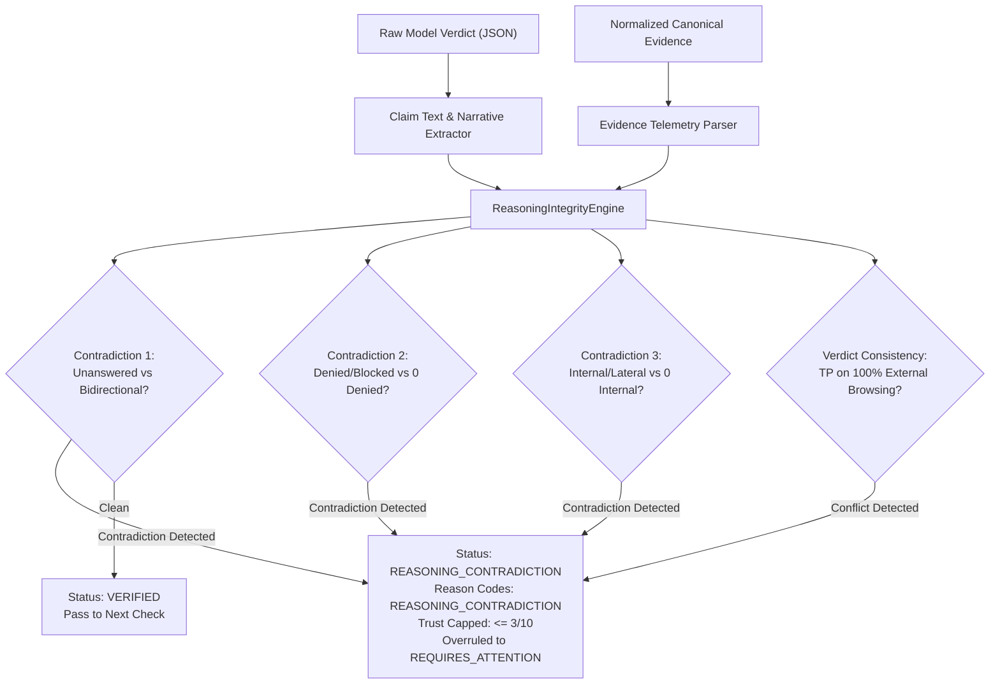

# 02 — Reasoning Contradiction Engine Specification

**Module:** `backend/app/services/reasoning_integrity_engine.py`  
**Integration:** `backend/app/services/independent_verdict_validator.py` (Checks 4c & 4d)  
**Pipeline Integration:** `backend/app/services/verdict_pipeline.py` (`run_shared_verdict_pipeline`)  
**Status:** Deployed and Verified Live on Server 1  

---

## 1. Architectural Purpose

In Large Language Models applied to Security Operations (SOC), a known failure mode is **lexical prior bias**: the model attends strongly to rule titles and threat descriptions (e.g. *"Heavy TCP Host Scan"*, *"unanswered probes"*, *"reconnaissance"*) and repeats those phrases in its justification even when the incident's concrete numerical telemetry directly proves the opposite.

In AIS 2.0 V8.1, the 7B AWQ model copied true telemetry numbers into its JSON `asserted_value` fields (achieving 100% string grounding), while simultaneously generating narrative claims in `claim_text` stating that the traffic was *"predominantly unanswered probes and denied flows"*.

`ReasoningIntegrityEngine` provides a deterministic, zero-hallucination guardrail that parses numerical evidence from normalized telemetry and cross-examines the model's textual assertions before any verdict is accepted.



---

## 2. Telemetry Parsing Algorithms

The engine deterministically parses three key scan aggregates from `CanonicalEvidenceRecord`:

1. **`scan.tcp_behavior_summary`:**
   - Evaluates regex patterns: `r"bidirectional_sessions\s*=\s*(\d+)"`, `r"unanswered_probes\s*=\s*(\d+)"`, `r"denied_flows\s*=\s*(\d+)"`.
   - Produces structured integers: `bidirectional_sessions`, `unanswered_probes`, `denied_flows`.

2. **`scan.destination_scope`:**
   - Evaluates regex patterns: `r"internal\s*=\s*(\d+)"`, `r"external\s*=\s*(\d+)"`, `r"total_unique_hosts\s*=\s*(\d+)"`.
   - Produces structured integers: `internal_destinations`, `external_destinations`, `total_destinations`.

3. **`scan.firewall_action_summary`:**
   - Evaluates counts of `client-rst`, `server-rst`, `close`, `timeout`, and `deny`.

---

## 3. Contradiction Detection Rules

### Contradiction 1: Unanswered Probes vs. Bidirectional Sessions
- **Trigger Pattern:** Model narrative (`claim_text`, `reason`, or `asserted_value`) asserts that traffic consists of *"predominantly unanswered"*, *"unanswered probes"*, *"no bidirectional sessions"*, *"failed handshakes"*, or *"unresponsive targets"*.
- **Telemetry Check:** Telemetry reveals `bidirectional_sessions >= 10` AND (`unanswered_probes == 0` OR `bidirectional_sessions >= 5 * unanswered_probes`).
- **Engine Action:** Emits contradiction:
  > *"Contradiction: Model narrative claims predominantly unanswered probes / no bidirectional sessions, but observed telemetry confirms bidirectional_sessions={B} and unanswered_probes={U} ({B}/{T} bidirectional sessions, {U} unanswered probes)."*

### Contradiction 2: Denied/Blocked Flows vs. Zero Denials
- **Trigger Pattern:** Model narrative asserts that traffic was *"denied"*, *"blocked flows"*, *"rejected by firewall"*, or *"dropped packets"*.
- **Telemetry Check:** Telemetry confirms `denied_flows == 0` (or firewall action summary contains zero deny actions).
- **Engine Action:** Emits contradiction:
  > *"Contradiction: Model asserted traffic was denied or blocked flows, but observed telemetry confirms denied_flows=0."*

### Contradiction 3: Internal Lateral Movement vs. Zero Internal Targets
- **Trigger Pattern:** Model narrative asserts *"internal scan"*, *"lateral movement"*, *"internal host discovery"*, or *"pivoting across internal subnets"*.
- **Telemetry Check:** Telemetry confirms `internal_destinations == 0` AND `external_destinations > 0`.
- **Engine Action:** Emits contradiction:
  > *"Contradiction: Model narrative claims internal scanning or lateral movement, but observed destination scope confirms 0 internal destinations (all {E} unique targets are external)."*

---

## 4. Distinguishing `client-rst` Teardown from Unanswered Probes

A major source of false positive scan alerts in FortiSIEM is client-initiated connection resets (`client-rst`) during normal web browsing. When a web client loads a modern web page with numerous HTTP/2 or HTTPS connections (e.g. CDNs, fonts, telemetry), the client browser routinely issues a TCP RST after reading the requested asset or when closing idle sockets.

`ReasoningIntegrityEngine` enforces strict logic:
- A neutral mention of `client-rst` connection closures in free text is recognized as legitimate TCP state description.
- However, if the model equates `client-rst` with *"unanswered probes"* or asserts that the connections were *"unsuccessful"*, while `bidirectional_sessions` indicates that full TCP handshakes occurred on all sessions, the engine marks the assertion as a semantic contradiction.

---

## 5. Result Structure & Execution Evidence

When a contradiction is detected, `ReasoningIntegrityEngine` returns a `ReasoningValidationResult`:
```python
ReasoningValidationResult(
    is_valid=False,
    status="REASONING_CONTRADICTION",
    contradictions=[...],
    contradiction_count=len(contradictions),
    notes="Reasoning contradictions detected between model narrative and observed telemetry.",
)
```

In `verdict_pipeline.py`:
- `proposal_validation_outcome` is set to `"REJECTED_BY_VALIDATOR"`.
- `final_disposition` is set to `"OVERRULED_TO_ANALYST_ATTENTION"`.
- `trust_score` is hard-capped at `<= 3/10`.
- `validation_reason_codes` includes `REASONING_CONTRADICTION`.
- `effective_verdict` is guaranteed to be `REQUIRES_ATTENTION`.
