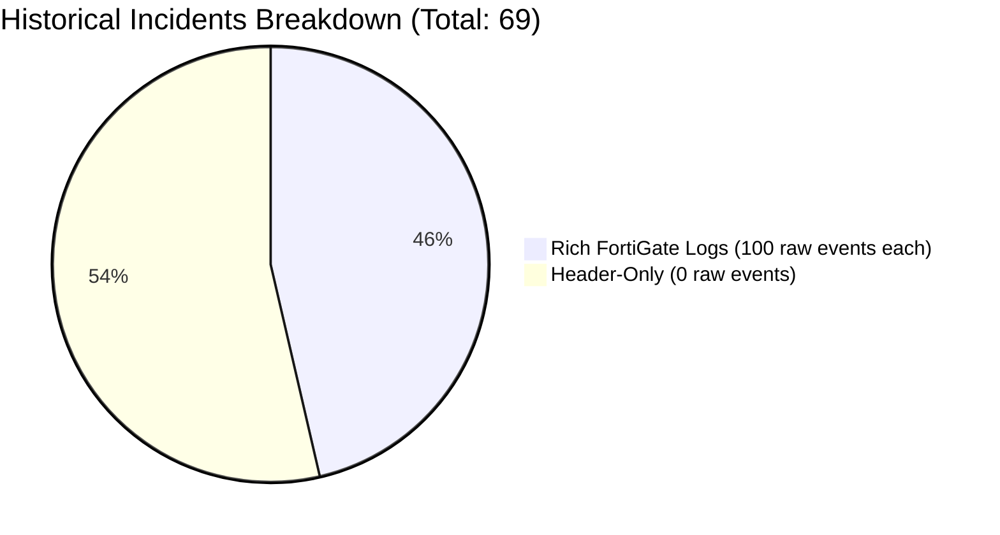

# 06 — Analyst Ground Truth & Learning Pilot Status

**Target Rule:** `Heavy TCP Host Scan On Fixed Port` (`PH_RULE_HEAVY_TCP_HOST_SCAN_FIXED_PORT`, UUID `40498741-ee6b-4a71-9101-0d6d3f77154c`)  
**Current Dataset Ground Truth State:** `INSUFFICIENT_DATA` (`0` verified human analyst labels)  
**Pilot Infrastructure Status:** Fully Functional and Ready for Analyst Queue Triage  

---

## 1. Historical Dataset Inventory & Stratification

An exhaustive audit of the PostgreSQL database on Server 1 confirms the following inventory of historical FortiSIEM incidents matching `PH_RULE_HEAVY_TCP_HOST_SCAN_FIXED_PORT`:

| Stratum / Category | Count | Percentage | Telemetry Completeness | Ground Truth Status | Pilot Eligibility |
| :--- | :---: | :---: | :--- | :--- | :--- |
| **Rich FortiGate Events** | `32` | `46.4%` | Full 100 raw events, TCP flags, session states, firewall actions | **0 Verified Labels** | **Primary Pilot Cohort (High Value)** |
| **Header-Only Incidents** | `37` | `53.6%` | Trigger counts and host IPs only; zero raw packet events | **0 Verified Labels** | **Secondary Cohort (Abstention Testing)** |
| **Total Incident Pool** | **`69`** | **`100.0%`** | Multi-tenant (`GDC_NOC`, `Demo-SOC`) | **`0 / 69` (`0.0%`)** | **`69` Pending Analyst Triage** |

---

## 2. Learning Pilot Workflow & API Endpoints

The Analyst Learning Platform is deployed and operational in `/opt/wysesoc-ai` on Server 1. Analysts and Lead Investigators can immediately begin queue triage via the following endpoints:

1. **Pending Review Queue (`GET /api/rule-learning/analyst-reviews/pending`):**
   - Retrieves unreviewed incidents stratified by tenant and evidence sufficiency.
   - Prioritizes the 32 rich-log incidents for initial ground-truth establishment.

2. **Submit Analyst Review (`POST /api/rule-learning/analyst-reviews`):**
   - Analyst inspects raw FortiGate telemetry, destination IPs, and domain reputations.
   - Submits structured resolution: `TRUE_POSITIVE`, `FALSE_POSITIVE`, or `BENIGN_OPERATIONAL`.
   - Records rationale, observed indicators, and analyst identity.

3. **Dual-Reviewer Adjudication (`POST /api/rule-learning/analyst-reviews/{review_id}/adjudicate`):**
   - In accordance with enterprise governance, high-confidence ground truth requires consensus or senior investigator adjudication.
   - Confirmed records are written to `HistoricalGroundTruth` and indexed for RAG retrieval.

---

## 3. How Verified Analyst Precedents Will Eliminate Model Prior Bias

The empirical findings of V8.1 and V8.2 prove that the 7B AWQ model's reasoning inversion stems from **zero in-context precedents (`NO_VERIFIED_PRECEDENT`)**:
- In the absence of examples, the model defaults to the lexical framing of the rule title (*"Heavy TCP Host Scan"*).
- Once human analysts label 5–10 representative incidents of external HTTPS browsing (e.g. workstations browsing news or cloud SaaS) as `FALSE_POSITIVE` or `BENIGN_WEB_ACTIVITY`:
  1. The RAG engine (`retrieved_precedents_count >= 2`) will inject these exact historical cases into Section 5 of the compiled prompt.
  2. The LLM will see concrete precedents showing that `bidirectional_sessions=100` on port 443 with `service=Browsing` is categorized as benign operational traffic.
  3. This will guide the model toward correct decisive verdicts naturally, while the deterministic `ReasoningIntegrityEngine` continues to protect against any residual hallucinations.

---

## 4. Minimum Sample Size Requirements for G8 Certification

To transition Gate G8 from `INSUFFICIENT_DATA` to a certified empirical accuracy score:
- **Absolute Minimum Required:** `30` independent, verified ground-truth cases.
- **Recommended Target:** `50` verified cases across both tenants (`30` rich-log, `20` header-only).
- **Consensus Requirement:** `>= 80%` inter-analyst agreement.
