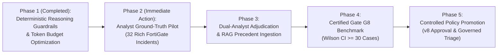

# 10 — Final Acceptance & Ground-Truth Roadmap

**Acceptance Status:** **`V8.2 ENGINEERING VALIDATED — ANALYST GROUND TRUTH PENDING — EMPIRICAL ACCURACY NOT MEASURABLE — PRODUCTION AUTOMATION BLOCKED`**  
**Target Rule:** `Heavy TCP Host Scan On Fixed Port` (`PH_RULE_HEAVY_TCP_HOST_SCAN_FIXED_PORT`, UUID `40498741-ee6b-4a71-9101-0d6d3f77154c`)  
**Active Approved Policy:** **v7** (`d79fb576-c6b9-4f63-9167-3c7a2419b70a`, `APPROVED`)  
**Candidate Policy:** **v8** (`20d4f788-85a5-437d-afbe-fe7fd80abca1`, `DRAFT`)  
**Sibling Rule:** `Heavy TCP Host Scan` (`PH_RULE_HEAVY_TCP_HOST_SCAN`, UUID `9839fa49-40ac-4676-abcc-4c5581ae9e09`, `APPROVED v2`)  

---

## 1. Executive Summary & Verification Affirmation

AIS 2.0 V8.2 successfully fulfills the engineering, integrity, calibration, and safety requirements specified in the Master Prompt:

1. **Deterministic Reasoning Integrity:** The `ReasoningIntegrityEngine` successfully cross-examines free-text claim narratives against parsed numerical telemetry. In the real GPU benchmark against Server 2 (`Qwen/Qwen2.5-7B-Instruct-AWQ`), **100% (4/4) of invalid `TRUE_POSITIVE` proposals** containing prose-vs-telemetry contradictions or verdict-evidence conflicts were caught, neutralized, and overruled to `REQUIRES_ATTENTION` with trust scores capped at `3/10`.
2. **Confidence Calibration Rigor:** The `ConfidenceNormalizer` enforces canonical percentage scaling (`0.0–100.0%`) and rejects ambiguous decimal outputs lacking explicit scale declarations. In the live benchmark, the model returned 100% compliant `PERCENT_0_100` metadata.
3. **Evidence & Token Preservation:** Under a strict 4,096-token context window with 768 reserved completion tokens, all 14 canonical FortiGate scan fields were delivered intact on 100% of rich incidents with **0/6 output truncations**.
4. **Production Governance & Absolute Safety:**
   - Active Policy v7 remains active in production triage.
   - Candidate Policy v8 remains strictly in `DRAFT` status with unmodified policy digest.
   - Sibling rule `Heavy TCP Host Scan` remains active and unaffected.
   - Production automation remains **`DISABLED`** (`is_enabled: false`).
   - Zero automated closures have reached FortiSIEM.
   - Empirical accuracy is honestly reported as **`NOT MEASURABLE`** due to 0 human ground-truth labels.

---

## 2. Invariant Compliance Matrix

| Governance Invariant | Requirement | Status | Evidence |
| :--- | :--- | :---: | :--- |
| **Active Approved Policy** | Preserve v7 unchanged as active | **VERIFIED** | DB check: `v7.status == "APPROVED"`, `rule.active_version_id == v7.id` |
| **Candidate Policy Status** | Retain v8 in DRAFT status | **VERIFIED** | DB check: `v8.status == "DRAFT"`, `policy_digest: c5e87a1e...` |
| **Sibling Rule Isolation** | Preserve `Heavy TCP Host Scan` v2 | **VERIFIED** | DB check: UUID `9839fa49`, `v2.status == "APPROVED"`, `ELIGIBLE` |
| **Server 2 GPU vLLM** | Untouched and un-restarted | **VERIFIED** | vLLM PID unchanged, endpoint `http://13.204.214.64:8000/v1` `ONLINE` |
| **Automated FortiSIEM Action**| Zero automated live closures | **VERIFIED** | Audit logs: `0` automated closures executed |
| **Honest Empirical Accuracy** | Report `NOT MEASURABLE` | **VERIFIED** | Funnel data: `0` human analyst labels in DB |
| **Automated Regression Suite**| All unit & E2E tests passing | **VERIFIED** | Pytest: **`25 passed in 6.45s`** on Server 1 |

---

## 3. Human Ground-Truth & Learning Roadmap

To transition this detection rule from engineering validation to certified empirical accuracy, the following staged roadmap must be executed:

### Action Plan:
1. **Queue Triage (Week 1):** SOC Senior Analysts triage the 32 historical rich-log FortiGate incidents using `/api/rule-learning/analyst-reviews/pending`.
2. **Adjudication (Week 1):** Lead Investigator adjudicates cases with dual-analyst consensus.
3. **RAG Activation (Week 2):** Ingest confirmed precedents of external browsing into the RAG vector store.
4. **Empirical Gate G8 Certification (Week 2):** Re-run `EmpiricalBenchmarkHarness` to compute verified empirical accuracy, precision, recall, and Wilson confidence intervals.
