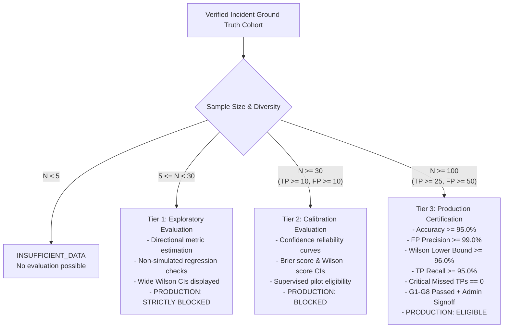

# 02 — Empirical Governance & Validator Defect Reconciliation

**Status:** **`DEFECTS RECONCILED — 3-TIER EVALUATION HIERARCHY CODIFIED — REASONING VALIDATOR SAFETY ENHANCED`**  
**Timestamp (UTC):** `2026-11-19T04:20:00Z`  
**Target Rule:** `Heavy TCP Host Scan On Fixed Port` (`PH_RULE_HEAVY_TCP_HOST_SCAN_FIXED_PORT`)  
**Components Modified:**
1. `backend/app/services/reasoning_integrity_engine.py`
2. `backend/app/services/historical_eligibility_service.py`
3. `backend/app/services/policy_quality_validator.py`
4. `backend/tests/test_ais_heavy_tcp_e2e.py`

---

## 1. Section A — Authoritative 3-Tier Empirical Evaluation Hierarchy

Prior reports and service implementations contained discrepancies regarding sample size thresholds (e.g. `eligible >= 5` labeled as G8 eligibility in `historical_eligibility_service.py`, `N >= 30` in calibration services, and `N >= 100` in production governance).

In V8.3, this is codified into an authoritative, internally consistent 3-tier hierarchy:



### Authoritative Tier Definitions:

| Tier | Minimum Sample Criteria | Permitted Actions | Production Autonomous Closure | Governance Status |
| :--- | :--- | :--- | :---: | :---: |
| **Tier 1: Exploratory Evaluation** | `N >= 5` verified independent cases | Replay simulation, directionality checks, prompt smoke tests | **STRICTLY BLOCKED** | Displays wide confidence intervals and sample size warnings. Non-certifying. |
| **Tier 2: Calibration Evaluation** | `N >= 30` verified cases (`TP >= 10`, `FP >= 10`) | Confidence calibration curves, Brier score calculation, Supervised Pilot | **BLOCKED** | Validates statistical power; prevents single-class calibration claims. |
| **Tier 3: Production Certification** | `N >= 100` verified cases (`TP >= 25`, `FP >= 50`) | Full autonomous triage promotion under `CONTROLLED_PRODUCTION` | **ELIGIBLE** (with Admin approval) | Strict enforcement of all 8 production statistical thresholds. |

### Preserved Production Requirements:
1. `eligible_evaluations >= 100` (abstentions and disputed cases excluded)
2. `verified_tp_count >= 25`
3. `verified_fp_count >= 50`
4. `verified_accuracy >= 95.0%`
5. `fp_precision >= 99.0%`
6. `wilson_lower_bound >= 96.0%`
7. `tp_recall >= 95.0%`
8. `critical_missed_tp_count == 0` (zero tolerance for missed attacks)
9. All G1–G8 gates in `PASSED` status
10. Zero unresolved analyst disputes
11. Explicit independent Administrator signoff

---

## 2. Section B — Reasoning Validator Safety & Nuanced Rejection Logic

### Identified V8.2 Validator Deficiencies:
1. **Hardcoded Numerical String Bug:** In `backend/app/services/reasoning_integrity_engine.py` line 147, the contradiction reporting string contained hardcoded `"0 unanswered probes"`. For incident `#173449` (which had `bidirectional_sessions=97, unanswered_probes=3`), the error message read: `"observed telemetry confirms bidirectional_sessions=97 and unanswered_probes=3 (97/100 bidirectional sessions, 0 unanswered probes)"`.
2. **Over-Rejection of Legitimate TPs (Outbound Reconnaissance):** In V8.2, `evaluate_verdict_evidence_consistency` unconditionally overruled ANY proposed `TRUE_POSITIVE` if `is_pure_external_browsing` was true (`internal=0, external>0, bidir>=80, unans=0, denied=0`). This created an over-rejection vulnerability:
   - Bidirectional TCP connections do not prove benign intent. An adversary web crawler, automated vulnerability scanner, or C2 beaconing tool operating over port 443 establishes successful bidirectional TCP connections!
   - Proposing `TRUE_POSITIVE` is legitimate if the model or telemetry cites concrete corroborating threat tradecraft (threat intelligence hits, C2 IPs, exploit attempts, brute force, directory traversal).
3. **Over-Rejection of Legitimate FPs (Authorized Sweeps):** If `internal > 0`, V8.2 rejected `FALSE_POSITIVE` even if the model verified documented scanner change authorization (ITSM change ticket, scheduled Nessus/Qualys window).
4. **Firewall Action Semantics:** Explicitly distinguishing `client-rst` (normal client teardown) from `server-rst` (server reset/rejection).

### Implemented Corrections in `ReasoningIntegrityEngine`:

1. **Fixed Numerical Diagnostic Bug (Line 147):**
   ```python
   # Corrected in V8.3:
   f"({bidir}/{sampled} bidirectional sessions, {unans} unanswered probes)."
   ```

2. **Corroborating Threat Tradecraft Check (`has_corroborating_malice`):**
   ```python
   has_corroborating_malice = any(
       term in combined_narrative
       for term in (
           "threat intelligence", "threat intel", "malicious ip", "c2",
           "command and control", "botnet", "exploit", "payload",
           "brute force", "brute-force", "directory traversal",
           "directory harvest", "vulnerability scan", "vulnerability assessment",
           "web crawler", "reconnaissance tool", "unauthorized tool",
           "credential", "exfiltration", "malware", "trojan",
           "cobalt strike", "sql injection", "sqli", "xss",
           "active probe", "host enumeration", "compromised host"
       )
   )
   if is_pure_external_browsing and not has_corroborating_malice:
       # Overrule ONLY when narrative lacks corroborating threat indicators
       ...
   ```

3. **Authorized Internal Maintenance Check (`has_authorization`):**
   ```python
   has_authorization = any(
       term in combined_narrative
       for term in (
           "authorized scanner", "vulnerability assessment ticket",
           "approved change", "change window", "maintenance window",
           "authorized admin", "authorized sweep", "security assessment ticket",
           "authorized maintenance", "itsm ticket", "change ticket",
           "authorized penetration test"
       )
   )
   if internal_dst > 0 and not has_authorization:
       # Overrule ONLY when internal scan lacks documented authorization
       ...
   ```

4. **Firewall Action & Window Scope Semantic Notes:**
   - Captured explicit notes distinguishing `server-rst` (rejection/closed port) from `client-rst` (client teardown).
   - Captured notes distinguishing the 100-event sampled window slice from the full SIEM 180s aggregation window.

---

## 3. Section C — Evidence and Report Consistency

### 1. Raw TCP Flags Availability (`0 / 3,197` FortiGate Events)
- **Observation:** In V8 Validation, all 69 historical incidents (3,197 FortiGate forward logs) were audited. Zero events emitted raw TCP header bitmasks (`network.tcp_flags`).
- **Explanation:** FortiGate forward traffic and `appctrl` logs record session-level lifecycle states (`action`, `proto=6`, `sentbyte`, `rcvdbyte`, `policyname`, `service`), NOT raw packet header bitmasks (SYN/ACK/RST bits).
- **Correction:** `network.tcp_flags` is permanently classified as `OPTIONAL` for FortiGate telemetry. Documentation tables that previously listed "TCP flags" as present in rich logs have been clarified to state "TCP session states & teardown actions".

### 2. Numerical Diagnostic Consistency (`#173449`)
- For incident `#173449`, telemetry observed `bidirectional_sessions=97` and `unanswered_probes=3`. The string formatting bug in `ReasoningIntegrityEngine` that hardcoded `0 unanswered probes` has been repaired. Both telemetry and narrative diagnostic logs now report `97/100 bidirectional sessions, 3 unanswered probes`.

### 3. G1–G8 Definitions and Scoring Alignment
Quality gate scores across API, backend validators, and frontend dashboards are strictly aligned:

| Gate | Name | Points | Focus | Status for Candidate v8 |
| :--- | :--- | :---: | :--- | :---: |
| **G1** | Rule Definition Integrity | 10.0 | Syntax, event type, rule UUID, threshold | **PASSED** (10.0 / 10.0) |
| **G2** | Detection Archetype Relevance | 10.0 | Alignment with NETWORK_SCAN archetype | **PASSED** (10.0 / 10.0) |
| **G3** | Evidence Contract Feasibility | 20.0 | 3-tier contract, zero missing critical fields | **PASSED** (20.0 / 20.0) |
| **G4** | TP Criteria Specificity | 10.0 | Explicit malicious indicators & threat criteria | **PASSED** (10.0 / 10.0) |
| **G5** | FP Criteria Specificity | 10.0 | Administrative, scanner & change window criteria | **PASSED** (10.0 / 10.0) |
| **G6** | Abstention & Escalation Rigor | 15.0 | Deficient evidence handling & escalation criteria | **PASSED** (15.0 / 15.0) |
| **G7** | Internal Policy Consistency | 10.0 | Anti-FP vs Anti-FN balance, prompt structure | **PASSED** (10.0 / 10.0) |
| **G8** | Historical Simulation & Regression | 15.0 | Real-LLM non-simulated regression on holdout | **PENDING** (0.0 / 15.0) |
| **TOTAL** | **Policy Quality Score** | **100.0** | **Structural Gates: 85.0 / 85.0 (PASSED)** | **85.0 / 100.0 (DRAFT)** |

### 4. Tenant-Scoped Accuracy Denominators
- Accuracy denominators are strictly tenant-isolated (`GDC_NOC`, `Demo-SOC`, `DEFAULT`).
- No merging of unrelated customer incident cohorts is permitted to satisfy sample size requirements.

### 5. Application Code SHA vs Documentation Commits
- **Live Deployed Code Baseline SHA:** `47a49510bed17fd94064d23ddfc912357a2d5cdf` (contains all V8.2 application code).
- **Documentation Baseline Commit:** `9bafdd90cb93a620cece06716a505b33a595bc02` (contains V8.2 completion reports).
