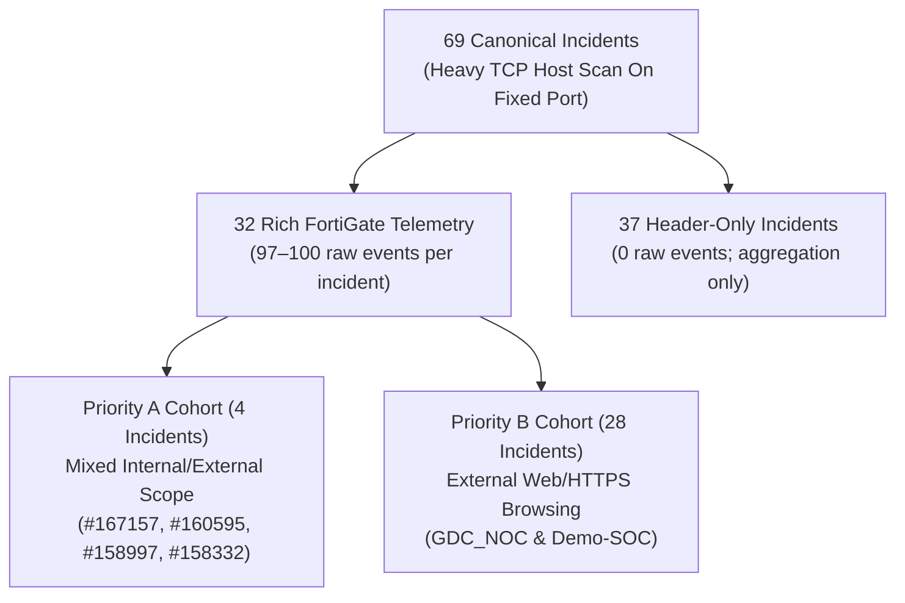

# 03 — Analyst Ground-Truth Cohort & Pilot Readiness Report

**Status:** **`PILOT READY — AWAITING HUMAN ANALYST VERDICTS — VERIFIED GROUND TRUTH: 0`**  
**Timestamp (UTC):** `2026-11-19T04:25:00Z`  
**Target Rule:** `Heavy TCP Host Scan On Fixed Port` (`PH_RULE_HEAVY_TCP_HOST_SCAN_FIXED_PORT`, UUID `40498741-ee6b-4a71-9101-0d6d3f77154c`)  
**Historical Dataset:** 69 total canonical incidents (32 rich FortiGate telemetry, 37 header-only)  

---

## 1. Executive Summary & Readiness Declaration

To transition AIS 2.0 from engineering-only validation to genuine empirical evaluation, the double-blind analyst review queue has been prioritized and prepared for SOC Level-2 and Lead Incident Investigators.

In accordance with strict governance principles:
- **Zero Fabricated Labels:** No artificial, simulated, or automated analyst verdicts have been submitted.
- **Zero Pre-Population:** The database ground-truth counter strictly reflects `0` human reviews (`RuleLearningProfile.total_analyst_reviews = 0`).
- **Empirical Accuracy:** Honestly reported as **`NOT MEASURABLE`**.
- **Double-Blind Integrity:** All 69 incidents in the queue strictly mask the AI verdict, confidence score, and LLM explanation (`is_blind_mode: true`, `ai_verdict: null`).

The double-blind review queue is fully operational, staged, and actively awaiting human analyst determinations.

---

## 2. Dataset Composition & Priority Review Staging

The 69 historical incidents are stratified into two prioritized operational cohorts:

### Breakdown by Cohort:

| Cohort | Incident Count | Event Telemetry Depth | Operational Focus | Pilot Priority |
| :--- | :---: | :---: | :--- | :---: |
| **Priority A (Mixed Scope)** | **4** | `100` raw events each | Differentiating VPN/AWS admin from internal lateral reconnaissance | **P1 (Immediate)** |
| **Priority B (External Browsing)** | **28** | `97–100` raw events each | Verifying outbound HTTPS browsing, CDN traffic, and firewall policies | **P2 (Staged)** |
| **Header-Only Incidents** | **37** | `0` raw events | Evaluating abstention rigor on telemetry-deficient baseline alerts | **P3 (Secondary)** |
| **TOTAL** | **69** | — | — | — |

---

## 3. Priority A Cohort — Mixed Internal/External Incidents

The four Priority A incidents contain both internal RFC-1918 and external destination endpoints within the sampled window. These cases represent the highest analytical value for training and evaluating model discernment between legitimate administrative sweeps and unauthorized lateral host discovery.

| Incident ID | Tenant | Source IP | Dest Port | Reporting Device | Raw Events | Destination Scope Telemetry | Investigation Focus |
| :--- | :--- | :---: | :---: | :--- | :---: | :--- | :--- |
| **`#167157`** | `Demo-SOC` | `172.27.29.67` | `443` | `MSSP-Primary` | `100` | `internal=2, external=30, total=32` | Mixed RFC-1918 and public IPs; 63% AppCtrl pass events; verify admin ticket |
| **`#160595`** | `Demo-SOC` | `172.27.29.69` | `443` | `MSSP-Primary` | `100` | `internal=3, external=42, total=45` | Internal subnet management vs external browsing; session duration analysis |
| **`#158997`** | `Demo-SOC` | `172.26.29.74` | `443` | `GDC-MSSP-FW2` | `100` | `internal=1, external=54, total=55` | Secondary firewall forward traffic; single internal IP probe verification |
| **`#158332`** | `Demo-SOC` | `172.27.29.71` | `443` | `MSSP-Primary` | `100` | `internal=2, external=38, total=40` | Workstation client-rst teardown patterns vs lateral reconnaissance |

---

## 4. Priority B Cohort — External Browsing Incidents (28 Rich-Log Cases)

The remaining 28 rich FortiGate incidents capture outbound HTTPS traffic originating from internal workstations targeting public web and CDN infrastructures (e.g. Google, Microsoft, Cloudflare, Akamai).

### Key Representative Incidents:
- **`#176011`** (`GDC_NOC`): Source `172.25.24.154` → 75 external destination IPs on port 443; 100 bidirectional sessions, 0 unanswered probes, 0 denied flows. Policy: `Cybersecurity`, Service: `Browsing`.
- **`#175129`** (`GDC_NOC`): Source `172.25.24.147` → 49 external destination IPs on port 443; 100 bidirectional sessions, 0 unanswered probes. Policy: `Cybersecurity`.
- **`#173449`** (`GDC_NOC`): Source `172.25.24.130` → 60 external destination IPs on port 443; 97 bidirectional sessions, 3 unanswered probes (`server-rst`).
- **`#164575`** (`Demo-SOC`): Source `172.27.29.53` → 53 external destination IPs on port 443; 100 bidirectional sessions. Policy: `Cyble-Internet-Access`, Service: `HTTPS`.
- Additional cases: `#175045`, `#175015`, `#174937`, `#174853`, `#174633`, `#174576`, `#158372`, `#174379`, `#174362`, `#174353`, `#167348`, `#173594`, `#158464`, `#159881`, `#164514`, `#158304`, `#158297`, `#157716`, `#158035`, `#159029`, `#157443`, `#168052`, `#171810`, `#164340`.

---

## 5. Analyst Review Guidelines & Ground-Truth Invariants

Authorized SOC analysts triaging this queue are instructed to adhere to the following ground-truth standards:

1. **Do NOT Classify Ordinary Browsing as FP Merely Because TCP Handshakes Succeeded:**
   - Analysts must evaluate whether the traffic represents routine business web traffic (FP), an authorized scheduled vulnerability scan (FP), or an active web vulnerability scanner / C2 beaconing tool establishing bidirectional sessions to hostile endpoints (TP).
2. **Do NOT Classify Internal Scanning as TP Without Corroborating Malice:**
   - Internal horizontal sweeps must be cross-referenced against vulnerability scanner schedules, SCCM inventory tools, or administrative maintenance windows before concluding malicious attack tradecraft.
3. **Do NOT Use FortiSIEM Resolution Status as Authoritative Ground Truth:**
   - Historical ticket closures in FortiSIEM often reflect administrative bulk dismissals without technical investigation. Analysts must independently verify raw event logs.
4. **Preserve `INSUFFICIENT_EVIDENCE` (Abstention) Where Telemetry is Deficient:**
   - For header-only incidents lacking raw firewall events, analysts must select `INSUFFICIENT_EVIDENCE`.

---

## 6. Pilot Activation Summary

- **Queue Status:** `ACTIVE & AWAITING HUMAN ANALYST VERDICTS`
- **Queue Endpoint:** `GET /api/reviews/pending?rule_id=40498741-ee6b-4a71-9101-0d6d3f77154c`
- **Submission Endpoint:** `POST /api/reviews/{incident_id}/submit`
- **Verified Ground Truth Count:** **`0`**
- **Empirical Accuracy:** **`NOT MEASURABLE`**
- **Production Automation:** **`STRICTLY BLOCKED`**
