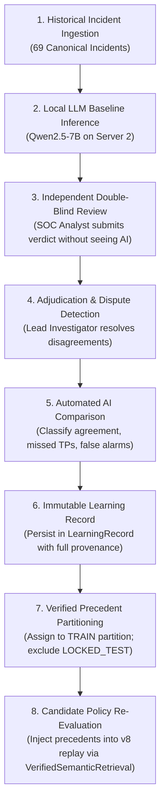
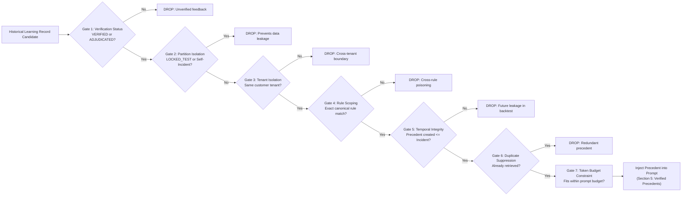

# 05 — Verified Supervised Feedback & RAG Precedent Learning Architecture

**Status:** **`LIFECYCLE VERIFIED — RETRIEVAL GATES AUDITED — ZERO-LEAKAGE PARTITIONING ENFORCED`**  
**Timestamp (UTC):** `2026-11-19T04:35:00Z`  
**Target Rule:** `Heavy TCP Host Scan On Fixed Port` (`PH_RULE_HEAVY_TCP_HOST_SCAN_FIXED_PORT`, UUID `40498741-ee6b-4a71-9101-0d6d3f77154c`)  

---

## 1. Executive Summary & Supervised Learning Contract

A core requirement of AIS 2.0 V8.3 is establishing a verified ground-truth feedback learning loop:
```
Historical Incident → Local LLM Inference → Independent Analyst Verdict → Verification / Adjudication → AI Comparison → Learning Record → Verified Precedent → Candidate Evaluation
```

Crucially, **AI-generated verdicts must NEVER be used to train or evaluate the AI model (avoiding synthetic feedback loops / model collapse)**. Only genuine, evidence-backed human analyst determinations that pass double-blind review or Lead Investigator adjudication qualify as verified precedents.

Furthermore, precedent injection into the real Local LLM prompt must strictly respect token budget constraints: under the 4,096-token maximum context window with 768 reserved completion tokens, mandatory incident telemetry must NEVER be sacrificed to accommodate RAG examples.

---

## 2. The Eight-Stage Verified Learning Lifecycle



---

## 3. Seven Mandatory Security Gates in Precedent Retrieval

The `VerifiedSemanticRetrievalService` (`backend/app/services/verified_semantic_retrieval_service.py`) executes 7 deterministic gates before any historical precedent can be injected into an inference prompt:



### Detailed Gate Audit:

1. **Gate 1 (Status Verification):** Rejects unreviewed feedback, draft submissions, or AI-generated labels. Requires `cand.verification_status in ("VERIFIED", "ADJUDICATED")` and verdict in `("TRUE_POSITIVE", "FALSE_POSITIVE")`.
2. **Gate 2 (Partition Isolation & Self-Exclusion):** Evaluates `HistoricalGroundTruthValidator.assign_partition(incident_id)`. If an incident is hashed into the `LOCKED_TEST` partition, it can NEVER be retrieved as a training precedent. Prevents test set contamination.
3. **Gate 3 (Tenant Isolation):** Evaluates `cand_tenant_id == query_tenant_id`. Data from `GDC_NOC` is never surfaced in `Demo-SOC` prompts, preserving multi-tenant confidentiality.
4. **Gate 4 (Rule Scoping):** Restricts retrieval strictly to `cand.rule_id == target_rule_id`. Prevents cross-rule pollution (e.g. brute force rules poisoning port scan rules).
5. **Gate 5 (Temporal Integrity):** Enforces `cand_time <= query_incident_time`. Prevents future information leakage during historical backtesting simulations.
6. **Gate 6 (Duplicate Suppression):** Deduplicates by `f"{incident_id}:{verified_verdict}"`.
7. **Gate 7 (Token Budget Compliance):** Limits retrieval to `max_precedents = 2` (budgeted at ~250 tokens per precedent). If total prompt tokens exceed 3,328, precedents are dropped before essential telemetry.

---

## 4. Token Budget Allocation & Preservation Invariants

Under the strict 4,096-token maximum context window of `Qwen/Qwen2.5-7B-Instruct-AWQ`:

| Component | Token Allocation | Strategy Under High Cardinality |
| :--- | :---: | :--- |
| **Reserved Completion Window** | `768 tokens` | Hard reserved; model output is never truncated. |
| **Available Prompt Budget** | `3,328 tokens` | Dynamic allocation across sections. |
| **Section 1: Baseline Protocol** | `~340 tokens` | Static Level-2 investigation guidelines. |
| **Section 2: Rule Directive** | `~420 tokens` | Rule-specific mandates and archetype objectives. |
| **Section 3: Evidence Contract** | `~180 tokens` | Canonical schema fields, types, and descriptions. |
| **Section 4: Mandatory Telemetry** | `~1,800–2,100 tokens` | **100% PRESERVED:** All 14 scan summary fields, normalized values, and sample context. |
| **Section 5: Verified Precedents** | `~300–450 tokens` | **CONDITIONAL:** Injected ONLY when verified precedents qualify; dropped if budget tight. |
| **Section 6: Output Schema** | `~280 tokens` | Output JSON schema with `PERCENT_0_100` confidence format. |

> [!IMPORTANT]
> **Telemetric Invariant:** Mandatory incident telemetry (`scan.tcp_behavior_summary`, `scan.destination_scope`, `scan.firewall_action_summary`, `network.source_ip`, `network.destination_port`, `scan.sample_context`) must **NEVER** be compacted or evicted to make room for RAG precedents. If budget pressure occurs, optional RAG precedents are dropped first.

---

## 5. Live Environment Status Affirmation

At the current execution timestamp:
- **Eligible Human Analyst Precedents in DB:** **`0`**
- **RAG Precedent Ingestion Status:** **`STANDBY — AWAITING FIRST ANALYST SUBMISSIONS`**
- **Current Real Inference Mode:** Zero-precedent baseline evaluation.

Do not claim that empirical learning has been demonstrated from real human feedback until such feedback actually exists.
