# 08 — UI & Manual Analyst Acceptance Report

**Status:** **`UI ACCEPTANCE VERIFIED — DOUBLE-BLIND WORKBENCH VALIDATED — HONEST EMPIRICAL REPORTING CONFIRMED`**  
**Timestamp (UTC):** `2026-11-19T04:45:00Z`  
**Frontend Application:** Next.js 14 / React Compact UI (`frontend/src/...`)  
**Target Rule:** `Heavy TCP Host Scan On Fixed Port` (`PH_RULE_HEAVY_TCP_HOST_SCAN_FIXED_PORT`, UUID `40498741-ee6b-4a71-9101-0d6d3f77154c`)  

---

## 1. Executive Summary & UI Verification Scope

Phase 7 evaluated the AIS 2.0 user interface to confirm that the existing compact frontend architecture fully supports the double-blind analyst workflow, displays honest empirical metrics without fabricating progress, and adheres to strict production safety gates.

Key achievements verified:
1. **Zero Sidebar Clutter:** No new top-level sidebar items or redundant pages were added; all workflow capabilities reside cleanly within the established **Agent Intelligence Studio (AIS 2.0)** and **Rule Learning Dashboard**.
2. **Double-Blind Analyst Experience:** Verified that the review workbench strips all AI predictions until an independent analyst verdict is formally committed.
3. **Honest Metric Presentation:** Verified that when zero eligible ground-truth labels exist, the UI renders **`NOT MEASURABLE`** rather than displaying a false `0%`, `100%`, or synthetic confidence gauge.

---

## 2. Ten Core Analyst Workflow Capabilities

```mermaid
flowchart LR
    Select["1. Select Target Rule\n(Heavy TCP Host Scan)"] --> Queue["2. Open Pending Queue\n(32 rich / 37 header-only)"]
    Queue --> Telemetry["3. Inspect Normalized Telemetry\n& Raw FortiGate Events"]
    Telemetry --> Assess["4. Perform Blind Assessment\n(No AI verdict visible)"]
    Assess --> Submit["5. Submit Independent Review\n(Verdict + EV-* citations)"]
    Submit --> Reveal["6. Post-Submission Reveal\n(Compare AI vs Analyst)"]
    Reveal --> Adjudicate["7. L2 Lead Adjudication\n(If dispute detected)"]
    Adjudicate --> Metrics["8. Monitor Rule Learning\n& Empirical G8 Readiness"]
```

| # | Analyst Capability | UI Location / Component | Verification Evidence |
| :---: | :--- | :--- | :--- |
| **1** | **Target Rule Selection** | `frontend/src/app/agent-intelligence-studio/page.tsx` | Dropdown cleanly filters to UUID `40498741...`. |
| **2** | **Pending Reviews Queue** | `RuleLearningDashboard.tsx` (`activeSubTab="workbench"`) | Renders 69 incidents; displays rich vs header-only indicators. |
| **3** | **Raw Event Inspection** | `RuleLearningDashboard.tsx` (Telemetry Viewer) | Expands full 100 raw FortiGate syslog records with parsed attributes. |
| **4** | **Normalized Scan Evidence** | `RuleLearningDashboard.tsx` (Evidence Contract) | Displays all 14 canonical scan fields with EV-* reference tags. |
| **5** | **Double-Blind Verdict Submission** | `RuleLearningDashboard.tsx` (Blind Assessment Form) | Radios for `TRUE_POSITIVE`, `FALSE_POSITIVE`, `INSUFFICIENT_EVIDENCE`. |
| **6** | **Evidence & Rationale Citation** | `RuleLearningDashboard.tsx` (Notes & References) | Text area for investigation notes; multi-select for evidence IDs. |
| **7** | **Post-Submission AI Reveal** | `RuleLearningDashboard.tsx` (Revealed AI Comparison) | Renders AI proposed verdict, confidence, and comparison outcome. |
| **8** | **Adjudication & Dispute View** | `RuleLearningDashboard.tsx` (Adjudication Panel) | Highlights `DISPUTED` cases and allows Lead Investigator resolution. |
| **9** | **Verified Learning Progress** | `RuleLearningDashboard.tsx` (`activeSubTab="metrics"`) | Displays review funnel, eligible counts, and learning stage. |
| **10** | **Empirical Accuracy & G8 Gate** | `RuleLearningDashboard.tsx` (G8 Readiness Section) | Accurately renders `NOT MEASURABLE` and lists 8 production blockers. |

---

## 3. Administrator Governance Dashboard Verification

When viewed by an Administrator or SOC Manager, the governance interface renders all required controls:

1. **Eligible Labeled Cases:** Accurately reflects `0 / 100` required cases.
2. **Pending Human Reviews:** Renders exact queue count (`69` incidents).
3. **Disputed Cases:** Displays `0` unresolved disputes.
4. **Partition Counts:** Displays `TRAIN`, `VALIDATION`, and `LOCKED_TEST` distributions.
5. **Confusion Matrix:** Renders empty state with transparent zero-counters:
   - Agreed TP: `0`
   - Agreed FP: `0`
   - Critical Missed TP: `0`
   - AI False Alarm: `0`
   - Abstained Resolved: `0`
6. **Empirical Metrics:** Displays `NOT MEASURABLE` for Verified Accuracy, FP Precision, TP Recall, and Wilson 95% Lower Bound.
7. **Production Automation State:** Displays **`DISABLED`** (`is_enabled: false`) with emergency kill switch active and responsive.
8. **Production Readiness Blockers:** Cleanly enumerates the 8 unsatisfied criteria required for promotion to `CONTROLLED_PRODUCTION`.

---

## 4. UI Acceptance Affirmation

The frontend interface meets all functional and governance specifications. It prevents analyst bias, preserves complete audit transparency, and provides a clear, compact operating experience for SOC teams.
