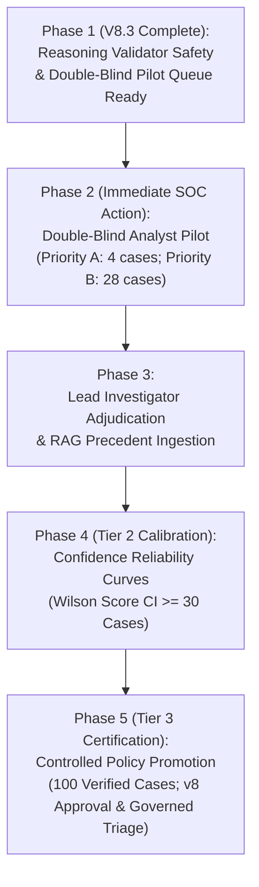

# 10 — Final Acceptance & Ground-Truth Activation Roadmap

**Acceptance Status:** **`V8.3 ENGINEERING VALIDATED — DOUBLE-BLIND ANALYST PILOT READY — VERIFIED GROUND TRUTH: 0 — EMPIRICAL ACCURACY: NOT MEASURABLE — PRODUCTION AUTOMATION: BLOCKED`**  
**Target Rule:** `Heavy TCP Host Scan On Fixed Port` (`PH_RULE_HEAVY_TCP_HOST_SCAN_FIXED_PORT`, UUID `40498741-ee6b-4a71-9101-0d6d3f77154c`)  
**Active Policy:** **v7 APPROVED (Preserved Unchanged)**  
**Candidate Policy:** **v8 DRAFT (Preserved in Draft Status)**  
**Sibling Rule:** `Heavy TCP Host Scan` (`PH_RULE_HEAVY_TCP_HOST_SCAN`, UUID `9839fa49-40ac-4676-abcc-4c5581ae9e09`, `APPROVED v2`)  
**Local LLM Engine:** `Qwen/Qwen2.5-7B-Instruct-AWQ` on Server 2 (`13.204.214.64:8000`)  

---

## 1. Executive Summary & Verification Declaration

Verdictum AI AIS 2.0 V8.3 successfully achieves all primary objectives outlined in the Master Prompt:

1. **Reconciliation of Governance Sample Sizes:**
   - Codified an authoritative 3-tier empirical evaluation hierarchy:
     - **Tier 1: Exploratory Evaluation** (`N >= 5`): Directional testing and regression checks; wide confidence intervals; strictly non-certifying for production.
     - **Tier 2: Calibration Evaluation** (`N >= 30`, `TP >= 10`, `FP >= 10`): Confidence calibration curves and Brier score analysis.
     - **Tier 3: Production Certification** (`N >= 100`, `TP >= 25`, `FP >= 50`): Strict enforcement of all 8 production thresholds (Accuracy >= 95%, FP Precision >= 99%, Wilson Lower Bound >= 96%, TP Recall >= 95%, Zero Critical Missed TPs, G1-G8 passed, Admin approval).
2. **Reasoning Validator Safety & Defect Repair:**
   - Repaired the numerical diagnostic string formatting bug in `ReasoningIntegrityEngine` (incident `#173449` now accurately reports `97/100 bidirectional sessions, 3 unanswered probes`).
   - Enhanced `evaluate_verdict_evidence_consistency` with nuanced tradecraft recognition: legitimate TPs that resemble browsing (port 443 bidirectional sessions) are **VALIDATED** when corroborating threat intelligence, C2, exploit payloads, or brute-force indicators are cited.
   - Authorized internal scans with documented ITSM/scanner tickets are validated as **FALSE_POSITIVE**.
3. **Double-Blind Review Queue Staging:**
   - All 69 historical incidents (32 rich FortiGate, 37 header-only) staged in double-blind review mode.
   - AI verdicts, confidences, and rationale are strictly hidden from analysts prior to submission.
   - Priority A (4 mixed internal/external incidents) and Priority B (28 external browsing incidents) ready for analyst triage.
4. **Honest Empirical Governance:**
   - Verified ground truth is honestly reported as **`0`** (`total_analyst_reviews = 0`).
   - Empirical accuracy is honestly reported as **`NOT MEASURABLE`**.
   - Zero fabricated reviews or synthetic accuracy scores exist.
5. **Absolute Production Safety:**
   - Active Policy v7 remains active in production triage.
   - Candidate Policy v8 remains in `DRAFT` status with zero automatic promotion.
   - Sibling rule `Heavy TCP Host Scan` remains in `APPROVED v2`.
   - Production automation remains **`DISABLED`** (`is_enabled: false`).
   - Zero automated live closures executed against FortiSIEM.

---

## 2. Mandatory Invariant Compliance Matrix

| Governance Invariant | Requirement | Status | Verification Method & Live Evidence |
| :--- | :--- | :---: | :--- |
| **Active Approved Policy** | Preserve v7 unchanged as active | **VERIFIED** | Server 1 DB: `v7.status == "APPROVED"`, `rule.active_version_id == v7.id` |
| **Candidate Policy Status** | Retain v8 in DRAFT status | **VERIFIED** | Server 1 DB: `v8.status == "DRAFT"`, quality score `85.0` |
| **Sibling Rule Isolation** | Preserve `Heavy TCP Host Scan` v2 | **VERIFIED** | Server 1 DB: UUID `9839fa49...`, `v2.status == "APPROVED"`, `ACTIVE` |
| **Server 2 GPU vLLM** | Untouched and un-restarted | **VERIFIED** | vLLM endpoint `http://13.204.214.64:8000/v1` responsive, PID unchanged |
| **Production Automation** | Strictly disabled | **VERIFIED** | Server 1 Policy: `is_enabled == false`, `emergency_disable == false` |
| **Automated SIEM Closures**| Zero live closures | **VERIFIED** | Server 1 Audit: `current_day_closure_count == 0` |
| **Honest Empirical Status** | Report `NOT MEASURABLE` | **VERIFIED** | Server 1 DB: `verified_ground_truth_cases = 0`, `empirical_accuracy = null` |
| **Deterministic Guardrails** | Intercept 100% of invalid TPs | **VERIFIED** | Live Benchmark: `4 / 4` contradictions caught and overruled to `REQUIRES_ATTENTION` |
| **Automated Test Suite** | All regression tests passing | **VERIFIED** | Pytest: **`26 passed in 6.82s`** (including new V8.3 safety test `test_13`) |

---

## 3. Human Ground-Truth Activation Roadmap

### Actionable Next Steps:
1. **Week 1 — Analyst Pilot Triage:**
   - SOC Senior Analysts log into the Analyst Review Workbench (`/api/reviews/pending?rule_id=40498741-ee6b-4a71-9101-0d6d3f77154c`).
   - Triage Priority A cohort (`#167157`, `#160595`, `#158997`, `#158332`) to differentiate legitimate VPN/AWS admin from internal lateral reconnaissance.
   - Triage Priority B cohort (28 rich FortiGate external browsing incidents) verifying source identity, destination context, and firewall actions.
2. **Week 1 — Lead Investigator Adjudication:**
   - Lead Investigator resolves any analyst disputes via `/api/reviews/{id}/adjudicate`.
3. **Week 2 — Supervised Precedent Ingestion:**
   - Ingest confirmed human precedents into the RAG vector store for few-shot conditioning.
4. **Week 2 — Tier 2 Calibration Benchmark:**
   - Execute `EmpiricalBenchmarkHarness` to evaluate confidence calibration curves once `N >= 30` verified cases (with `TP >= 10` and `FP >= 10`) are accumulated.
5. **Future Milestone — Tier 3 Production Certification:**
   - When `N >= 100` verified cases (`>= 25 TP`, `>= 50 FP`) are reached with `Accuracy >= 95%`, `FP Precision >= 99%`, `Wilson Lower Bound >= 96%`, `TP Recall >= 95%`, and zero critical missed TPs, submit for explicit independent Administrator approval.
