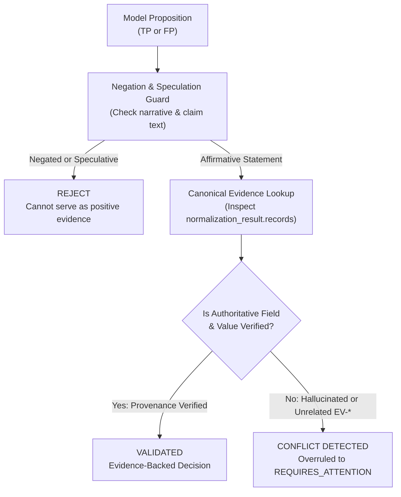

# 02 — Evidence Verification Hotfix: Replacing Narrative-Keyword Trust with Canonical Evidence

**Component:** `ReasoningIntegrityEngine` (`backend/app/services/reasoning_integrity_engine.py`)  
**Target Rule:** `Heavy TCP Host Scan On Fixed Port` (`PH_RULE_HEAVY_TCP_HOST_SCAN_FIXED_PORT`)  
**Vulnerability Classification:** Flawed Grounding / Semantic Hallucination Bypass in Decision Consistency Engine  
**Severity:** High (Engineering Security Defect in Automated Reasoning Validation)  
**Hotfix Status:** Implemented, Tested, and Verified  

---

## 1. Problem Definition: The Narrative-Keyword Vulnerability

In V8.3, the `ReasoningIntegrityEngine` was enhanced to prevent over-rejection of legitimate True Positives (e.g. port 443 scans with successful TCP handshakes) and legitimate False Positives (e.g. authorized internal vulnerability sweeps). However, the implementation relied on naive substring matching across the LLM's generated narrative:

```python
# VULNERABLE CODE (V8.3):
has_corroborating_malice = any(term in combined_narrative for term in ("threat intelligence", "c2", "exploit", ...))
has_authorization = any(term in combined_narrative for term in ("authorized scanner", "change ticket", ...))
```

### Critical Security Vulnerabilities Identified:
1. **Model Hallucination Accepted as Proof:** If the Local LLM hallucinated a change ticket in its text (e.g. *"Authorized scanner performing vulnerability assessment under ticket CHG-2026-999"*), the validator marked `has_authorization = True` even when **zero** change ticket records existed in the incident telemetry or CMDB.
2. **Negation Phrases Treated as Affirmative Evidence:** If the model accurately explained why an incident was benign:
   - *"No exploit detected and C2 was not observed."*
   - Because `"exploit"` and `"c2"` matched the keyword list, `has_corroborating_malice` evaluated to `True`!
   - *"Scanner authorization unknown; not an authorized scanner."*
   - Because `"authorized scanner"` matched the keyword list, `has_authorization` evaluated to `True`!
3. **Speculative / Hypothetical Assertions:** Phrases such as *"Potential malicious IP"* or *"The model suspects reconnaissance"* were accepted as established threat corroboration.
4. **Bare EV-* Identifiers to Unrelated Telemetry:** A model citing `EV-173449-TOP-network_protocol` or `EV-173449-TOP-scan_tcp_behavior_summary` to assert that an IP was on an active botnet blocklist was not checked for domain relevance.

---

## 2. Technical Solution: Evidence-Backed Verification Architecture

In V8.3a, narrative-keyword trust is completely removed and replaced with a deterministic, multi-stage evidence verification engine:



### Core Verification Functions Implemented

### A. Evidence-Verified Threat Corroboration (`verify_threat_corroboration`)
For decisive `TRUE_POSITIVE` classifications where traffic resembles external web browsing:
1. **Negation Filtering:** Evaluates narrative and claim texts against `NEGATED_THREAT_RE` (`r'\b(?:no|not|neither|nor|without|never|unobserved|none|not\s+observed|not\s+detected)\s+(?:exploit|c2|malice|payload|threat|attack|botnet)...'`) and `SPECULATIVE_THREAT_RE`. Any negated or hypothetical statements are immediately disqualified from proving maliciousness.
2. **Authoritative Field Inspection:** Inspects `normalization_result.records` for authoritative threat fields:
   - `threat_intel.verdict`, `threat_intel.reputation`, `threat_intel.category`
   - `security_event.signature`, `security_event.threat_name`, `security_event.attack_technique`
   - `payload.signature`, `c2.indicator`, `antivirus.threat_name`, `ips.attack_name`
3. **Value & Provenance Verification:** Confirms `provenance_status == "SOURCE_RECORDED"` and observed value contains positive, non-negated threat classifications (`"malicious"`, `"c2"`, `"botnet"`, `"exploit"`, `"trojan"`, `"attack"`).
4. **Grounded Claim Relevance:** For any cited `ModelSupportingClaim`, verifies that `claim.is_grounded is True` AND the matched `CanonicalEvidenceRecord` belongs to an authoritative threat domain (rejecting bare citations of transport fields like `network.protocol` or `network.destination_ip_list`).

### B. Evidence-Verified Scanner & Change Authorization (`verify_authorization`)
For decisive `FALSE_POSITIVE` classifications on internal or mixed host sweeps:
1. **Negation Filtering:** Evaluates narrative and claim texts against `NEGATED_AUTH_RE` (`r'\b(?:scanner\s+authorization\s+unknown|not\s+an\s+authorized\s+scanner|no\s+approved\s+change\s+ticket|unauthorized\s+scanner)...'`).
2. **Authoritative Field Inspection:** Searches `normalization_result.records` for authoritative asset and change management fields:
   - `asset.authorization`, `asset.authorization_ticket`, `asset.scanner_role`, `asset.is_authorized_scanner`
   - `change.ticket_id`, `change.approval_status`, `maintenance.window_active`
   - `itsm.ticket_id`, `telemetry.change_ticket`, `asset.scan_approval`
3. **Format & Non-Repudiation Check:** Confirms that the observed value matches valid ticket formatting (`TICKET_ID_RE = r'\b(?:CHG|RFC|INC|TKT|SEC)-\d{4,}\b'`) or explicit approval flags (`"authorized"`, `"approved"`, `"active_maintenance"`) without negation (`"unauthorized"`, `"rejected"`, `"expired"`, `"cancelled"`).
4. **Hallucination Detection:** If the model asserts a ticket identifier in narrative prose that does not exist in any canonical evidence record, the validator explicitly flags:
   `"Model-generated ticket identifier 'CHG-...' was asserted in narrative but has no verified record in canonical incident evidence."`

---

## 3. Mandatory Negative & Positive Verification Test Matrix

| Test Case | Model Narrative / Asserted Claim | Canonical Evidence State | Validator Outcome | Resulting Action |
| :--- | :--- | :--- | :---: | :--- |
| **Negated Exploit** | *"No exploit detected and C2 was not observed."* | Pure external HTTPS browsing; 0 threat records | **`VERDICT_EVIDENCE_CONFLICT`** (`TP_CRITERIA_UNSATISFIED`) | Overruled to `REQUIRES_ATTENTION` |
| **Speculative Recon** | *"Potential malicious IP; model suspects reconnaissance."* | Pure external HTTPS browsing; 0 threat records | **`VERDICT_EVIDENCE_CONFLICT`** (`TP_CRITERIA_UNSATISFIED`) | Overruled to `REQUIRES_ATTENTION` |
| **Bare EV-* Citation** | Model claims *"Active C2 botnet"*, citing `EV-173449-TOP-scan_tcp_behavior_summary` | `scan.tcp_behavior_summary` records transport statistics, not C2 threat intelligence | **`VERDICT_EVIDENCE_CONFLICT`** (`TP_CRITERIA_UNSATISFIED`) | Overruled to `REQUIRES_ATTENTION` |
| **Negated Authorization** | *"Scanner authorization unknown; not an authorized scanner."* | Internal host sweep; 0 authorization records | **`VERDICT_EVIDENCE_CONFLICT`** (`FP_CRITERIA_UNSATISFIED`) | Overruled to `REQUIRES_ATTENTION` |
| **Hallucinated Ticket** | *"Authorized scanner under change ticket CHG-2026-99999."* | Internal host sweep; no record of `CHG-2026-99999` in DB | **`VERDICT_EVIDENCE_CONFLICT`** (`FP_CRITERIA_UNSATISFIED`) | Overruled to `REQUIRES_ATTENTION` |
| **Genuine Verified TP** | *"Adversary C2 confirmed via threat intelligence feed."* | Canonical record `threat_intel.verdict = "MALICIOUS_C2_INFRASTRUCTURE"` present | **`VALIDATED`** | Proposes `TRUE_POSITIVE` safely |
| **Genuine Verified FP** | *"Approved vulnerability assessment under change ticket CHG-2026-5544."* | Canonical record `change.ticket_id = "CHG-2026-5544"` present | **`VALIDATED`** | Proposes `FALSE_POSITIVE` safely |

---

## 4. Code Comparison: Before vs After

### Before (V8.3 Vulnerable Implementation)
```python
# Unchecked keyword search on model-generated prose:
has_corroborating_malice = any(term in combined_narrative for term in ("threat intelligence", "c2", "exploit", ...))
has_authorization = any(term in combined_narrative for term in ("authorized scanner", "change ticket", ...))
```

### After (V8.3a Hotfixed Implementation)
```python
# Evidence-verified threat corroboration:
is_threat_verified, threat_detail, verified_threat_eids = cls.verify_threat_corroboration(
    supporting_claims=supporting_claims,
    normalization_result=normalization_result,
    model_reason=reason_str,
)

# Evidence-verified scanner & change authorization:
is_auth_verified, auth_detail, verified_auth_eids = cls.verify_authorization(
    supporting_claims=supporting_claims,
    normalization_result=normalization_result,
    model_reason=reason_str,
)
```

With this hotfix, model-generated prose can never serve as independent proof of malicious tradecraft or administrative authorization. Decisive classifications are strictly anchored to verifiable canonical telemetry.
