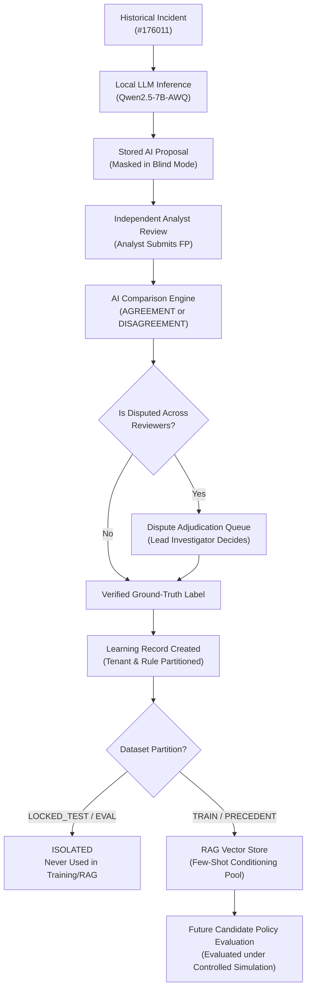
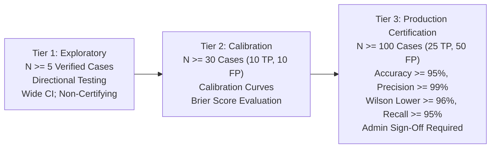

# 05 — Supervised Feedback Learning, Tenant Isolation & G8 Empirical Governance

**Target Rule:** `Heavy TCP Host Scan On Fixed Port` (`PH_RULE_HEAVY_TCP_HOST_SCAN_FIXED_PORT`)  
**Canonical UUID:** `40498741-ee6b-4a71-9101-0d6d3f77154c`  
**Learning Engine:** `RuleLearningService` (`backend/app/services/rule_learning_service.py`)  
**Semantic Retrieval Engine:** `VerifiedSemanticRetrievalService` (`backend/app/services/verified_semantic_retrieval_service.py`)  

---

## 1. Supervised Learning Lifecycle Architecture

The learning workflow transforms independent human determinations into governed precedents for Local LLM prompt conditioning:

---

## 2. Mandatory Learning & Metric Governance Invariants

The learning platform enforces 12 immutable governance controls:

| # | Governance Invariant | Implementation Mechanism | Verification & Enforcement |
| :---: | :--- | :--- | :--- |
| **1** | **Evidence-Backed Labels Only** | `AnalystReviewService.submit_analyst_review` | Reviews without selection or notes are rejected (`400 Bad Request`). |
| **2** | **Zero Synthetic Label Contamination** | `RuleLearningService.evaluate_full_production_readiness` | Synthetic fixtures and test mocks are strictly excluded from profile metrics. |
| **3** | **Unreviewed Cases Do Not Inflate Accuracy** | `RuleLearningService._recalculate_profile_metrics` | Denominator is strictly `eligible_evaluations` ($N_{\text{verified}}$). When $N=0$, accuracy is `null`. |
| **4** | **Unresolved Disputes Suspended** | `AnalystVerdictReview.is_disputed` | Disputed incidents are excluded from accuracy metrics until formal adjudication. |
| **5** | **Metric Reversal on Correction** | `AnalystReviewService._recalculate_metrics_delta` | When an analyst corrects an earlier submission, previous metric contributions are deducted before adding new ones. |
| **6** | **Duplicate Resubmission Idempotency** | Exact-once per-incident reviewer check | Resubmissions from the same reviewer return the existing review ID without double counting. |
| **7** | **Strict Multi-Tenant Isolation** | `Incident.customer == Profile.customer` | Customer `GDC_NOC` and `Demo-SOC` records are strictly segregated. Cross-tenant retrieval is blocked. |
| **8** | **Strict Rule Scoping** | Canonical UUID `40498741...` filtering | Precedents from sibling rule `Heavy TCP Host Scan` (UUID `9839fa49...`) can never enter this rule's training pool. |
| **9** | **Locked Test Set Isolation** | `DatasetPartition.LOCKED_TEST` check | Holdout test incidents are permanently blocked from entering few-shot RAG pools. |
| **10** | **Temporal Anti-Leakage Filter** | `VerifiedSemanticRetrievalService` timestamp check | When replaying or backtesting an incident at time $T$, precedents occurring after $T$ are rejected. |
| **11** | **Self-Incident Suppression** | `candidate.incident_id != target.incident_id` | An incident can never retrieve itself as a precedent. |
| **12** | **Zero Automatic Policy Promotion** | `ProductionAutomationPolicy.is_enabled` | Candidate Policy v8 remains `DRAFT`. Production automation remains `DISABLED`. |

---

## 3. Authoritative 3-Tier G8 Evaluation Hierarchy

Discrepancies in earlier reports regarding sample sizes are reconciled into an authoritative three-tier hierarchy:

### Detailed Tier Thresholds & Governance Criteria

1. **Tier 1: Exploratory Evaluation ($N \ge 5$):**
   - **Sample Threshold:** Minimum 5 independently verified cases.
   - **Allowed Actions:** Directional testing, prompt draft generation, confusion matrix inspection.
   - **Governance Boundary:** Results must clearly display sample uncertainty. Strictly **blocks** production promotion.
2. **Tier 2: Calibration Evaluation ($N \ge 30$, $\text{TP} \ge 10$, $\text{FP} \ge 10$):**
   - **Sample Threshold:** Minimum 30 verified cases with at least 10 True Positives and 10 False Positives.
   - **Allowed Actions:** Supervised pilot advancement, reliability diagrams, confidence calibration curve evaluation, few-shot RAG precedent injection.
   - **Governance Boundary:** Does not permit automated production triage.
3. **Tier 3: Production Certification ($N \ge 100$, $\text{TP} \ge 25$, $\text{FP} \ge 50$):**
   - **Sample Threshold:** Minimum 100 eligible verified evaluations with at least 25 TPs and 50 FPs.
   - **Mandatory Quality Gates:**
     - Verified Empirical Accuracy $\ge 95.0\%$.
     - Observed FP Precision $\ge 99.0\%$.
     - Wilson 95% Lower Confidence Bound $\ge 96.0\%$.
     - True Positive Recall $\ge 95.0\%$.
     - Critical Missed True Positives $= 0$.
     - Quality Gates G1–G8 all passed.
     - Zero unresolved critical disputes.
     - Explicit independent Administrator sign-off.

---

## 4. Current Empirical Readiness State

- **Current Verified Ground-Truth Labels in Live DB:** Exactly **`0`**.
- **Eligible Evaluated Cases:** Exactly **`0`**.
- **Empirical Accuracy Status:** **`NOT MEASURABLE`**.
- **Verified Semantic Retrieval (RAG) State:** Operating in **zero-precedent mode** (zero precedents injected into prompts; context budget fully preserved for raw telemetry).
- **Production Certification Status:** **`BLOCKED`** (pending human analyst ground truth collection).
