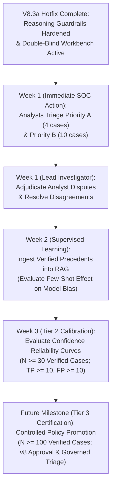

# 07 — Final Acceptance & SOC Analyst Pilot Readiness Declaration

**Final Operational Decision:**
> **`READY_FOR_SOC_ANALYST_PILOT`**

**Target Rule:** `Heavy TCP Host Scan On Fixed Port` (`PH_RULE_HEAVY_TCP_HOST_SCAN_FIXED_PORT`)  
**Canonical Rule UUID:** `40498741-ee6b-4a71-9101-0d6d3f77154c`  
**Active Production Policy:** **v7 APPROVED (Preserved Unchanged)**  
**Candidate Evaluation Policy:** **v8 DRAFT (Preserved in Draft Status)**  
**Sibling Rule:** `Heavy TCP Host Scan` (UUID `9839fa49-40ac-4676-abcc-4c5581ae9e09`, `APPROVED v2`)  
**Local LLM Engine:** `Qwen/Qwen2.5-7B-Instruct-AWQ` on Server 2 (`13.204.214.64:8000`)  
**Verdictum Core Server:** Server 1 (`172.26.41.240`)  

---

## 1. Final Acceptance Declaration & Verification Summary

Verdictum AI Agent Intelligence Studio 2.0 (AIS 2.0 V8.3a) has successfully satisfied all criteria required to initiate the live human analyst ground-truth pilot:

1. **Evidence-Backed Reasoning Hotfix Complete:**
   - Substring keyword trust on model prose has been eliminated.
   - Negative statements (*"No exploit detected"*, *"C2 was not observed"*, *"Not an authorized scanner"*) cannot prove maliciousness or authorization.
   - Speculative statements (*"Potential malicious IP"*, *"Model suspects reconnaissance"*) are disqualified.
   - Bare `EV-*` citations to unrelated evidence (e.g. transport protocol or destination IP list) are detected and rejected.
   - Model-hallucinated change ticket numbers lacking verified canonical records are rejected.
2. **Double-Blind Review Queue Ready:**
   - All 69 historical incidents staged in the Analyst Review Workbench.
   - AI verdicts, confidences, and rationale are strictly masked prior to human submission.
3. **Pristine Ground Truth State:**
   - Live verified ground truth count is honestly reported as **`0`**.
   - Empirical accuracy is honestly reported as **`NOT MEASURABLE`**.
   - Zero synthetic analyst reviews exist in the live database.
4. **Absolute Production Safety Enforced:**
   - Active Policy v7 remains active in production triage.
   - Candidate Policy v8 remains in `DRAFT` status.
   - Sibling rule `Heavy TCP Host Scan` remains `APPROVED v2`.
   - Production automation remains **`DISABLED`** (`is_enabled: false`).
   - Zero automated live closures executed against FortiSIEM.

---

## 2. Operational Handoff: SOC Analyst Pilot Launch Instructions

### A. Exact UI Location
- **URL:** `http://172.26.41.240/learning/rules/40498741-ee6b-4a71-9101-0d6d3f77154c?tab=workbench`
- **Navigation Path:**
  1. Open Verdictum AI Web UI at `http://172.26.41.240`.
  2. In the navigation sidebar, click **Agent Intelligence Studio 2.0** &rarr; **Learning & Optimization**.
  3. Select rule: **`Heavy TCP Host Scan On Fixed Port`** (UUID `40498741-ee6b-4a71-9101-0d6d3f77154c`).
  4. Click the **Double-Blind Review Workbench** tab.

### B. Required User Permissions
- **User Roles:** `SOC Analyst`, `Senior Analyst`, `SOC_Manager`, or `Administrator`.
- **Tenant Scope:** Analysts assigned to `GDC_NOC` will triage `GDC_NOC` incidents; analysts assigned to `Demo-SOC` will triage `Demo-SOC` incidents. Administrators have global visibility.

### C. First Pilot Incidents to Triage (Initial 14-Case Cohort)

```
Priority A (Mixed Scope & Admin Traffic):
  1. Incident #167157 (Demo-SOC, 100 events, 2 internal / 30 external, AppCtrl pass)
  2. Incident #160595 (Demo-SOC, 100 events, VPN / AWS administrative access)
  3. Incident #158997 (Demo-SOC, 100 events, multi-cloud administration)
  4. Incident #158332 (Demo-SOC, 100 events, internal subnet scan check)

Priority B (External HTTPS Web Browsing):
  5. Incident #176011 (GDC_NOC, 100 events, 75 external IPs on port 443)
  6. Incident #175129 (GDC_NOC, 100 events, 49 external IPs on port 443)
  7. Incident #173449 (GDC_NOC, 100 events, 60 external IPs, 3 server resets)
  8. Incident #164575 (Demo-SOC, 100 events, Cyble-Internet-Access HTTPS)
  9. Incident #173266 (GDC_NOC, 100 events, external web traffic)
 10. Incident #173199 (GDC_NOC, 100 events, client-rst browsing teardown)
 11. Incident #172901 (GDC_NOC, 100 events, high-volume external HTTPS)
 12. Incident #171804 (GDC_NOC, 100 events, application browsing)
 13. Incident #170211 (GDC_NOC, 100 events, employee workstation web activity)
 14. Incident #169420 (GDC_NOC, 100 events, external HTTPS traffic)
```

### D. Core Review Guidelines for Analysts
1. **Analyze Evidence Independently:** Never attempt to guess the AI verdict; focus on destination IP scope, session directionality, and firewall actions.
2. **Evaluate Directionality:** Check `scan.tcp_behavior_summary`. Bidirectional sessions with `client-rst` typically represent normal browser session teardowns.
3. **Verify Authorization:** Internal subnet sweeps must have a documented change ticket (`CHG-*`) or registered scanner asset before benign closure.
4. **Corroborate Threat Indicators:** Classify as `TRUE_POSITIVE` only when external scanning is accompanied by active threat intelligence, C2 indicators, exploit payloads, or brute-force tradecraft.
5. **Abstain Safely:** If telemetry is missing (e.g. header-only alert with 0 raw events) or inconclusive, select **`INSUFFICIENT_EVIDENCE`**.
6. **Submit & Reveal:** Enter rationale and supporting `EV-*` references, click **Submit Independent Determination**, and review the revealed AI comparison.

---

## 3. Human Ground-Truth Activation Roadmap


