# WyseSOC AI — End-to-End Architecture and Data Flow Audit

**Document:** `01_ARCHITECTURE_AND_DATA_FLOW_AUDIT.md`  
**Platform:** WyseSOC AI (Verdictum AI)  
**Target Incident ID:** 176061 (`68ec2d89-d8d3-4c5c-9aec-ec6ea77a1eff`)  
**AI Inference Engine:** Server 2 (`Qwen/Qwen2.5-7B-Instruct-AWQ` on vLLM, Port 8000)  
**Status:** VERIFIED & IMPLEMENTED  

---

## 1. Executive Summary

This architecture and data-flow audit establishes the technical foundation for the end-to-end evidence processing pipeline in WyseSOC AI. The audit examines the complete lifecycle of security event telemetry from raw SIEM ingestion on Server 1, through parsing, canonical schema normalization, archetype classification, evidence context assembly, LLM prompt synthesis, Server 2 model inference, response claim extraction, independent verification, database persistence, and frontend rendering.

---

## 2. Technology Stack Overview

### 2.1 Backend (Server 1)
- **Framework:** FastAPI (Python 3.11 / 3.12) with asynchronous ASGI endpoints (`uvicorn`).
- **Data Persistence & ORM:** SQLAlchemy with SQLite (local/dev) and PostgreSQL (production).
- **Data Modeling & Validation:** Pydantic v2 for canonical schemas, request/response contracts, and strict validation.
- **LLM Client:** Asynchronous OpenAI-compatible client (`AsyncOpenAI`) interfacing with the vLLM OpenAI-compatible endpoint on Server 2 (`http://<SERVER_2_IP>:8000/v1`).
- **Telemetry & Logging:** Structured JSON audit logs, cryptographic replay hashing (`SHA-256`), and runtime execution provenance tracking.

### 2.2 Frontend
- **Framework:** Next.js 14 (App Router, React 18, TypeScript).
- **Styling:** Tailwind CSS with dark-mode security operations center theme.
- **Component Architecture:** Modular UI components (`AITriageWorkbenchDetailPage`, `ServerInfrastructureMonitor`, `HistoricalTelemetryTimeline`, `TokenBifurcationWidget`).
- **State Management & Communication:** React Hooks with custom API abstraction layer (`frontend/src/lib/api.ts`).

### 2.3 AI Inference Engine (Server 2)
- **Host:** Dedicated GPU inference server running vLLM daemon.
- **Model:** `Qwen/Qwen2.5-7B-Instruct-AWQ` (4-bit AWQ quantized, high-throughput, structured JSON compliance).
- **Context Window:** Configurable up to 32,768 tokens (targeted at 16,384 tokens with 8,192 token input budget).
- **Serving Protocol:** OpenAI-compatible REST API `/v1/chat/completions` with constrained decoding (`response_format={"type": "json_object"}`).

---

## 3. Incident Ingestion and Parsing Subsystem

### 3.1 Ingestion Service (`backend/app/services/ingestion_service.py`)
- **Ingestion Entrypoints:**
  - REST API endpoint: `POST /api/v1/incidents/ingest`
  - SIEM webhook receiver: FortiSIEM JSON format with top-level attributes and nested `events` array.
- **Raw Event Structure:**
  - FortiSIEM incidents contain incident-level header attributes:
    - `incidentSrc`: Source IP address string or host identifier.
    - `incidentTarget`: Target IP address string or host identifier.
    - `incidentRptIp`: Reporting firewall/device IP address.
    - `incidentRptDevName`: Reporting device hostname.
    - `incidentDetail`: Raw incident description string.
    - `incidentDetailJson`: Serialized JSON payload containing detailed event properties.
  - Linked granular event records (`Event` model) storing:
    - `raw_log`: Full unparsed syslog/CEF string (e.g. FortiGate UTM webfilter syslog).
    - `parsed_details`: JSON dictionary of semi-structured attributes extracted by FortiSIEM parser (e.g. `{"Source IP": "192.0.2.48", "Destination IP": "198.51.100.32", "Web Site Category": "Entertainment"}`).

### 3.2 Evidence Normalization Service (`backend/app/services/evidence_normalization_service.py`)
The normalization layer transforms heterogeneous vendor logs and unstructured syslog strings into a unified canonical schema (`CanonicalEvidenceRecord`):
1. **Syslog Key-Value Extraction:** Tokenizes raw text matching `(\w+)=(?:"([^"]*)"|(\S+))` to extract embedded attributes (`srcip`, `dstip`, `url`, `catdesc`, `action`).
2. **Key Sanitization:** Cleans attribute names by removing spaces, dashes, dots, and converting to lowercase (e.g. `"Source IP"` $\to$ `"sourceip"`, `"Web Site Category"` $\to$ `"websitecategory"`).
3. **Canonical Field Mapping:** Resolves vendor aliases to standardized canonical paths:
   - `network.source_ip` $\leftarrow$ `["source_ip", "src_ip", "srcip", "sourceip", "src", "client_ip"]`
   - `network.destination_ip` $\leftarrow$ `["destination_ip", "dest_ip", "dstip", "destinationip", "dst", "server_ip"]`
   - `http.url` $\leftarrow$ `["url", "request_url", "uri", "http_url", "target_url"]`
   - `webCategory` $\leftarrow$ `["webcategory", "catdesc", "websitecategory", "urlcategory", "category"]`
   - `security.action` $\leftarrow$ `["action", "act", "disposition", "status"]`
4. **Provenance Tracking:** Records whether a field was obtained via `DIRECT`, `ALIASED`, or `KEY_VALUE_EXTRACTED` transformation.

---

## 4. AI Evidence Context Builder and Token Management

### 4.1 Token Budgeting (`backend/app/services/evidence_compaction_service.py`)
- Manages an effective 8,192 token input budget targeting a 16,384 token model context window.
- Allocates fixed token reservations for:
  - System Prompt & Safety Directives: 1,500 tokens.
  - Policy Requirements & Detection Rule: 1,200 tokens.
  - Semantic Precedents (RAG): 1,000 tokens.
  - Output Completion Reserve: 2,048 tokens.
  - Incident Evidence Telemetry: Dynamic remainder (~4,000 to 10,000 tokens).

### 4.2 Compaction & Priority-Based Selection
- Assigns priority tiers to canonical evidence fields:
  - **Priority 1 (Mandatory Identifiers):** `event.timestamp`, `network.source_ip`, `security.event_type`, `network.destination_ip`.
  - **Priority 2 (High-Value Telemetry):** `user.name`, `endpoint.hostname`, `process.name`, `security.action`.
  - **Priority 3 (SOC Investigation Attributes):** `http.url`, `webCategory`, `http.method`, `http.status_code`, `network.service`.
  - **Priority 4 (Contextual Telemetry):** Byte counts, packet counts, interface names.
- Compaction performs deterministic deduplication across identical events, eliminating redundant log entries while preserving time ranges, occurrence counters, and unique attributes.

---

## 5. Detection Archetypes and Rule Intelligence

### 5.1 Detection Archetype Registry (`backend/app/services/detection_archetype_registry.py`)
Categorizes detection rules into standardized archetypes with explicit field expectations:
- `POLICY_VIOLATION`:
  - **Mandatory Core Fields:** `network.source_ip`, `security.event_type`, `event.timestamp`.
  - **Conditional Fields:** `user.name`, `http.url`, `webCategory`, `network.destination_ip`, `http.status_code`, `security.action`, `endpoint.hostname`.
- `WEB_ATTACK`:
  - **Mandatory Core Fields:** `network.source_ip`, `http.url`, `http.method`.
  - **Conditional Fields:** `http.status_code`, `user_agent`, `payload`.
- `BRUTE_FORCE`:
  - **Mandatory Core Fields:** `network.source_ip`, `user.name`, `event.timestamp`.
- **Precedence Rule:** Policy violation and web filtering rules take precedence over web application attack archetypes to prevent requiring non-logged HTTP methods (such as `GET`/`POST`) on perimeter webfilter drops.

---

## 6. Model Claim Extraction and Independent Validation

### 6.1 Model Claim Extractor (`backend/app/services/model_claim_extractor.py`)
- Inspects the structured JSON output from Server 2 Qwen model.
- Parses analytical claims asserted in the verdict `reason` and `supporting_evidence`.
- Links claims to cited evidence IDs (`EV-176061-001`, `EV-176061-TOP-source_ip`).
- Performs type-aware verification (`compare_evidence_values`) for IP addresses, URLs, HTTP codes, and categories.

### 6.2 Independent Verdict Validator (`backend/app/services/independent_verdict_validator.py`)
- Operates strictly after LLM inference as an independent, deterministic gatekeeper.
- Validates that:
  1. All claims are grounded in verified telemetry (`grounding_ratio == 1.0`).
  2. No telemetry contradictions exist (e.g. claiming loopback when source != destination).
  3. False-positive criteria are satisfied by affirmative evidence rather than assumptions.
  4. Mandatory core fields for the rule archetype are present.
- If validation fails, the verdict is downgraded to `REQUIRES_ATTENTION` with confidence `0.0%`, preserving analyst safety.

---

## 7. End-to-End Data Flow Architecture

```mermaid
flowchart TD
    SIEM["FortiSIEM Log Ingestion\n(Syslog / JSON Webhook)"] --> IngestService["IngestionService\n(backend/app/services/ingestion_service.py)"]
    IngestService --> RawDB[("Database Storage\nIncident & Event Models")]
    
    RawDB --> NormService["EvidenceNormalizationService\n- Syslog KV Regex Extractor\n- Alias Dictionary\n- Canonical Evidence Schema"]
    NormService --> CanonStore["Canonical Evidence Records\n(network.source_ip, http.url, etc.)"]
    
    CanonStore --> ArchClass["RuleIntelligenceAnalyzer\n(Archetype: POLICY_VIOLATION)"]
    ArchClass --> Preflight["EvidencePreflightValidator\n(Tracks: PRESENT, NOT_IN_SOURCE, NOT_MAPPED)"]
    
    Preflight --> Compaction["EvidenceCompactionService\n(8K/16K Token Budgeting & Deduplication)"]
    Compaction --> PromptBuild["VerdictPipeline Prompt Assembly\n(System Directives + Evidence Table + Schema)"]
    
    PromptBuild --> vLLM["Server 2 vLLM Inference\n(Qwen2.5-7B-Instruct-AWQ :8000)"]
    vLLM --> JSONParse["LLM Response Parser\n(Structured JSON Extraction)"]
    
    JSONParse --> ClaimExtract["ModelClaimExtractor\n(Type-Aware Value Comparison)"]
    ClaimExtract --> IndValidator["IndependentVerdictValidator\n- Grounding Verification\n- Contradiction Detection\n- FP Criteria Gatekeeper"]
    
    IndValidator --> AuditDB[("Verdict Audit Log Storage\n- Replay Signature SHA-256\n- Snapshot Versioning")]
    AuditDB --> APIEndpoint["Incident Verdict REST API\n(/api/v1/incidents/{id}/ai-verdict)"]
    APIEndpoint --> FrontendUI["Next.js AI Triage Workbench\n- Validation Status & Badges\n- Grounding Diagnostics\n- Preserved History"]
```

---

## 8. Verification Status

| Component | Status | Verification Method |
|---|---|---|
| Ingestion & Header Parser | VERIFIED | Tests T01, T03, T24 |
| Syslog Key-Value Regex | VERIFIED | Tests T02, T04, T23 |
| Canonical Schema Normalization | VERIFIED | Tests T01-T04, T06 |
| Archetype Classification | VERIFIED | Tests T01, T14, T17 |
| Token Budget & Compaction | VERIFIED | 8K/16K Integration Tests |
| Type-Aware Comparison | VERIFIED | Tests T10, T11, T21 |
| Contradiction & FP Validator | VERIFIED | Tests T08, T09, T13, T15 |
| Frontend Diagnostics | VERIFIED | TypeScript Build & Next.js Bundle |
