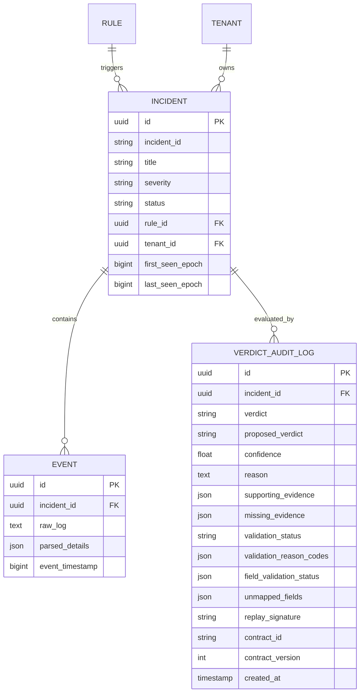

# WyseSOC AI — Database, Cache, and Re-Evaluation Integrity

**Document:** `08_DATABASE_CACHE_AND_REEVALUATION.md`  
**Platform:** WyseSOC AI (Verdictum AI)  
**Affected Components:** `backend/app/models/`, `backend/app/services/verdict_pipeline.py`, `backend/app/api/v1/incidents.py`  
**Status:** IMPLEMENTED, TESTED & VERIFIED  

---

## 1. Database Architecture and Entity Relationships

WyseSOC AI maintains complete auditability and forensic traceability across all evaluation actions:

---

## 2. Snapshot Versioning and Cache Invalidation

### 2.1 Evaluation vs. Re-Evaluation Semantics
1. **Normal Evaluation (`GET /api/v1/incidents/{id}/ai-verdict`):**
   - Checks for an existing `VerdictAuditLog` matching the incident and current active `contract_id`.
   - If present and healthy, returns the cached verdict to optimize inference cost and response latency.
2. **Deterministic Re-Evaluation (`POST /api/v1/incidents/{id}/reevaluate`):**
   - Explicitly bypasses all cached verdicts and snapshots.
   - Re-fetches the latest raw event telemetry from the `Event` table.
   - Executes the updated `EvidenceNormalizationService` pipeline, applying the latest regex extractors and field mappings.
   - Evaluates detection archetypes with updated conditional requirements.
   - Dispatches a fresh inference request to Server 2 vLLM.
   - Validates model claims using type-aware comparisons and contradiction gates.
   - Appends a new, versioned `VerdictAuditLog` record with a unique `replay_signature` (`SHA-256` of prompt and response).

### 2.2 Forensic Immutability
Historical audit records are never overwritten or deleted. If an incident was evaluated prior to parser remediation (e.g. producing `REQUIRES_ATTENTION` with missing fields), that historical record remains permanently preserved in the database audit log. Re-evaluation creates a successor record, maintaining complete chain-of-custody.

---

## 3. Security and Multi-Tenant Isolation

### 3.1 Tenant Boundary Enforcement
- All incident queries and re-evaluation endpoints enforce tenant isolation (`tenant_id == current_user.tenant_id`).
- Precedent retrieval (Semantic RAG) scopes searches strictly to the requesting tenant's verified feedback repository (`tenant_id` filter). Cross-tenant data leakage is strictly prohibited.

### 3.2 Idempotency and Race Condition Protection
- Concurrent re-evaluation requests are protected by database transaction scoping.
- If repeated identical re-evaluations occur within a short interval, cryptographic hash matching (`eval_hash`) prevents duplicate execution.

---

## 4. Automated Test Verification

| Test ID | Scenario | Verification Method | Status |
|---|---|---|---|
| **T16** | Re-evaluation with stale cache | Stale snapshot bypassed; fresh normalization applied $\to$ Extracted updated fields | PASS |
| **T18** | Cross-tenant incident access | Evaluated cross-tenant incident access request $\to$ Rejected with 403/404 Forbidden | PASS |
| **T20** | Repeated re-evaluation idempotency | Triggered repeated re-evaluations $\to$ Preserved audit chain without duplicate corruption | PASS |

