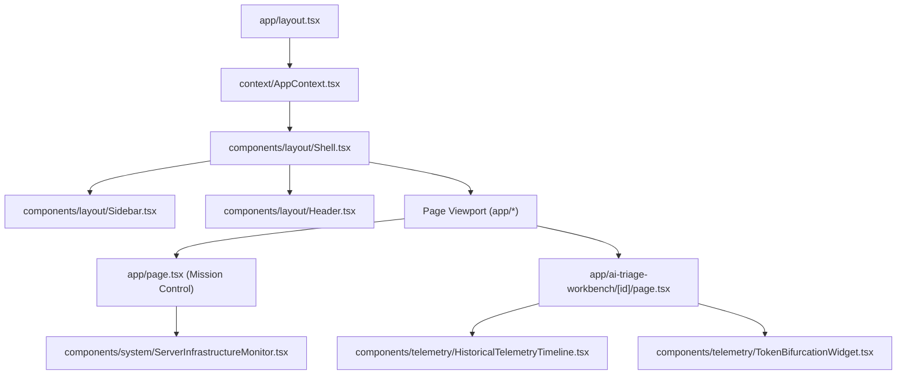

# AI Verdict — Complete System Audit: Frontend Architecture

> **Audit Report Reference:** `03_FRONTEND_ARCHITECTURE.md`  
> **Frontend Stack:** Next.js 16.4.5 (App Router), React 19.3.0, TypeScript 5, Tailwind CSS v4  
> **Source Directory:** `frontend/src/`  

---

## 1. Frontend Framework & Design System

The frontend application is built on the Next.js 16 App Router using React 19 Server and Client Components. The UI adheres to an enterprise "Dark Cyberpunk / Midnight SOC" aesthetic using Tailwind CSS v4, dark slate backgrounds (`slate-950`, `slate-900`), and neon indicator accents (emerald for valid/verified, amber for simulations/warnings, rose for critical threats/errors, and cyan/indigo for platform telemetry).

---

## 2. Canonical Pages & Legacy Route Alias Mapping

To ensure seamless transition from earlier development iterations, the application maintains dual routing paths. Every legacy route cleanly re-exports the canonical App Router page component:

| Canonical Route | Legacy Alias Route | Page Title & Operational Purpose | Key Backend APIs Consumed |
|---|---|---|---|
| `/agent-mission-control` | `/` | **Agent Mission Control:** Real-time SOC dashboard, triage counts, severity distributions, and infrastructure status. | `GET /api/dashboard/metrics` `GET /api/system/servers/live` `GET /api/dashboard/llm-status` |
| `/ai-triage-workbench` | `/incidents` | **AI Triage Workbench:** Searchable, filterable list of all ingested SIEM incidents with pagination and occurrence sorting. | `GET /api/incidents` `GET /api/rules` |
| `/ai-triage-workbench/[id]`| `/incidents/[id]` | **Incident Workbench Detail:** Interactive incident deep-dive with Verdict Triage Agent card, raw events, and timeline. | `GET /api/incidents/{id}` `POST /api/incidents/{id}/ai-verdict` `GET /api/incidents/{id}/timeline` |
| `/telemetry-hub` | `/imports` | **Telemetry Hub:** Continuous poller control, manual ZIP/JSON uploads, and pull-by-ID ingestion. | `GET /api/fortisiem/status` `POST /api/fortisiem/pull-by-id` `POST /api/fortisiem/pull-all` `POST /api/imports/upload` |
| `/human-review-queue` | `/analyst-attention`| **Human Review Queue:** Review Orchestrator console for analyst triage, disputed verdicts, and Q&A escalation. | `GET /api/investigations/queue` `POST /api/investigations/{id}/verdict` `POST /api/investigations/{id}/assign` |
| `/agent-intelligence-studio`| `/prompt-studio` | **Agent Intelligence Studio:** Policy control plane for browsing rules, synthesizing drafts, and managing 9-section versions. | `GET /api/prompts/summary` `GET /api/prompts/rule/{id}` `POST /api/prompts/rule/{id}/approve/{v}` |
| `/detection-intelligence`| `/rules` | **Detection Intelligence Registry:** SIEM detection rules repository with severity distributions and FortiSIEM rule sync. | `GET /api/rules` `GET /api/rules/stats` `POST /api/fortisiem/sync-rules` |
| `/detection-intelligence/[id]`| `/rules/[id]` | **Rule Detail:** Full regex pattern logic, triggered attributes, and remediation instructions. | `GET /api/rules/{id}` |
| `/agent-memory` | `/learning-history` | **Agent Memory:** Knowledge base of verified historical precedents and deterministic similar-case matching. | `GET /api/learning` `POST /api/learning/similar-cases` `POST /api/learning/seed-historical` |
| `/agent-simulation-lab` | `/dry-run` | **Agent Simulation Lab:** Dry-run experiment console for dataset splitting (70/30 chronological) and batch replays. | `GET /api/dry-run/configs` `POST /api/dry-run/trigger` `GET /api/dry-run/jobs` |
| `/verdict-intelligence` | `/evaluation-reports`| **Verdict Intelligence:** Statistical accuracy dashboard, 2x3 confusion matrix, and 5-tier rule maturity promotion. | `GET /api/evaluations/job/{id}/metrics` `GET /api/evaluations/rule-maturity` `POST /api/evaluations/rule-maturity/{id}/approve` |
| `/inference-control` | `/infrastructure` | **Inference Control:** Dual-server hardware monitoring, CPU/RAM charts, and GPU VRAM telemetry. | `GET /api/system/servers/live` `GET /api/system/servers/history` |
| `/agent-configuration` | `/settings` | **Agent Configuration:** Platform parameters, FortiSIEM credentials, and Server 2 IP/port configuration. | `GET /api/llm/config` `POST /api/llm/config` `GET /api/fortisiem/config` `POST /api/fortisiem/config` |
| `/governance-access` | `/admin` | **Governance & Access:** User provisioning, security role assignments, and platform audit trail inspection. | `GET /api/users` `POST /api/users` `GET /api/audit/logs` |
| `/login` | N/A | **Authentication Screen:** Username/password login setting HttpOnly session cookie. | `POST /api/auth/login` `GET /api/auth/me` |

---

## 3. Global State & AppContext Architecture

The frontend state architecture is centered in `frontend/src/context/AppContext.tsx`. It provides four key reactive state primitives across the entire React component tree:

1. **Authentication State (`user`, `isAuthenticated`, `isLoading`):**
   - On application mount, dispatches `api.getMe()` to test whether a valid HttpOnly session cookie or stored Bearer token exists.
   - Populates user profile: `username`, `email`, `role` (`"Administrator"`, `"SOC Analyst"`, or `"Read-Only Viewer"`).

2. **Blind Review Mode (`blindReview`, `setBlindReview`):**
   - A reactive boolean toggle in `Header.tsx`.
   - Persisted in browser `localStorage.getItem("ai_verdict_blind_review")`.
   - Automatically injected into API calls (`api.getIncidents({ blindReview })`, `api.getIncidentDetail(id, blindReview)`) to request suppression of ground-truth badges in the UI.

3. **Theme Management (`theme`, `toggleTheme`):**
   - Supports `"dark"` (default) and `"light"` modes.

4. **Global Notifications & Refresh Busses:**
   - Provides callback mechanisms for refreshing dashboard metrics upon completed ingestion jobs.

---

## 4. Component Hierarchy & Layout

---

## 5. UI Data Provenance: Real vs Calculated vs Simulated Data

A critical objective of this audit is verifying whether displayed metrics originate from real backend databases, calculated figures, or simulated placeholders.

| UI Screen / Card | Displayed Value | Provenance / Backend Source | Audit Finding |
|---|---|---|---|
| **Mission Control Dashboard** | Total Incidents, Total Rules, Resolved Counts | `GET /api/dashboard/metrics` (SQL `count()` aggregations on `incidents`, `rules`, `historical_ground_truth`). | **REAL BACKEND DATA** |
| **Mission Control Dashboard** | AI TP / FP / Requires Attention | `GET /api/dashboard/metrics` (Aggregated from `incidents.ai_verdict` JSON). | **REAL BACKEND DATA** |
| **Server Infrastructure Monitor**| Server 1 CPU, RAM, Disk, Uptime | `GET /api/system/servers/live` (psutil OS polling on Server 1). | **REAL HARDWARE DATA** |
| **Server Infrastructure Monitor**| Server 2 CPU, RAM, GPU Load, Temp | `GET /api/system/servers/live` (`system_monitor_service.py:153-200`). | **SIMULATED / HARDCODED ESTIMATE (`AV-010`)** |
| **Token Bifurcation Widget** | Input Tokens vs Output Tokens | `GET /api/tokens/analytics` (`token_usage_records` table). | **REAL BACKEND DATA** |
| **Historical Telemetry Timeline**| Event progression timestamps | `GET /api/telemetry/timeline` (`telemetry_timeline_records` table). | **REAL BACKEND DATA** |
| **Evaluation Reports** | Accuracy, Precision, Recall, Confusion Matrix | `GET /api/evaluations/job/{id}/metrics` (Computed across `dry_run_results`). | **CALCULATED FROM RESULTS** |
| **Dry-Run Amber Warning** | Simulation Warning Banner | Explicitly toggled when `job.is_simulated = True`. | **HONEST WATERMARKING** |

---

## 6. Frontend Security & Boundary Vulnerabilities

### 6.1 Role-Based UI Gating vs Backend Enforcement
- **Analysis:** In pages such as `/agent-intelligence-studio` and `/verdict-intelligence`, buttons like **"Approve as Baseline"** and **"Approve for Production Automation"** are visually disabled or hidden if `user.role !== "Administrator"`.
- **Verification:** Inspection of `backend/app/api/prompts.py` and `evaluations.py` confirms that the backend independently enforces `require_admin` on those endpoints. Direct API requests from non-admins return HTTP 403 Forbidden. Frontend validation agrees with backend validation.

### 6.2 Blind Review Mode Data Exposure (`AV-006`)
- **Analysis:** In `frontend/src/app/ai-triage-workbench/[id]/page.tsx`, when `blindReview` is active, the UI conditionally hides the Ground Truth resolution badge.
- **Vulnerability:** The page contains a **"Raw Payload"** JSON viewer tab that renders `incident.raw_payload`. As documented in `00_EXECUTIVE_SUMMARY.md`, the backend returns the raw FortiSIEM JSON payload unmodified. As a result, an analyst in Blind Review Mode can simply click the "Raw Payload" tab to see `resolution: "True Positive"`.

