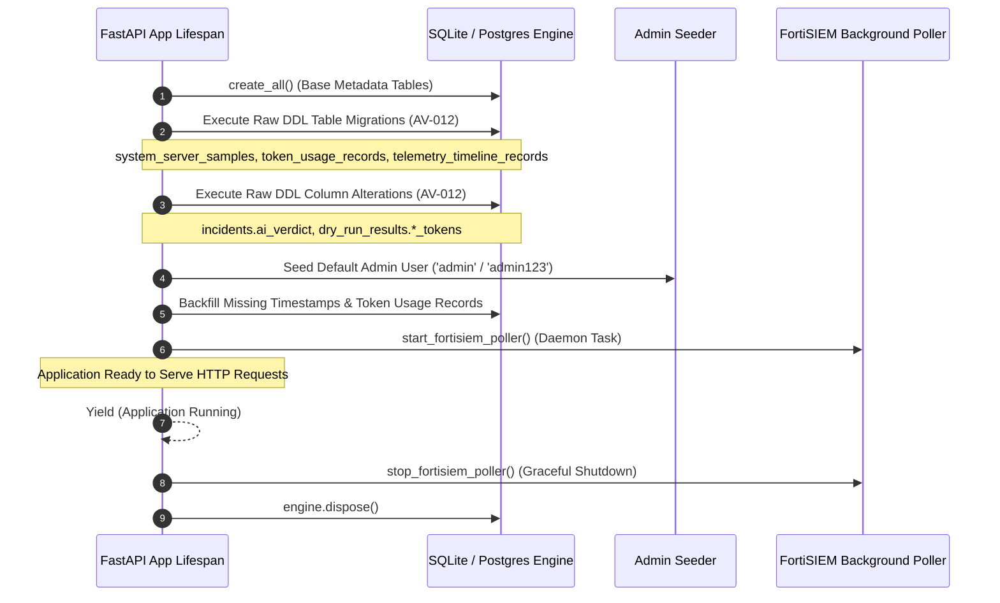

# 04. Backend Architecture Audit

## 1. Overview and Technology Stack

The AI Verdict backend is built as an asynchronous REST service utilizing Python 3.11/3.13 and the FastAPI framework. It handles incident ingestion, detection rule synchronization, LLM prompt engineering, local model inference orchestration, validation simulation (dry-runs), and analyst investigation workflows.

| Component | Technology | Version / Specification | Source Reference |
| :--- | :--- | :--- | :--- |
| **Web Framework** | FastAPI | `^0.110.0` | [`backend/pyproject.toml`](file:///c:/Users/amit/OneDrive/Documents/SOC-AI-Agent/backend/pyproject.toml#L15) |
| **ASGI Server** | Uvicorn | `^0.28.0` (Standard) | [`backend/pyproject.toml`](file:///c:/Users/amit/OneDrive/Documents/SOC-AI-Agent/backend/pyproject.toml#L16) |
| **ORM / Data Access** | SQLAlchemy Async | `^2.0.28` | [`backend/pyproject.toml`](file:///c:/Users/amit/OneDrive/Documents/SOC-AI-Agent/backend/pyproject.toml#L17) |
| **Database Drivers** | aiosqlite / asyncpg | `aiosqlite ^0.20.0`, `asyncpg ^0.29.0` | [`backend/pyproject.toml`](file:///c:/Users/amit/OneDrive/Documents/SOC-AI-Agent/backend/pyproject.toml#L19-L20) |
| **Schema Validation** | Pydantic v2 | `^2.6.4` | [`backend/pyproject.toml`](file:///c:/Users/amit/OneDrive/Documents/SOC-AI-Agent/backend/pyproject.toml#L18) |
| **HTTP Client** | HTTPX | `^0.27.0` | [`backend/pyproject.toml`](file:///c:/Users/amit/OneDrive/Documents/SOC-AI-Agent/backend/pyproject.toml#L22) |
| **Security / Auth** | python-jose, passlib | JWT (HS256), bcrypt hashing | [`backend/pyproject.toml`](file:///c:/Users/amit/OneDrive/Documents/SOC-AI-Agent/backend/pyproject.toml#L24-L25) |
| **Migration Tool** | Alembic | `^1.13.1` (Partially bypassed) | [`backend/pyproject.toml`](file:///c:/Users/amit/OneDrive/Documents/SOC-AI-Agent/backend/pyproject.toml#L21) |

---

## 2. Application Entry Point and Lifespan Context Manager

The backend entry point is defined in [`backend/app/main.py`](file:///c:/Users/amit/OneDrive/Documents/SOC-AI-Agent/backend/app/main.py#L35). The application uses FastAPI's modern `lifespan` context manager rather than legacy startup/shutdown event handlers.

### 2.1 Lifespan Execution Sequence



### 2.2 Critical Lifespan Finding: Raw DDL Schema Alterations (`AV-012`)

During startup, [`main.py`](file:///c:/Users/amit/OneDrive/Documents/SOC-AI-Agent/backend/app/main.py#L42-L135) executes raw SQL strings to create tables and add columns if they do not exist:
- `system_server_samples`
- `token_usage_records`
- `telemetry_timeline_records`
- `ALTER TABLE incidents ADD COLUMN ai_verdict VARCHAR`
- `ALTER TABLE dry_run_results ADD COLUMN prompt_tokens INTEGER`
- `ALTER TABLE dry_run_results ADD COLUMN completion_tokens INTEGER`
- `ALTER TABLE dry_run_results ADD COLUMN total_tokens INTEGER`

> [!WARNING]
> **Architectural Risk (AV-012):** This practice bypasses Alembic migration tracking. Environments migrated via Alembic CLI alone will lack these essential telemetry and token tracking tables unless the FastAPI lifespan executes against the target database.

---

## 3. Middleware and Request Pipeline

The HTTP middleware stack is registered in [`main.py`](file:///c:/Users/amit/OneDrive/Documents/SOC-AI-Agent/backend/app/main.py#L182-L195):

1. **CORS Middleware (`CORSMiddleware`):**
   - Configured via `settings.BACKEND_CORS_ORIGINS`.
   - Defaults allow `http://localhost:3000`, `http://127.0.0.1:3000`, and production host origins.
   - `allow_credentials=True`: Permits cookies in cross-origin requests.
   - `allow_methods=["*"]`, `allow_headers=["*"]`.
2. **Authentication Handling (`backend/app/core/deps.py`):**
   - Supports dual-mode JWT bearer authentication:
     - Primary: Extracted from HTTP Authorization header (`Bearer <token>`).
     - Secondary / Browser: Extracted from HttpOnly cookie `access_token`.

---

## 4. Complete API Router Inventory

All endpoints are mounted under the root `/api` prefix across 17 distinct routers:

| Router Module | Mount Prefix | Endpoints | Authentication / RBAC | Core Responsibility |
| :--- | :--- | :---: | :--- | :--- |
| [`auth.py`](file:///c:/Users/amit/OneDrive/Documents/SOC-AI-Agent/backend/app/api/auth.py) | `/api/auth` | 4 | Public (Login) / Authenticated | User authentication, token issuance, user profile (`/me`), logout. |
| [`incidents.py`](file:///c:/Users/amit/OneDrive/Documents/SOC-AI-Agent/backend/app/api/incidents.py) | `/api/incidents` | 8 | Authenticated / Role-filtered | Incident query, single incident view (with Blind Review suppression), manual ingestion, re-triage. |
| [`rules.py`](file:///c:/Users/amit/OneDrive/Documents/SOC-AI-Agent/backend/app/api/rules.py) | `/api/rules` | 5 | Authenticated / Admin (Create/Update) | Detection rule listing, rule creation, rule editing, deletion, and rule-level statistics. |
| [`prompts.py`](file:///c:/Users/amit/OneDrive/Documents/SOC-AI-Agent/backend/app/api/prompts.py) | `/api/prompts` | 8 | Authenticated / Admin (Approve/Archive) | Agent Intelligence Studio policies, draft synthesizer, 9-section editor, approval state machine, rollback. |
| [`dry_run.py`](file:///c:/Users/amit/OneDrive/Documents/SOC-AI-Agent/backend/app/api/dry_run.py) | `/api/dry-run` | 4 | Authenticated (Analyst / Admin) | Policy validation simulation jobs, job status polling, detailed run results, side-by-side version comparison. |
| [`evaluation.py`](file:///c:/Users/amit/OneDrive/Documents/SOC-AI-Agent/backend/app/api/evaluation.py) | `/api/evaluation` | 3 | Authenticated | Ground-truth benchmark evaluation, Confusion matrix calculation, Accuracy/Recall/F1 metrics. |
| [`learning.py`](file:///c:/Users/amit/OneDrive/Documents/SOC-AI-Agent/backend/app/api/learning.py) | `/api/learning` | 6 | Authenticated / Admin (Verify) | Learning records store, analyst feedback queue, few-shot precedent candidate query, feedback verification. |
| [`metrics.py`](file:///c:/Users/amit/OneDrive/Documents/SOC-AI-Agent/backend/app/api/metrics.py) | `/api/metrics` | 3 | Authenticated | High-level SOC operations metrics, verdict distribution, triage time, resolution rate. |
| [`fortisiem.py`](file:///c:/Users/amit/OneDrive/Documents/SOC-AI-Agent/backend/app/api/fortisiem.py) | `/api/fortisiem` | 6 | Authenticated (Admin for config/sync) | FortiSIEM supervisor credentials config, connectivity test, manual rule sync, manual incident sync. |
| [`system.py`](file:///c:/Users/amit/OneDrive/Documents/SOC-AI-Agent/backend/app/api/system.py) | `/api/system` | 4 | Authenticated | Hardware and operating system metrics (CPU, RAM, GPU, Disk) for Server 1 and Server 2. |
| [`audit.py`](file:///c:/Users/amit/OneDrive/Documents/SOC-AI-Agent/backend/app/api/audit.py) | `/api/audit` | 2 | Admin Only | Immutable security audit log stream, filtering by action, actor, and target entity. |
| [`llm_config.py`](file:///c:/Users/amit/OneDrive/Documents/SOC-AI-Agent/backend/app/api/llm_config.py) | `/api/llm-config` | 4 | Admin Only | Local LLM endpoint URL, model temperature, timeout, mock fallback toggle, connectivity diagnostics. |
| [`server1.py`](file:///c:/Users/amit/OneDrive/Documents/SOC-AI-Agent/backend/app/api/server1.py) | `/api/server1` | 2 | Authenticated | Server 1 (Core Web/API) specific telemetry and health status. |
| [`server2.py`](file:///c:/Users/amit/OneDrive/Documents/SOC-AI-Agent/backend/app/api/server2.py) | `/api/server2` | 2 | Authenticated | Server 2 (GPU Inference Worker) specific telemetry, vLLM status, VRAM consumption. |
| [`dev.py`](file:///c:/Users/amit/OneDrive/Documents/SOC-AI-Agent/backend/app/api/dev.py) | `/api/dev` | 2 | Authenticated (Admin / Development) | Development fixture seeder, reset database demo data, synthetic test incident generation. |
| [`health.py`](file:///c:/Users/amit/OneDrive/Documents/SOC-AI-Agent/backend/app/api/health.py) | `/health` / `/api/health` | 2 | Public | Liveness probe, database ping, basic status. |
| [`root.py`](file:///c:/Users/amit/OneDrive/Documents/SOC-AI-Agent/backend/app/api/root.py) | `/` | 1 | Public | API root information, version string, status. |

---

## 5. Service Layer Architecture

The backend implements business logic via dedicated service classes in `backend/app/services/`:

```
backend/app/services/
├── ai_verdict_service.py       # VerdictTriageAgent: Prompts, LLM invocation, fallback handling
├── ingestion_service.py        # Ingests FortiSIEM ZIPs/JSON, parses rules, normalizes fields
├── fortisiem_service.py        # FortiSIEM REST client, supervisor session, incident/rule queries
├── fortisiem_scheduler.py      # Background 180s polling daemon with 2-minute safety buffer
├── prompt_studio_service.py    # Agent Intelligence Studio: Policy state machine, 9-section framework
├── dry_run_service.py          # Validation engine: Replays historical incidents against prompt versions
├── evaluation_service.py       # Metrics engine: Precision, recall, confusion matrix calculation
├── learning_service.py         # AgentMemoryEngine: Learning records, few-shot candidate search
├── incident_service.py         # Incident queries, timeline building, ground-truth filtering
├── rule_parser.py              # DetectionContextEngine: Regex parsing of SIEM XML/XML-like rules
├── system_monitor_service.py   # Telemetry collector for Server 1 and Server 2
├── llm_config_service.py       # Runtime LLM configuration and network probing
└── audit_service.py            # Audit event writer to audit_logs table
```

---

## 6. Database Transaction Boundaries & Concurrency Control

### 6.1 Session Management
Database sessions are created via `get_db()` dependency in [`backend/app/core/database.py`](file:///c:/Users/amit/OneDrive/Documents/SOC-AI-Agent/backend/app/core/database.py#L42-L47):
```python
async def get_db() -> AsyncGenerator[AsyncSession, None]:
    async with AsyncSessionLocal() as session:
        try:
            yield session
            await session.commit()
        except Exception:
            await session.rollback()
            raise
```
- Standard request handling automatically commits upon successful completion and rolls back on unhandled exceptions.
- Ingestion services and dry-run loops manage their own internal commit checkpoints to prevent gigantic single transactions.

### 6.2 Concurrency Bottleneck Finding (`AV-013`)
In [`dry_run.py`](file:///c:/Users/amit/OneDrive/Documents/SOC-AI-Agent/backend/app/api/dry_run.py#L128-L133), validation runs are executed synchronously within the FastAPI async handler (`await execute_dry_run_job(...)`). There is no Celery or Redis task queue:
- Long simulations (e.g. 500 incidents at 3.5s per inference = 1750 seconds) hold the HTTP connection open.
- Under SQLite, long-running write transactions during simulations block ingestion poller commits.

---

## 7. Exception Handling & Error Suppression

The application employs `fastapi.HTTPException` for standard operational errors (400, 401, 403, 404, 500). However, critical error-suppression patterns exist:

1. **Inference Fallback Suppression (`AV-004`):**
   In [`ai_verdict_service.py`](file:///c:/Users/amit/OneDrive/Documents/SOC-AI-Agent/backend/app/services/ai_verdict_service.py#L225-L235), if the local LLM fails or times out, the service catches the exception and, if `allow_mock` is True, silently returns a simulated verdict:
   ```python
   except Exception as e:
       logger.error(f"Error calling LLM provider: {e}")
       if allow_mock:
           logger.warning("Falling back to simulated provider due to error")
           return await self.simulated_provider.generate_verdict(prompt_text, incident_context)
       raise
   ```
   Because `LOCAL_LLM_ALLOW_MOCK_FALLBACK=true` in `backend/.env`, connection failures to Server 2 produce synthetic 94-96% verdicts without alerting the operator of infrastructure failure.

2. **Ingestion Malformed Event Suppression:**
   In [`ingestion_service.py`](file:///c:/Users/amit/OneDrive/Documents/SOC-AI-Agent/backend/app/services/ingestion_service.py#L442-L460), individual unparseable events in an incident are dropped with a warning log, allowing the incident to be created with partial telemetry.

---

## 8. Summary Assessment

The backend architecture is cleanly structured with strong separation between routers, services, and models. However, it exhibits significant architectural vulnerabilities:
- **Lifespan raw DDL** (`AV-012`) decoupling from Alembic.
- **Synchronous simulation jobs** (`AV-013`) without a background task worker.
- **Silent heuristic fallback** (`AV-004`) masking model failures.
- **Cleartext configuration persistence** (`AV-014`) in `.env`.

