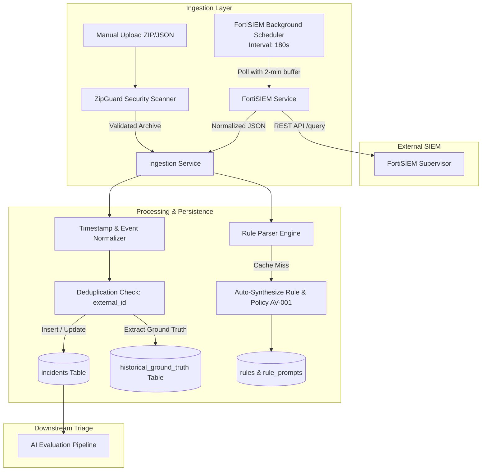

# 05. SIEM Ingestion and Integrations Audit

## 1. Executive Summary

This report documents the ingestion pipeline, SIEM integration architecture, and telemetry normalization engine within AI Verdict. The primary SIEM integration target is **Fortinet FortiSIEM (Supervisor REST API)**, supplemented by batch file ingestion supporting ZIP archives containing raw incident payloads, events, and rule definitions.

---

## 2. Ingestion Methods and Architecture

The platform supports two primary ingestion modalities:
1. **Automated Continuous Polling:** A background scheduler periodically queries the FortiSIEM Supervisor REST API for new and updated incidents.
2. **Manual File Ingestion (ZIP / JSON):** Security engineers can upload exported FortiSIEM archives directly via the UI or REST API.

---

## 3. FortiSIEM Supervisor Integration

### 3.1 Authentication and Client Configuration
- **Implementation File:** [`backend/app/services/fortisiem_service.py`](file:///c:/Users/amit/OneDrive/Documents/SOC-AI-Agent/backend/app/services/fortisiem_service.py#L42-L120)
- **Protocol:** HTTPS REST API using HTTP Basic Authentication (`Authorization: Basic <base64>`).
- **Endpoint Structure:**
  - Connectivity Test: `GET /phoenix/rest/version` or `GET /phoenix/rest/config/system`
  - Incident Query: `POST /phoenix/rest/incident/query` with XML/JSON search criteria.
  - Incident Detail: `GET /phoenix/rest/incident/detail/<incident_id>`
  - Event Telemetry Query: `POST /phoenix/rest/event/query`
- **Session Management:** Stateless per-request authentication using `httpx.AsyncClient`.
- **SSL / TLS Verification:** Enabled by default, configurable via `FORTISIEM_VERIFY_SSL`.

### 3.2 Continuous Polling Scheduler
- **Implementation File:** [`backend/app/services/fortisiem_scheduler.py`](file:///c:/Users/amit/OneDrive/Documents/SOC-AI-Agent/backend/app/services/fortisiem_scheduler.py#L25-L95)
- **Polling Frequency:** 180 seconds (3 minutes) loop interval.
- **Watermark & Safety Buffer Strategy:**
  - The scheduler maintains a `last_poll_timestamp` watermark in memory.
  - On each polling cycle, the scheduler applies a **2-minute safety buffer**:
    $$\text{Query Start Time} = \text{last\_poll\_timestamp} - 120\text{ seconds}$$
  - This prevents incident loss caused by delayed indexing or event clock drift on the FortiSIEM supervisor.

---

## 4. Archive Ingestion & ZipGuard Sandbox

Manual upload of incident bundles is protected by `ZipGuard` to defend against zip bombs and path traversal vulnerabilities.

- **Implementation File:** [`backend/app/core/zip_guard.py`](file:///c:/Users/amit/OneDrive/Documents/SOC-AI-Agent/backend/app/core/zip_guard.py#L18-L92)
- **Security Controls:**
  | Defense Parameter | Limit | Enforcement Action |
  | :--- | :--- | :--- |
  | **Max Uncompressed Size** | 250 MB | Abort extraction with `ZipBombDetectedException` |
  | **Max Total Files** | 2,000 files | Abort extraction if exceeded |
  | **Compression Ratio Limit** | 50 : 1 | Abort if uncompressed/compressed exceeds 50 |
  | **Path Traversal Defense** | Strict verification | Rejects entries with `..`, absolute paths (`/` or `C:\`), or null bytes |

---

## 5. Normalization, Deduplication, and Field Mapping

### 5.1 Timestamp Heuristics
Because raw SIEM exports exhibit varying timestamp formats and timezones, [`ingestion_service.py`](file:///c:/Users/amit/OneDrive/Documents/SOC-AI-Agent/backend/app/services/ingestion_service.py#L175-L215) implements an iterative parsing engine:
1. ISO-8601 strings (`2026-03-29T10:15:30Z`).
2. Millisecond epoch timestamps (`1711707330000`).
3. Standard epoch timestamps (`1711707330`).
4. FortiSIEM custom string formats (`MM/DD/YYYY HH:mm:ss`).
5. Missing or unparseable timestamps default to `datetime.utcnow()`.

### 5.2 Event Telemetry Normalization
In [`ingestion_service.py`](file:///c:/Users/amit/OneDrive/Documents/SOC-AI-Agent/backend/app/services/ingestion_service.py#L220-L290), event attributes are mapped to standard SOC primitives:
- `src_ip`, `dest_ip`
- `src_port`, `dest_port`
- `user`, `host_name`
- `process_name`, `cmdline`
- `file_path`, `hash_md5`, `hash_sha256`

### 5.3 Deduplication Logic
- Incidents are uniquely identified by `external_id` (the native FortiSIEM incident ID).
- If `external_id` already exists:
  - If the incident is already closed or triaged, existing AI verdicts are **not overwritten** unless an explicit re-triage is requested.
  - Status updates (e.g. resolution changes in SIEM) update the local record.

---

## 6. Ground-Truth Segregation During Ingestion

During ingestion, [`ingestion_service.py`](file:///c:/Users/amit/OneDrive/Documents/SOC-AI-Agent/backend/app/services/ingestion_service.py#L320-L365) inspects the payload for historical resolution markers:
- `clearedReason`, `resolution`, `comments`, `clearedUser`.
- If present, a corresponding record is written to the `historical_ground_truth` table, marking whether the historical incident was resolved as `TRUE_POSITIVE` or `FALSE_POSITIVE`.
- However, as identified in finding **AV-006**, the complete raw JSON containing these exact ground-truth fields is stored in `incidents.raw_payload`, causing data leakage during Blind Review mode.

---

## 7. Downstream Actions and SIEM Write-Back Audit

> [!IMPORTANT]
> **Audit Finding:** The application is **100% READ-ONLY** with respect to the FortiSIEM Supervisor.

1. **Absence of Write-Back:** There are **zero** API calls or functions in the codebase that modify FortiSIEM incident status, update comments, assign analysts, or close tickets on the supervisor.
2. **Ticketing Integration:** There is no integration with ServiceNow, Jira, or external SOAR platforms.
3. **Operational Consequence:** The AI Verdict system operates as an **out-of-band analytical advisory console**. Analysts must manually transfer verdicts or close incidents directly inside FortiSIEM.

---

## 8. Failure Modes and Data Resiliency

| Scenario | Behavior in Code | Source Reference | Severity |
| :--- | :--- | :--- | :--- |
| **FortiSIEM Supervisor Offline** | Poller logs connection error, increments backoff, retries in 180s. Does not crash server. | [`fortisiem_scheduler.py#L75-L82`](file:///c:/Users/amit/OneDrive/Documents/SOC-AI-Agent/backend/app/services/fortisiem_scheduler.py#L75-L82) | Low |
| **Corrupted ZIP File** | ZipGuard raises exception; upload is rejected with HTTP 400. Staging files purged. | [`zip_guard.py#L85-L91`](file:///c:/Users/amit/OneDrive/Documents/SOC-AI-Agent/backend/app/core/zip_guard.py#L85-L91) | Low |
| **Unknown Detection Rule** | Automatically synthesizes placeholder rule and auto-activates draft prompt (`AV-001`). | [`ingestion_service.py#L720-L728`](file:///c:/Users/amit/OneDrive/Documents/SOC-AI-Agent/backend/app/services/ingestion_service.py#L720-L728) | **Critical** |
| **Malformed Event Fields** | Corrupt events dropped with warning; incident created with partial event array. | [`ingestion_service.py#L450-L458`](file:///c:/Users/amit/OneDrive/Documents/SOC-AI-Agent/backend/app/services/ingestion_service.py#L450-L458) | Medium |
| **Duplicate Ingestion** | Primary key constraint on `external_id` triggers update branch; skips re-triage. | [`ingestion_service.py#L510-L535`](file:///c:/Users/amit/OneDrive/Documents/SOC-AI-Agent/backend/app/services/ingestion_service.py#L510-L535) | Low |

