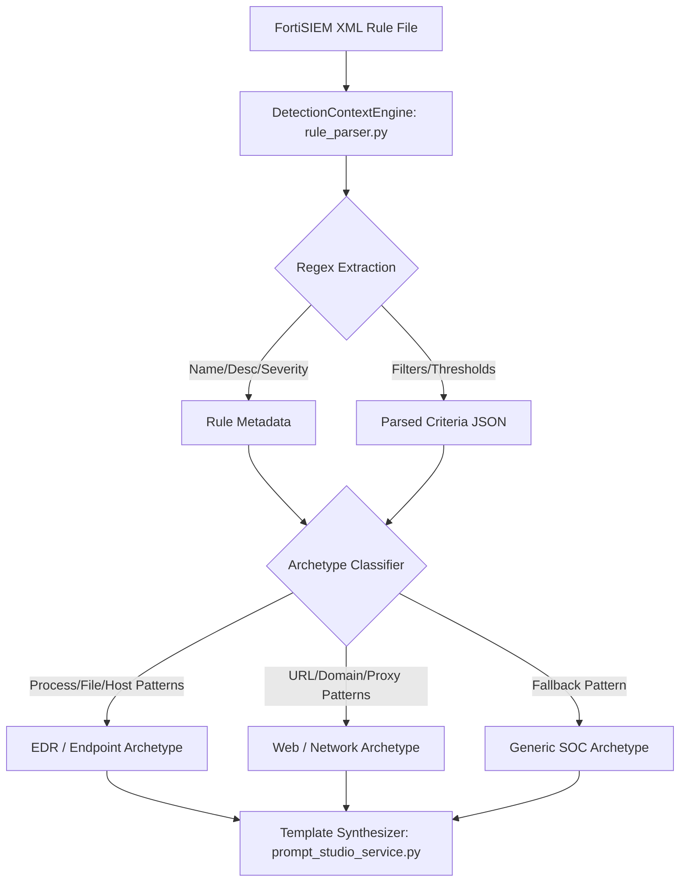

# 06. Detection Rule Engine Audit

## 1. Executive Summary

The Detection Rule Engine is responsible for importing, parsing, cataloging, and categorizing SIEM detection rules. It translates vendor-specific rule representations (primarily FortiSIEM XML rule exports) into structured relational models within the `rules` database table. These rules form the contextual foundation upon which the Agent Intelligence Studio synthesizes triage policies.

---

## 2. Detection Rule Architecture & Data Model

Rules are persisted in the `rules` table, mapped by [`backend/app/models/rule.py`](file:///c:/Users/amit/OneDrive/Documents/SOC-AI-Agent/backend/app/models/rule.py#L12-L45):

| Field Name | Type | Constraints | Description |
| :--- | :--- | :--- | :--- |
| `id` | Integer | Primary Key | Internal autoincrement ID. |
| `rule_id` | String | Unique, Indexed | SIEM native identifier (e.g. `PH_RULE_PHISHING_MALWARE`). |
| `name` | String | Not Null | Human-readable rule title. |
| `description` | Text | Nullable | Functional explanation of the detection logic. |
| `severity` | String | Default: `MEDIUM` | Normalized severity (`LOW`, `MEDIUM`, `HIGH`, `CRITICAL`). |
| `raw_content` | Text | Nullable | Raw XML or text export from the SIEM. |
| `parsed_criteria` | JSON | Nullable | Extracted conditions, event filters, and threshold rules. |
| `created_at` | DateTime | UTC Timestamp | Creation record timestamp. |
| `updated_at` | DateTime | UTC Timestamp | Last update timestamp. |

---

## 3. Rule Ingestion and Parsing Engine

### 3.1 Parser Implementation (`rule_parser.py`)
- **Class:** `DetectionContextEngine` in [`backend/app/services/rule_parser.py`](file:///c:/Users/amit/OneDrive/Documents/SOC-AI-Agent/backend/app/services/rule_parser.py#L22-L185)
- **Mechanism:** Line-by-line regular expression parsing of FortiSIEM XML rule structures.
- **Extracted Attributes:**
  - `<ruleName>` $\rightarrow$ `name`
  - `<ruleDescription>` $\rightarrow$ `description`
  - `<ruleSeverity>` $\rightarrow$ Normalized severity integer/string
  - `<eventFilter>` / `<pattern>` $\rightarrow$ Extracted boolean expressions and field conditions.



### 3.2 Heuristic Archetype Classification
The rule parser automatically classifies rules into one of three behavioral archetypes to drive policy synthesis:
1. **EDR / Endpoint Archetype:** Detected via keywords such as `process`, `cmdline`, `hash`, `powershell`, `svchost`, `parent_process`.
2. **Web / Network Archetype:** Detected via keywords such as `url`, `http`, `domain`, `uri`, `user_agent`, `proxy`, `firewall`.
3. **Generic SOC Archetype:** Default fallback when neither endpoint nor web patterns dominate.

---

## 4. Rule Synchronization and API Routing

### 4.1 Route Discrepancy (`AV-015`)
The platform documentation specifies that detection rules are synchronized via:
`POST /api/rules/sync/fortisiem`

In the actual implementation:
- **Actual Route:** `POST /api/fortisiem/sync-rules` in [`backend/app/api/fortisiem.py`](file:///c:/Users/amit/OneDrive/Documents/SOC-AI-Agent/backend/app/api/fortisiem.py#L115-L145).
- The route under `rules.py` does not exist, representing an API contract discrepancy.

### 4.2 Sync Logic
1. Authenticates to FortiSIEM Supervisor.
2. Queries active rules via `GET /phoenix/rest/config/rules`.
3. Compares fetched `rule_id` against the local database.
4. Updates existing records if definitions changed; inserts new rules if missing.

---

## 5. Critical Vulnerability: Dynamic Rule & Policy Auto-Creation (`AV-001`)

During incident ingestion ([`ingestion_service.py`](file:///c:/Users/amit/OneDrive/Documents/SOC-AI-Agent/backend/app/services/ingestion_service.py#L607-L730)), if an incoming incident references a rule name or rule ID that does not exist in the database:

1. **Auto-Synthesis of Rule:** The service synthesizes a new `Rule` record using the incident title.
2. **Auto-Synthesis of Policy:** The service creates a `RulePrompt` record and calls `synthesize_draft_prompt()` to generate a 9-section SOC directive.
3. **Immediate Auto-Activation:**
   ```python
   # ingestion_service.py lines 724-726
   rp.active_version_id = draft.id
   db.add(rp)
   await db.commit()
   ```
   The generated heuristic draft is immediately set as the **active, production policy** without review or approval by a SOC Administrator.

> [!CAUTION]
> **Operational Risk (AV-001):** Any incoming alert with an unrecognized rule ID causes an unverified AI triage policy to become immediately active in production. If the heuristic archetype misclassifies the alert, subsequent incidents evaluated under this rule will be triaged using flawed instructions.

---

## 6. Detection Logic Limitations & Semantics Preservation

| Feature | Audited Implementation | Risk / Limitation |
| :--- | :--- | :--- |
| **Complex Boolean Logic** | Regex extracts simple field-operator-value pairs. Nested XML `<and>` / `<or>` groups are flattened into a simple list. | Fine-grained threshold conditions (e.g. 5 failures within 60 seconds followed by 1 success) lose temporal sequence context. |
| **Vendor Syntax Translation** | Translates FortiSIEM event attributes to internal naming convention. | Vendor-specific attributes outside standard mapping are omitted from `parsed_criteria`. |
| **Rule Versioning** | The `rules` table stores only the current definition; it lacks a historical version table. | If a rule is updated on FortiSIEM, historical incident audit trails cannot reference the exact rule text present at the time of detection. |
| **Rule Deletion Handling** | Hard delete via `DELETE /api/rules/{id}` cascades to rule prompts and prompt versions. | Deleting a rule destroys the audit trail of previous dry-run results and AI prompt versions associated with that rule. |

