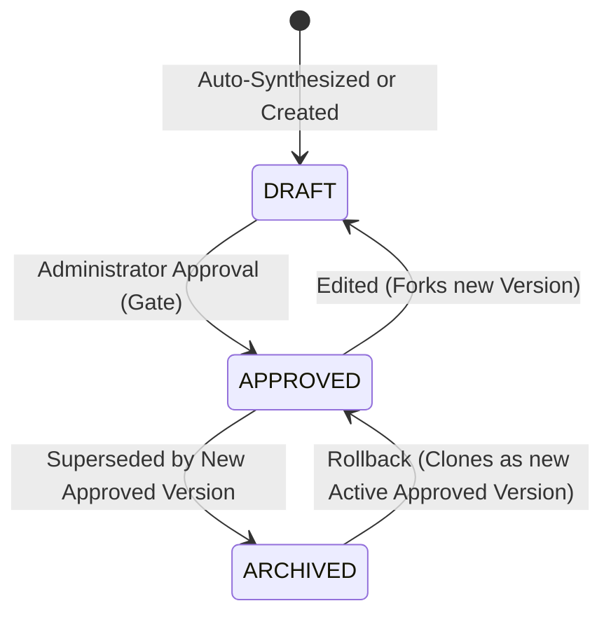

# 07. Agent Intelligence Studio Audit

## 1. Executive Summary

The Agent Intelligence Studio (AIS) is the operational core of the AI Verdict platform. It governs how detection rules are translated into explicit triage directives for local LLMs. AIS implements a **9-section structured prompt framework**, deterministic cold-start template generation, version control, and administrative approval gates.

This audit evaluates the policy engine, data models, state machine transitions, and discovered governance vulnerabilities.

---

## 2. 9-Section Structured Directive Framework

Each prompt version implements a standardized 9-section SOC policy framework, mapped in the `prompt_versions` table ([`backend/app/models/prompt_version.py`](file:///c:/Users/amit/OneDrive/Documents/SOC-AI-Agent/backend/app/models/prompt_version.py#L12-L58)):

| Section # | Section Name | Database Column | Purpose |
| :---: | :--- | :--- | :--- |
| **1** | Role & Objective | `role_and_objective` | Establishes the agent persona and analytical boundary. |
| **2** | Incident & Rule Context | `incident_and_rule_context` | Injects rule name, SIEM logic, and severity thresholds. |
| **3** | Detection Conditions | `detection_conditions` | Technical indicators that confirm detection fidelity. |
| **4** | False Positive Indicators | `false_positive_indicators` | Known benign patterns, maintenance scripts, administrative tools. |
| **5** | True Positive Indicators | `true_positive_indicators` | Confirmed adversary behaviors, exploitation, lateral movement. |
| **6** | Investigation Steps | `investigation_steps` | Step-by-step telemetry validation instructions for the LLM. |
| **7** | Verdict Criteria | `verdict_criteria` | Formal rules for assigning `TP`, `FP`, or `REQUIRES_ATTENTION`. |
| **8** | Escalation Conditions | `escalation_conditions` | Triggers requiring human analyst intervention or immediate paging. |
| **9** | Analyst Questions | `analyst_questions` | Structured queries the model must answer to justify its verdict. |

---

## 3. Template Synthesis vs. Manual Authoring

### 3.1 Cold-Start Template Synthesizer
- **Implementation File:** [`backend/app/services/prompt_studio_service.py`](file:///c:/Users/amit/OneDrive/Documents/SOC-AI-Agent/backend/app/services/prompt_studio_service.py#L45-L160)
- **Function:** `synthesize_draft_prompt(rule: Rule) -> PromptVersion`
- **Mechanism:**
  - Evaluates rule metadata and parsed criteria against the three archetypes (EDR, Web, Generic).
  - Populates all 9 sections deterministically using specialized security boilerplate.
  - Ensures a rule has an operational policy immediately upon creation without requiring manual drafting.

### 3.2 Manual Policy Authoring
- Administrators and SOC Analysts can edit any section of a policy in the frontend studio.
- Edits to an approved version automatically fork a new version with status `DRAFT`, preserving the active approved version unchanged.

---

## 4. Policy Lifecycle State Machine

The policy version lifecycle is governed by strict state transitions ([`prompt_studio_service.py`](file:///c:/Users/amit/OneDrive/Documents/SOC-AI-Agent/backend/app/services/prompt_studio_service.py#L180-L245)):



### 4.1 State Definitions
- **`DRAFT`:** Work in progress. Can be modified, tested in dry-runs, or deleted. Intended never to be evaluated in live production triage.
- **`APPROVED`:** Formally validated. Only one version per rule can be active (`rule_prompts.active_version_id`). Read-only; cannot be directly edited.
- **`ARCHIVED`:** Historical approved version superseded by a newer approval. Retained for audit and rollback.

### 4.2 Safe Rollback Mechanism
When an operator rolls back to an archived version:
- The system does **not** change the old archived row's status.
- Instead, it **clones** the archived version into a brand-new version record, marks it `APPROVED`, and updates `active_version_id`.
- This ensures an unbroken, strictly monotonically increasing version history.

---

## 5. Critical Policy Governance Vulnerabilities

Despite the intended security controls, code inspection identified three severe governance breakdowns:

### 5.1 Auto-Activation of Unapproved Heuristic Drafts (`AV-001`)
- **Location:** [`backend/app/services/ingestion_service.py#L724-L726`](file:///c:/Users/amit/OneDrive/Documents/SOC-AI-Agent/backend/app/services/ingestion_service.py#L724-L726) and [`fortisiem_service.py#L233-L235`](file:///c:/Users/amit/OneDrive/Documents/SOC-AI-Agent/backend/app/services/fortisiem_service.py#L233-L235)
- **Code:**
  ```python
  draft = await self.prompt_studio.synthesize_draft_prompt(rule)
  rp = RulePrompt(rule_id=rule.id, active_version_id=draft.id)
  ```
- **Finding:** When a new rule is imported from FortiSIEM or dynamically created during incident ingestion, the system creates a draft and immediately assigns `active_version_id = draft.id`.
- **Severity:** **CRITICAL**. Completely circumvents the human approval gate.

### 5.2 Unapproved Draft Execution in Live Inference (`AV-002`)
- **Location:** [`backend/app/services/ai_verdict_service.py#L133`](file:///c:/Users/amit/OneDrive/Documents/SOC-AI-Agent/backend/app/services/ai_verdict_service.py#L133)
- **Code:**
  ```python
  active_v = next((v for v in rp.versions if v.id == rp.active_version_id), rp.versions[0])
  ```
- **Finding:** If a `RulePrompt` exists but `active_version_id` is `None`, the triage service falls back to `rp.versions[0]`. Because `versions[0]` is often an unreviewed `DRAFT`, live triage runs against unapproved prompts.
- **Severity:** **HIGH**.

### 5.3 Partial Assembly of the 9-Section Policy Framework (`AV-003`)
- **Location:** [`backend/app/services/ai_verdict_service.py#L135-L146`](file:///c:/Users/amit/OneDrive/Documents/SOC-AI-Agent/backend/app/services/ai_verdict_service.py#L135-L146)
- **Finding:** When assembling the runtime prompt for the LLM, the triage service concatenates sections 1, 2, 4, 5, 6, and 7, but **completely omits**:
  - Section 3: `detection_conditions`
  - Section 8: `escalation_conditions`
  - Section 9: `analyst_questions`
- Furthermore, in [`dry_run_service.py#L128,L138`](file:///c:/Users/amit/OneDrive/Documents/SOC-AI-Agent/backend/app/services/dry_run_service.py#L128), simulation replays only assemble **sections 1 and 2**.
- **Severity:** **MEDIUM**. Critical analyst directives (escalation triggers and detection prerequisites) defined in the UI are silently excluded from model inference.

---

## 6. Audit Summary

| Feature / Control | Documented Claim | Audited Implementation | Compliance Status |
| :--- | :--- | :--- | :--- |
| **9-Section Framework** | Complete 9-part directive sent to LLM | Sections 3, 8, and 9 omitted at runtime | **NON-COMPLIANT (AV-003)** |
| **Approval Gate** | Only APPROVED policies run in production | Unapproved drafts auto-activated during ingestion | **NON-COMPLIANT (AV-001)** |
| **Draft Isolation** | DRAFT policies restricted to dry-runs | Unapproved drafts execute if active is unset | **NON-COMPLIANT (AV-002)** |
| **Rollback Safety** | Non-destructive version cloning | Fully implemented and verified in code | **COMPLIANT** |

