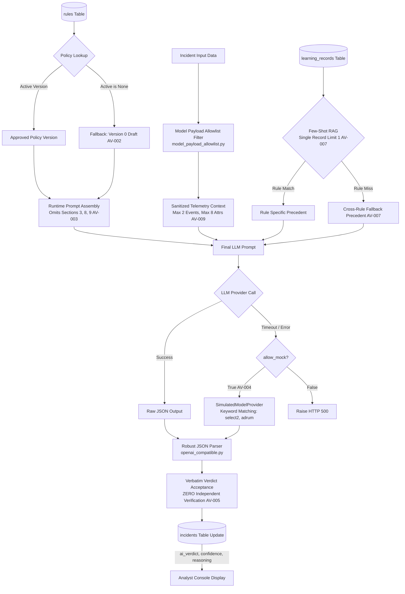

# 08. AI Verdict Decision Engine Audit

## 1. Executive Summary

The AI Verdict Decision Engine is the analytical core of the platform, implemented by the `VerdictTriageAgent` in [`backend/app/services/ai_verdict_service.py`](file:///c:/Users/amit/OneDrive/Documents/SOC-AI-Agent/backend/app/services/ai_verdict_service.py#L35-L310). Its mandate is to evaluate security incidents against active detection policies, retrieve historical precedents, orchestrate local LLM inference, and produce structured, actionable verdicts: `TRUE_POSITIVE`, `FALSE_POSITIVE`, or `REQUIRES_ATTENTION`.

This audit traces the complete decision execution path, evaluates verdict formation logic, and details critical reliability vulnerabilities.

---

## 2. End-to-End Decision Flow



---

## 3. Telemetry Preparation & Allowlist Sanitization

Before being passed to the prompt generator, incident data is filtered through [`backend/app/llm/model_payload_allowlist.py`](file:///c:/Users/amit/OneDrive/Documents/SOC-AI-Agent/backend/app/llm/model_payload_allowlist.py#L30-L165):
1. **Ground-Truth Stripping:** Explicitly removes `clearedReason`, `resolution`, `comments`, `clearedUser`, and `ground_truth`.
2. **Field Truncation (`AV-009`):**
   - Retains a maximum of **2 events** per incident.
   - Retains a maximum of **8 attributes** per event.
   - Truncates individual attribute values at **180 characters**.
   - Truncates incident descriptions at **250 characters**.
3. **Impact on Complex Alerts:** Multi-stage attacks (e.g. initial access $\rightarrow$ persistence $\rightarrow$ discovery $\rightarrow$ exfiltration) involving dozens of correlated events have 90%+ of their telemetry discarded prior to LLM evaluation.

---

## 4. Runtime Prompt Assembly & Incomplete Framework (`AV-003`)

In [`ai_verdict_service.py`](file:///c:/Users/amit/OneDrive/Documents/SOC-AI-Agent/backend/app/services/ai_verdict_service.py#L135-L146), the prompt is assembled via string concatenation:

```python
system_prompt = f"""
{active_v.role_and_objective}

CONTEXT:
{active_v.incident_and_rule_context}

FALSE POSITIVE INDICATORS:
{active_v.false_positive_indicators}

TRUE POSITIVE INDICATORS:
{active_v.true_positive_indicators}

INVESTIGATION STEPS:
{active_v.investigation_steps}

VERDICT CRITERIA:
{active_v.verdict_criteria}
"""
```

> [!WARNING]
> **Audit Finding (AV-003):** 
> - Section 3 (`detection_conditions`), Section 8 (`escalation_conditions`), and Section 9 (`analyst_questions`) are **never provided to the LLM**.
> - Even if a SOC manager configures mandatory escalation conditions in the UI, the decision engine drops them during prompt synthesis.

---

## 5. Output Schema & Verdict Definitions

The LLM is instructed to respond with a strict JSON object conforming to the following structure:
```json
{
  "verdict": "TRUE_POSITIVE | FALSE_POSITIVE | REQUIRES_ATTENTION",
  "confidence": 0.85,
  "reasoning": "Detailed forensic explanation grounded in provided telemetry.",
  "key_evidence": [
    "powershell.exe executed with encoded command line flag -enc",
    "Outbound network connection to known external IP"
  ],
  "recommended_action": "Isolate host and revoke compromised credentials.",
  "risk_score": 85
}
```

### 5.1 Criteria for Each Verdict
- **`TRUE_POSITIVE`:** Assigned when telemetry exhibits explicit indicators of compromise (IoCs), attacker techniques matching True Positive indicators in Section 5, or unapproved tools executing in sensitive contexts.
- **`FALSE_POSITIVE`:** Assigned when telemetry matches authorized administrative behavior, standard scheduled maintenance tasks, known software update scripts, or approved benign patterns defined in Section 4.
- **`REQUIRES_ATTENTION`:** Assigned when telemetry is ambiguous, required attributes are missing or truncated, contradictory signals exist, or the incident matches criteria defined in Section 7 as requiring manual escalation.

---

## 6. Critical Vulnerabilities in the Decision Engine

### 6.1 Total Absence of Independent Deterministic Verification (`AV-005`)
- **Location:** [`backend/app/services/ai_verdict_service.py#L261-L285`](file:///c:/Users/amit/OneDrive/Documents/SOC-AI-Agent/backend/app/services/ai_verdict_service.py#L261-L285)
- **Current Behavior:** The decision engine takes the JSON output from the model (`verdict`, `confidence`, `reasoning`, `key_evidence`) and directly commits it to the database.
- **Missing Safeguard:**
  - There is **no secondary validator** verifying that strings listed under `key_evidence` actually exist in the incident telemetry.
  - The model can hallucinate non-existent IP addresses, hashes, or command-line flags, and the platform will store them as "verified evidence."
  - Confidence scores are taken verbatim from the LLM without mathematical calibration.
- **Severity:** **CRITICAL**.

### 6.2 Silent Fallback to Simulated Heuristics (`AV-004`)
- **Location:** [`backend/app/services/ai_verdict_service.py#L225-L235`](file:///c:/Users/amit/OneDrive/Documents/SOC-AI-Agent/backend/app/services/ai_verdict_service.py#L225-L235)
- **Current Behavior:** If the local LLM times out or errors, and `allow_mock` is active (`LOCAL_LLM_ALLOW_MOCK_FALLBACK=true` in `backend/.env`), the system falls back to `SimulatedModelProvider`.
- **Mechanism of Simulation:**
  - Evaluates hardcoded substring keywords from test fixtures:
    - If `select2`, `adrum`, or `knob.js` are in telemetry $\rightarrow$ returns `FALSE_POSITIVE` with 96% confidence.
    - If `70cb3d6bf67c91a7` is in telemetry $\rightarrow$ returns `TRUE_POSITIVE` with 94% confidence.
  - Returns simulated confidence and reasoning, persisting it as a real AI evaluation.
- **Severity:** **HIGH**. Production outages of the GPU inference server are masked by fabricated verdicts.

---

## 7. Decision Verification Matrix

| Claimed Feature | Implementation Verification | Finding / Assessment |
| :--- | :--- | :--- |
| **Evidence Grounding** | Model outputs `key_evidence` array | **UNGROUNDED:** No verification against raw telemetry (`AV-005`). |
| **Calibrated Confidence** | Numeric float between 0.0 and 1.0 | **RAW PROMPT OUTPUT:** Uncalibrated model self-assessment. |
| **Escalation Enforcement** | Model enforces escalation triggers | **OMITTED:** Escalation section omitted from prompt (`AV-003`). |
| **Model Failure Handling** | System alerts analyst on failure | **MASKED:** Silent fallback to fixture simulator (`AV-004`). |
| **Audit Reproducibility** | Complete prompt & response saved | **PARTIAL:** Verdict and reasoning saved; exact assembled prompt string is not persisted per incident. |

