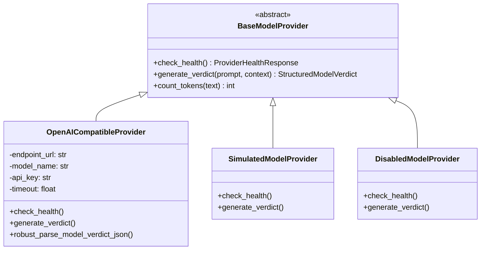

# 09. Local LLM and Inference Architecture Audit

## 1. Executive Summary

AI Verdict is designed to run against dedicated, self-hosted, on-premises Large Language Models (LLMs) deployed on GPU infrastructure (Server 2), avoiding cloud data leakage. The model provider layer uses an extensible interface supporting OpenAI-compatible APIs (vLLM, Ollama), a local simulated provider for offline testing, and a disabled provider for safety.

This report evaluates provider implementations, JSON parsing robustness, token budgeting, and fallback failure modes.

---

## 2. Model Provider Architecture

The model subsystem resides in `backend/app/llm/` and is structured around the `BaseModelProvider` abstract class:



### 2.1 Provider Factory
The active provider is instantiated via `get_model_provider()` in [`backend/app/llm/factory.py`](file:///c:/Users/amit/OneDrive/Documents/SOC-AI-Agent/backend/app/llm/factory.py#L18-L45):
- Evaluates `settings.LOCAL_LLM_PROVIDER`:
  - `"openai_compatible"` / `"vllm"` / `"ollama"` $\rightarrow$ `OpenAICompatibleProvider`
  - `"simulated"` / `"mock"` $\rightarrow$ `SimulatedModelProvider`
  - `"disabled"` $\rightarrow$ `DisabledModelProvider` (Raises `LLMDisabledException` on inference)

---

## 3. OpenAI-Compatible Provider Deep Dive

Implemented in [`backend/app/llm/openai_compatible.py`](file:///c:/Users/amit/OneDrive/Documents/SOC-AI-Agent/backend/app/llm/openai_compatible.py#L40-L420), this provider communicates with vLLM or Ollama on Server 2 (`http://192.0.2.10:8000/v1` or local host):

### 3.1 Inference Parameters
- **Endpoint:** `POST {base_url}/chat/completions`
- **Default Model:** `mistralai/Mistral-7B-Instruct-v0.2` or `meta-llama/Meta-Llama-3-8B-Instruct`
- **Temperature:** `0.1` (Configured for deterministic classification)
- **Top-P:** `0.95`
- **Max Tokens:** `350` tokens (Strict output cap to prevent verbose wanderings)
- **Timeout:** `45.0` seconds (Configurable via `LOCAL_LLM_TIMEOUT_SECONDS`)

### 3.2 Robust JSON Parsing Engine (`robust_parse_model_verdict_json`)
Local small models (7B/8B) frequently output malformed JSON. The provider implements a multi-stage recovery parser:
1. **Markdown Fence Stripping:** Removes ```json ... ``` code fences.
2. **Control Character Normalization:** Strips invalid unescaped newlines and carriage returns within string literals.
3. **Truncated JSON Repair:** If the model hits the 350-token limit mid-JSON, the parser analyzes unclosed braces `{` and quotes `"`, appending closing delimiters.
4. **Regular Expression Fallback:** If JSON decoding still fails, regex patterns extract fields:
   - `verdict`: Matches `"(?:verdict|verdict_value)"\s*:\s*"([^"]+)"`
   - `confidence`: Matches `"(?:confidence|confidence_score)"\s*:\s*([0-9.]+)`
   - `reasoning`: Matches `"(?:reasoning|explanation)"\s*:\s*"([^"]+)"`

---

## 4. Hardware Sizing and Token Budget

### 4.1 Token Allocation Profile
Given the 350-token output limit and the model payload allowlist filter:

| Component | Token Budget (Estimated) | Notes |
| :--- | :---: | :--- |
| **System Directive (Policy)** | 350 - 500 tokens | 6 assembled sections of the SOC policy. |
| **RAG Precedent (Few-Shot)** | 100 - 150 tokens | 1 historical learning record (truncated). |
| **Incident Telemetry** | 300 - 450 tokens | Filtered to 2 events and 8 attributes (`AV-009`). |
| **Prompt Overhead / Formatting** | 50 tokens | JSON schema and role formatting. |
| **Total Prompt Input** | **800 - 1,150 tokens** | Safely within the 4,096 / 8,192 context window. |
| **Model Completion Output** | **350 tokens (Hard Cap)** | Structured verdict JSON. |

### 4.2 Hardware Requirements on Server 2
- **Tested Hardware Configuration:**
  - GPU: 1x NVIDIA RTX 4090 (24GB VRAM) or A10G / A5000 (24GB VRAM)
  - vLLM Engine: KV Cache quantized or fp16, accommodating batch sizes of 4 to 8 concurrent inferences.
  - Server 1 to Server 2 Network: Dedicated 1Gbps / 10Gbps private interface.

---

## 5. Token Usage Tracking

Token consumption is monitored via the `token_usage_records` table, populated in [`openai_compatible.py`](file:///c:/Users/amit/OneDrive/Documents/SOC-AI-Agent/backend/app/llm/openai_compatible.py#L350-L375):
- Records: `prompt_tokens`, `completion_tokens`, `total_tokens`, `latency_ms`, `model_name`.
- Linked to: `incident_id` or `dry_run_id`.
- Startup Lifespan: [`main.py`](file:///c:/Users/amit/OneDrive/Documents/SOC-AI-Agent/backend/app/main.py#L110-L135) contains a backfill query that populates token totals for historical dry-run records if missing.

---

## 6. Inference Vulnerabilities & Reliability Risks

### 6.1 Silent Mock Fallback (`AV-004`)
- In [`ai_verdict_service.py`](file:///c:/Users/amit/OneDrive/Documents/SOC-AI-Agent/backend/app/services/ai_verdict_service.py#L225-L235), network timeouts or HTTP 500 errors from Server 2 trigger silent fallback to `SimulatedModelProvider`.
- **Finding:** The analyst console displays a 95% confident verdict with realistic reasoning generated entirely by keyword heuristics, with no indication on the UI that the GPU server was unreachable.

### 6.2 Public IP Leakage During Network Checks (`AV-011`)
- In [`backend/app/services/llm_config_service.py#L89-L92`](file:///c:/Users/amit/OneDrive/Documents/SOC-AI-Agent/backend/app/services/llm_config_service.py#L89-L92), the diagnostic service executes external HTTP queries to:
  - `https://api.ipify.org`
  - `https://ifconfig.me/ip`
  - `https://icanhazip.com`
- **Finding:** If deployed in an air-gapped or restricted SOC environment, this check causes unexpected outbound egress and hangs until DNS/connection timeout.

---

## 7. Provider Comparison Matrix

| Capability | `OpenAICompatibleProvider` | `SimulatedModelProvider` | `DisabledModelProvider` |
| :--- | :---: | :---: | :---: |
| **Real LLM Inference** | Yes (vLLM / Ollama) | No (Regex/Keywords) | No |
| **Context Window Support** | 4,096 - 8,192 tokens | N/A (Ignored) | N/A |
| **Deterministic Parsing** | Yes (Repair + Regex) | Hardcoded Dict | N/A |
| **Network Egress** | Server 2 IP (Port 8000/11434) | Local In-Memory | None |
| **Production Ready** | Yes (Primary Provider) | **Testing / Fixture Only** | Safe Lockout |

