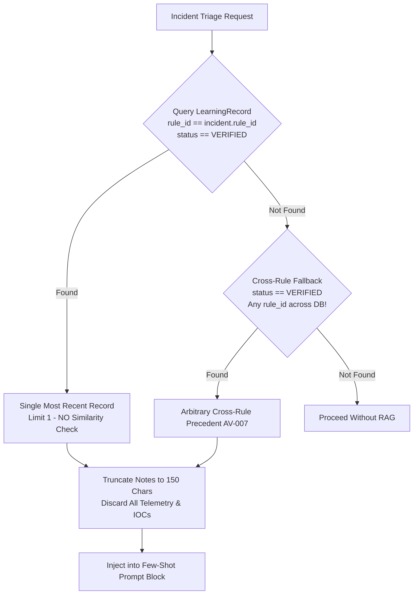

# 10. RAG, Memory, and Learning Engine Audit

## 1. Executive Summary

The platform incorporates an adaptive memory and feedback subsystem, designed to allow the AI Verdict engine to learn from analyst corrections and historical ground truth. Implemented primarily in [`learning_service.py`](file:///c:/Users/amit/OneDrive/Documents/SOC-AI-Agent/backend/app/services/learning_service.py) (`AgentMemoryEngine`) and [`learning.py`](file:///c:/Users/amit/OneDrive/Documents/SOC-AI-Agent/backend/app/api/learning.py), the subsystem manages the `learning_records` table and provides few-shot context injection during inference.

This audit evaluates the learning lifecycle, feedback verification workflows, and discovers severe RAG poisoning and context contamination vulnerabilities.

---

## 2. Learning Records Data Model

Feedback and precedent cases are stored in the `learning_records` table ([`backend/app/models/learning_record.py`](file:///c:/Users/amit/OneDrive/Documents/SOC-AI-Agent/backend/app/models/learning_record.py#L12-L52)):

| Field Name | Type | Description |
| :--- | :--- | :--- |
| `id` | Integer (PK) | Internal autoincrement ID. |
| `incident_id` | Integer (FK) | Reference to the evaluated incident. |
| `rule_id` | Integer (FK) | Reference to the associated detection rule. |
| `analyst_id` | Integer (FK) | User ID of the submitting analyst. |
| `feedback_verdict`| String | Analyst-assigned verdict (`TRUE_POSITIVE`, `FALSE_POSITIVE`). |
| `original_verdict`| String | Initial AI-assigned verdict prior to override. |
| `analyst_notes` | Text | Human rationale explaining why the AI was correct or incorrect. |
| `is_verified` | Boolean | Administrative verification flag. |
| `status` | String | Verification status (`PENDING_REVIEW`, `VERIFIED`, `REJECTED`). |
| `feedback_timestamp` | DateTime | Timestamp of analyst submission. |

---

## 3. Discrepancy Between Claimed Matching & Actual RAG Retrieval

### 3.1 Documented / Standalone Matching Engine (`find_similar_cases`)
In [`learning_service.py#L85-L165`](file:///c:/Users/amit/OneDrive/Documents/SOC-AI-Agent/backend/app/services/learning_service.py#L85-L165), the `AgentMemoryEngine` provides a sophisticated deterministic case-matching algorithm:
- Filters by `rule_id`.
- Computes Jaccard similarity across extracted IOCs (IPs, hashes, usernames).
- Computes similarity across event process names.
- Ranks cases and returns top-$k$ matches with similarity scores.

### 3.2 Actual Live Inference Retrieval (`AV-007`)
In [`ai_verdict_service.py#L149-L180`](file:///c:/Users/amit/OneDrive/Documents/SOC-AI-Agent/backend/app/services/ai_verdict_service.py#L149-L180), the live triage engine **does not call `find_similar_cases` at all**. Instead, it executes the following query:

```python
# ai_verdict_service.py lines 152-168
stmt = select(LearningRecord).where(
    LearningRecord.rule_id == rule.id,
    LearningRecord.status == "VERIFIED"
).order_by(desc(LearningRecord.feedback_timestamp)).limit(1)
result = await db.execute(stmt)
record = result.scalar_one_or_none()

if not record:
    # Cross-Rule Fallback Injection!
    fallback_stmt = select(LearningRecord).where(
        LearningRecord.status == "VERIFIED"
    ).order_by(desc(LearningRecord.feedback_timestamp)).limit(1)
    record = (await db.execute(fallback_stmt)).scalar_one_or_none()
```



> [!CRITICAL]
> **Audit Finding (AV-007): Cross-Rule Context Contamination:**
> 1. **No Similarity Matching:** The system takes the single newest record regardless of whether it shares any telemetry, attack type, or context with the current incident.
> 2. **Cross-Rule Precedent Injection:** If a rule has no verified feedback, the system grabs the newest feedback record from **any other rule in the entire database**. An analyst note regarding a benign PowerShell script in an EDR rule will be injected as a precedent into an SQL injection web alert.
> 3. **Missing Telemetry:** The few-shot injection only includes the verdict and the first 150 characters of `analyst_notes`. The underlying telemetry of the precedent is not included.

---

## 4. Immediate Few-Shot RAG Poisoning (`AV-008`)

In [`investigation_service.py#L303-L355`](file:///c:/Users/amit/OneDrive/Documents/SOC-AI-Agent/backend/app/services/investigation_service.py#L303-L355), when an analyst reviews an incident and submits feedback via the Investigation Console:

```python
# investigation_service.py lines 320-335
if feedback_data.is_independently_verified:
    record = LearningRecord(
        incident_id=incident.id,
        rule_id=incident.rule_id,
        analyst_id=current_user.id,
        feedback_verdict=feedback_data.verdict,
        original_verdict=incident.ai_verdict,
        analyst_notes=feedback_data.notes,
        is_verified=True,
        status="VERIFIED",  # <-- IMMEDIATELY VERIFIED
        feedback_timestamp=datetime.utcnow()
    )
```

> [!CAUTION]
> **Audit Finding (AV-008): Zero-Gate Precedent Poisoning:**
> - A junior analyst who ticks the "I have independently verified this decision" checkbox causes the record to be created with status `VERIFIED` immediately.
> - Because live inference retrieves the newest `VERIFIED` record by timestamp, that analyst's feedback **instantly becomes the active few-shot prompt for all subsequent incidents under that rule** (and any other rule lacking precedents).
> - There is no mandatory secondary review or supervisor approval before feedback modifies model inference behavior.

---

## 5. RAG Audit Summary

| RAG Dimension | Stated Design | Audited Implementation | Risk Level |
| :--- | :--- | :--- | :---: |
| **Retrieval Strategy** | Multi-case telemetry similarity search | Single-record query by timestamp (`limit 1`) | **High** |
| **Rule Scoping** | Strict rule-bound retrieval | Cross-rule database fallback (`AV-007`) | **Critical** |
| **Telemetry Context** | Precedent telemetry paired with verdict | Only 150 chars of text notes; telemetry discarded | **Medium** |
| **Feedback Approval Gate** | Administrative verification workflow | Bypassed if submitter marks "independently verified" (`AV-008`) | **High** |
| **Poisoning Defense** | Anomaly detection on feedback drift | None; newest record takes absolute precedence | **High** |

