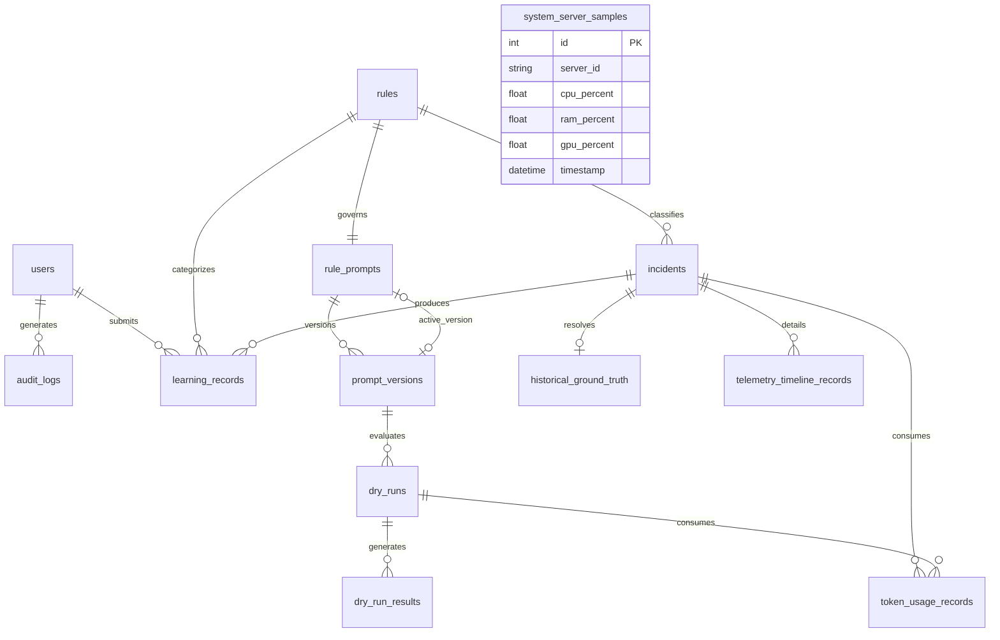

# 12. Database and Data Lifecycle Audit

## 1. Executive Summary

AI Verdict uses an asynchronous relational database architecture powered by SQLAlchemy 2.0. The system supports both **SQLite (aiosqlite)** for lightweight single-server deployments and **PostgreSQL (asyncpg)** for production enterprise workloads.

This report documents the complete database schema across all 13 tables, analyzes foreign key relationships and indexing strategies, audits migration integrity, and evaluates data retention practices.

---

## 2. Entity-Relationship Architecture

---

## 3. Comprehensive Table Inventory & Specifications

The database schema encompasses 13 distinct tables:

### 3.1 Authentication & Governance
1. **`users`:** User accounts, hashed passwords, RBAC role (`ADMINISTRATOR`, `SOC_ANALYST`, `READ_ONLY_VIEWER`), active status.
2. **`audit_logs`:** Immutable audit stream capturing `timestamp`, `user_id`, `action`, `resource_type`, `resource_id`, and `details` JSON.

### 3.2 Detection & Policy Studio
3. **`rules`:** Detection rule catalog, SIEM `rule_id`, `name`, `severity`, `parsed_criteria` JSON.
4. **`rule_prompts`:** Rule-to-policy mapping record containing `rule_id` (FK to `rules.id`) and `active_version_id` (FK to `prompt_versions.id`).
5. **`prompt_versions`:** 9-section prompt directives, version number, author ID, approval status (`DRAFT`, `APPROVED`, `ARCHIVED`), approval timestamp.

### 3.3 Incidents & Ground Truth
6. **`incidents`:** Core incident records: `external_id`, `title`, `severity`, `status`, `ai_verdict`, `confidence`, `reasoning`, `raw_payload`, `events` JSON.
7. **`historical_ground_truth`:** Historical human/SIEM resolutions: `incident_id` (FK), `resolution_status`, `assigned_analyst`, `close_reason`.
8. **`telemetry_timeline_records`:** Deconstructed event timeline entries: `incident_id` (FK), `timestamp`, `event_type`, `summary`, `raw_event` JSON.

### 3.4 Simulation & Learning Subsystems
9. **`dry_runs`:** Validation job records: `rule_prompt_id`, `prompt_version_id`, `split_strategy`, `status`, `metrics_summary` JSON.
10. **`dry_run_results`:** Individual incident simulation predictions: `dry_run_id` (FK), `incident_id` (FK), `predicted_verdict`, `actual_verdict`, `latency_ms`.
11. **`learning_records`:** Feedback memory: `incident_id` (FK), `rule_id` (FK), `analyst_id` (FK), `feedback_verdict`, `status` (`PENDING_REVIEW`, `VERIFIED`, `REJECTED`).

### 3.5 Operational Telemetry & Cost
12. **`system_server_samples`:** Hardware health metrics: `server_id`, `cpu_percent`, `ram_percent`, `gpu_percent`, `gpu_vram_used_gb`, `timestamp`.
13. **`token_usage_records`:** LLM token accounting: `prompt_tokens`, `completion_tokens`, `total_tokens`, `latency_ms`, `model_name`, `timestamp`.

---

## 4. Migration Architecture & Schema Drift Audit (`AV-012`)

### 4.1 Alembic Migration History
The repository contains 3 formal Alembic migrations under `backend/alembic/versions/`:
- `001_initial_schema.py`: Baseline tables (`users`, `incidents`, `rules`, `rule_prompts`, `prompt_versions`).
- `002_add_feedback_and_metrics.py`: Adds `learning_records`, `dry_runs`, `dry_run_results`, `historical_ground_truth`.
- `003_add_server_metrics.py`: Basic server metric definitions.

### 4.2 Critical Finding: Lifespan Schema Mutation Bypass
In [`backend/app/main.py#L42-L135`](file:///c:/Users/amit/OneDrive/Documents/SOC-AI-Agent/backend/app/main.py#L42-L135), the application executes raw SQL statements on startup to build missing tables and alter columns:
- Tables created via raw SQL: `system_server_samples`, `token_usage_records`, `telemetry_timeline_records`.
- Columns altered via raw SQL: `incidents.ai_verdict`, `dry_run_results.prompt_tokens`, `dry_run_results.completion_tokens`, `dry_run_results.total_tokens`.

> [!WARNING]
> **Schema Drift Risk (AV-012):**
> Alembic cannot reproduce the actual production database state from its migration scripts alone. If a DevOps pipeline provisions a database using `alembic upgrade head`, the database will be missing 3 tables and 4 columns until the FastAPI application executes its lifespan handler.

---

## 5. Foreign Key Integrity & Cascade Rules

- **Rule Deletion Cascades:** Deleting a `Rule` cascades to `rule_prompts` and `prompt_versions` (`ondelete="CASCADE"`).
  - *Risk:* Hard-deleting a rule purges all historical prompt versions and dry-run benchmarks associated with that rule.
- **Incident Deletion:** Incidents are treated as append-only. There is no automated TTL purging service implemented.
- **Active Version Foreign Key:** `rule_prompts.active_version_id` points to `prompt_versions.id`. To avoid circular foreign key locking during table creation, this constraint is resolved at the ORM layer or initialized as nullable.

---

## 6. Historical Replay & Decision Reproducibility

| Requirement | Implementation Reality | Assessment |
| :--- | :--- | :--- |
| **Incident Telemetry Preservation** | Preserved verbatim in `raw_payload` | **Compliant** |
| **Exact Prompt Preservation** | Only prompt version text is stored; exact assembled prompt sent to LLM is **not** saved per incident | **Non-Compliant**: Dynamic few-shot precedent injected at runtime cannot be audited retrospectively. |
| **LLM Output Preservation** | Verdict, confidence, and reasoning saved in `incidents` table | **Compliant** |
| **Raw Model JSON Preservation** | Raw model JSON string is discarded after parsing into DTO | **Non-Compliant**: Inability to audit JSON parsing failures or repair actions retrospectively. |

