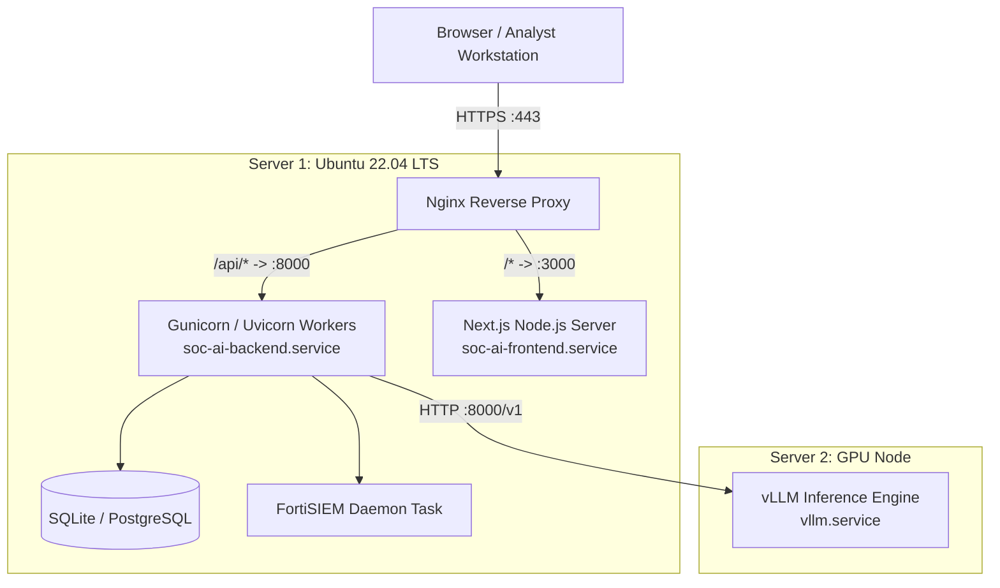

# 14. Configuration and Deployment Architecture Audit

## 1. Executive Summary

This report delivers a comprehensive audit of the configuration management and deployment architecture for AI Verdict. It documents all 19 system configuration variables, evaluates their security implications, and reviews the automated deployment scripts and systemd process management models for both Core Application Server (Server 1) and GPU Inference Node (Server 2).

---

## 2. Exhaustive Configuration Variable Inventory

Configuration is managed via Pydantic Settings in [`backend/app/config.py`](file:///c:/Users/amit/OneDrive/Documents/SOC-AI-Agent/backend/app/config.py#L12-L85). Settings load from host environment variables with fallback to `.env`:

| # | Variable Name | Purpose | Default Value (Redacted) | Req? | Consumed By | Security / Operational Risk |
| :-: | :--- | :--- | :--- | :-: | :--- | :--- |
| **1** | `APP_NAME` | Service branding string | `"AI Verdict Enterprise"` | No | UI / Metadata | None |
| **2** | `APP_ENV` | Environment identifier | `"production"` | No | Logging / Startup | Low |
| **3** | `DEBUG` | Verbose debug flag | `False` | No | FastAPI Application | Medium (Disables detailed stack traces if False) |
| **4** | `SECRET_KEY` | JWT signing secret | `[REDACTED HARDCODED FALLBACK]` | No | [`security.py`](file:///c:/Users/amit/OneDrive/Documents/SOC-AI-Agent/backend/app/core/security.py) | **CRITICAL (AV-014)**: Known hardcoded fallback permits token forgery. |
| **5** | `ALGORITHM` | JWT signing algorithm | `"HS256"` | No | [`security.py`](file:///c:/Users/amit/OneDrive/Documents/SOC-AI-Agent/backend/app/core/security.py) | Low |
| **6** | `ACCESS_TOKEN_EXPIRE_MINUTES` | JWT session lifetime | `480` (8 Hours) | No | [`auth.py`](file:///c:/Users/amit/OneDrive/Documents/SOC-AI-Agent/backend/app/api/auth.py) | Low |
| **7** | `DATABASE_URL` | Primary async DB connection string | `"sqlite+aiosqlite:///./ai_verdict.db"` | No | [`database.py`](file:///c:/Users/amit/OneDrive/Documents/SOC-AI-Agent/backend/app/core/database.py) | Medium (SQLite lock contention under load) |
| **8** | `BACKEND_CORS_ORIGINS` | Permitted cross-origin endpoints | `["http://localhost:3000", ...]` | No | [`main.py`](file:///c:/Users/amit/OneDrive/Documents/SOC-AI-Agent/backend/app/main.py) | Low |
| **9** | `LOCAL_LLM_PROVIDER` | Active LLM engine selector | `"openai_compatible"` | No | [`factory.py`](file:///c:/Users/amit/OneDrive/Documents/SOC-AI-Agent/backend/app/llm/factory.py) | High (Switches between real GPU and mock) |
| **10** | `LOCAL_LLM_URL` | Server 2 inference API endpoint | `"http://192.0.2.10:8000/v1"` | No | [`openai_compatible.py`](file:///c:/Users/amit/OneDrive/Documents/SOC-AI-Agent/backend/app/llm/openai_compatible.py) | Medium (Network routing failure) |
| **11** | `LOCAL_LLM_MODEL` | Target LLM model name | `"mistralai/Mistral-7B-Instruct-v0.2"`| No | [`openai_compatible.py`](file:///c:/Users/amit/OneDrive/Documents/SOC-AI-Agent/backend/app/llm/openai_compatible.py) | Low |
| **12** | `LOCAL_LLM_API_KEY` | Optional bearer token for vLLM | `[REDACTED EMPTY/OPTIONAL]` | No | [`openai_compatible.py`](file:///c:/Users/amit/OneDrive/Documents/SOC-AI-Agent/backend/app/llm/openai_compatible.py) | Medium |
| **13** | `LOCAL_LLM_TIMEOUT_SECONDS` | Network timeout for model response | `45.0` | No | [`openai_compatible.py`](file:///c:/Users/amit/OneDrive/Documents/SOC-AI-Agent/backend/app/llm/openai_compatible.py) | Medium (Triggers fallback on timeout) |
| **14** | `LOCAL_LLM_ALLOW_MOCK_FALLBACK`| Fallback to fixture simulator | `True` (In `backend/.env`) | No | [`ai_verdict_service.py`](file:///c:/Users/amit/OneDrive/Documents/SOC-AI-Agent/backend/app/services/ai_verdict_service.py) | **HIGH (AV-004)**: Silently masks GPU server outages with mock verdicts. |
| **15** | `FORTISIEM_HOST` | FortiSIEM Supervisor IP/FQDN | `[REDACTED IP/HOST]` | No | [`fortisiem_service.py`](file:///c:/Users/amit/OneDrive/Documents/SOC-AI-Agent/backend/app/services/fortisiem_service.py) | High (Cleartext write-back to `.env`) |
| **16** | `FORTISIEM_USERNAME` | FortiSIEM Supervisor User | `[REDACTED USERNAME]` | No | [`fortisiem_service.py`](file:///c:/Users/amit/OneDrive/Documents/SOC-AI-Agent/backend/app/services/fortisiem_service.py) | High |
| **17** | `FORTISIEM_PASSWORD` | FortiSIEM Supervisor Password | `[REDACTED PASSWORD]` | No | [`fortisiem_service.py`](file:///c:/Users/amit/OneDrive/Documents/SOC-AI-Agent/backend/app/services/fortisiem_service.py) | **CRITICAL (AV-014)**: Cleartext write-back to `.env`. |
| **18** | `FORTISIEM_VERIFY_SSL` | Enforce TLS cert validation | `True` | No | [`fortisiem_service.py`](file:///c:/Users/amit/OneDrive/Documents/SOC-AI-Agent/backend/app/services/fortisiem_service.py) | Medium |
| **19** | `FORTISIEM_POLL_INTERVAL_SECONDS` | Continuous polling frequency | `180` (3 Minutes) | No | [`fortisiem_scheduler.py`](file:///c:/Users/amit/OneDrive/Documents/SOC-AI-Agent/backend/app/services/fortisiem_scheduler.py) | Low |

---

## 3. Server 1 Deployment Architecture (Core Web & API)

Server 1 hosts the frontend, backend REST API, background scheduler, and primary database.



### 3.1 Automated Deployment Script (`scripts/install_ubuntu.sh`)
- Prepares base Ubuntu 22.04 LTS operating system.
- Installs Python 3.11, Node.js 20.x, Nginx, and build essentials.
- Configures virtual environment using `pip` / `poetry`.
- Generates systemd service units for backend and frontend.

### 3.2 Systemd Process Management
- **`soc-ai-backend.service`:** Runs Uvicorn worker bound to `127.0.0.1:8000`. Configured with `Restart=always`, `RestartSec=5s`.
- **`soc-ai-frontend.service`:** Runs Next.js standalone server bound to `127.0.0.1:3000`.

### 3.3 Nginx Reverse Proxy Configuration (`scripts/nginx/soc-ai-agent.conf`)
- Terminates SSL/TLS certificates.
- Routes `/api/` traffic to `http://127.0.0.1:8000/api/` with HTTP/1.1 keepalive.
- Routes root `/` traffic to `http://127.0.0.1:3000/`.
- Sets security headers: `X-Frame-Options: SAMEORIGIN`, `X-Content-Type-Options: nosniff`.

---

## 4. Server 2 Deployment Architecture (GPU Inference Node)

Server 2 hosts the high-performance local inference stack dedicated to serving LLM requests from Server 1.

### 4.1 Deployment Scripts
The repository provides two alternative deployment automation scripts for Server 2:
1. **`scripts/install_llm_server.sh` (vLLM Engine - Recommended):**
   - Installs CUDA 12.x drivers, NVIDIA Container Toolkit, and Python 3.11.
   - Installs `vllm` high-throughput inference engine.
   - Deploys `vllm.service` systemd unit running:
     ```bash
     python3 -m vllm.entrypoints.openai.api_server \
       --model mistralai/Mistral-7B-Instruct-v0.2 \
       --port 8000 \
       --gpu-memory-utilization 0.90 \
       --max-model-len 4096
     ```
2. **`scripts/install_ollama_llm.sh` (Ollama Engine - Lightweight Alternative):**
   - Installs Ollama binary and pulls quantized GGUF weights (`llama3:8b-instruct-q4_K_M` or `mistral:7b-instruct-q4_K_M`).
   - Runs Ollama daemon on port 11434.

---

## 5. Deployment Vulnerabilities and Hardening Gaps

1. **Unprotected Secrets in Plaintext Files (`AV-014`):**
   - Environment files (`backend/.env`) are read and written directly by web worker processes.
   - File permissions on `.env` are not restricted to `0600` in deployment scripts.
2. **Missing Outbound Network Egress Filtering:**
   - Server 1 allows unrestricted outbound network connections, permitting public IP discovery probes (`AV-011`).
3. **Absence of Rate Limiting in Nginx Configuration:**
   - Nginx configuration lacks `limit_req_zone` directives. Authentication endpoints (`/api/auth/login`) are vulnerable to brute-force credential stuffing.

